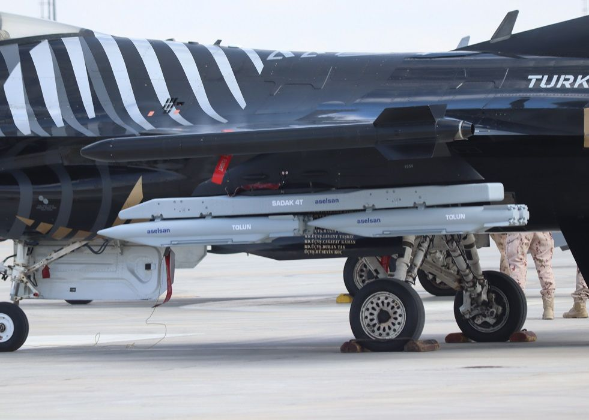
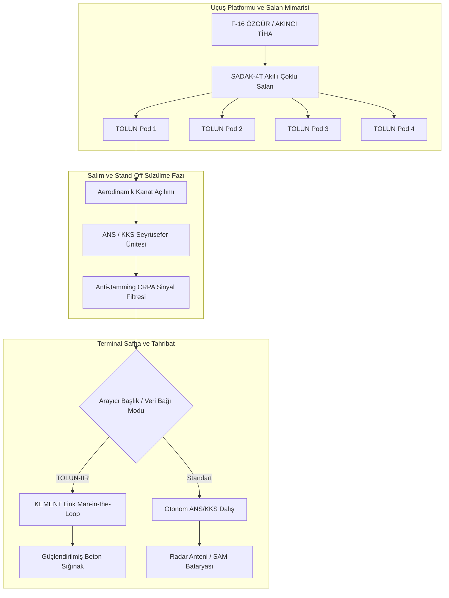

# 🎯 Proje: ASELSAN TOLUN Minyatür Bomba Sistemi

[

  

](../../../docs/TRL_GUIDE.md)

## 🛡️ Stratejik Tanım & Doktriner Öncelik
**TOLUN**, Türk Hava Kuvvetleri ve müttefik hava platformları için hava-yer taarruz mimarisinde devrim yaratan, yüksek hassasiyetli GPS/INS ve IIR güdümlü yeni nesil bir minyatür mühimmat sistemidir. Düşman hava savunma şemsiyesinin menzili dışından (Stand-Off) 100+ km mesafeden fırlatılabilen TOLUN, katlanır kanat yapısı ve optimize edilmiş aerodinamik süzülme oranı ile hedefine yüksek süratle yönelir. 

ASELSAN tarafından geliştirilen **SADAK-4T Akıllı Çoklu Taşıma Salanı** sayesinde tek bir silah istasyonunda 4 adet TOLUN mühimmatı taşınabilmekte; bu sayede tek bir F-16 veya Bayraktar AKINCI TİHA sortisinde 8 ila 12 farklı korunaklı hedef tek seferde cerrahi hassasiyetle imha edilebilmektedir. 1 metre kalınlığındaki güçlendirilmiş betonu delme kabiliyetine sahip özel harp başlığı mimarisi, stratejik komuta sığınakları, uçak hangarları ve hava savunma radarları için yüksek caydırıcılık sağlamaktadır.

## 📊 Kapsamlı Teknik Özellikler

| Parametre | Değer / Standart | Operasyonel Detay |
| :--- | :--- | :--- |
| **Güdüm Mimarisi** | GPS / INS (KKS / ANS) + IIR Opsiyonu | Çok kanallı Anti-Jamming CRPA anten korumalı |
| **Operasyonel Menzil** | 100+ km | Yüksek irtifa salımlarında 110+ km süzülme erimi |
| **Toplam Ağırlık** | ~139 kg (306 lb) | Kompakt minyatür bomba geometrisi |
| **Harp Başlığı** | ~17 kg PBXN-109 / Parçacık Tesirli & Delici | 1 m güçlendirilmiş C35 betonu delme kapasitesi |
| **Uzunluk / Çap** | ~1.85 m / ~180 mm | Katlanır kanat ve dar gövde profili |
| **Kanat Açıklığı** | ~1.4 m (Kanatlar açık pozisyonda) | Yüksek L/D süzülme oranı sağlayan eliptik profil |
| **Hassasiyet (CEP)** | < 3 Metre | Terminal safhada nokta vuruş hassasiyeti |
| **Taşıma Salanı** | SADAK-4T Akıllı Salan | MIL-STD-1760 arayüzü ile tek istasyondan 4'lü bağımsız salım |
| **Uyumlu Platformlar** | F-16 Blok 30/40/50 ÖZGÜR, AKINCI TİHA, KAAN, HÜRJET | Çoklu milli ve müttefik hava platformları |

## 🧩 Alt Sistemler ve Aviyonik/Elektronik Entegrasyonu
- **Güdüm ve Seyrüsefer Kontrol Ünitesi:** ASELSAN üretimi lazer halkalı jiroskop (RLG) tabanlı INS ve Anti-Jamming destekli GPS/KKS modülü; yoğun elektronik karıştırma şartlarında dahi sapmayı önleyen Kalman filtreleme yazılımları.
- **SADAK-4T Pylon Akıllı Arayüzü:** Uçuş görev bilgisayarı ile mühimmatlar arasında MIL-STD-1760 standartlarında anlık hedef koordinatı güncellemesi, ayrılma sekansı yönetimi ve bağımsız ateşleme tetikleme mimarisi.
- **KEMENT Veri Bağı & TOLUN-IIR:** Terminal safhada kızılötesi görüntüleyici (IIR) arayıcı başlık entegrasyonu ile pilota/operatöre anlık görüntü akışı sağlayan ve Man-in-the-Loop yeteneğiyle son saniyede hedef güncelleme olanağı sunan ağ yapısı.
- **Akıllı Çarpma ve Tapa Elektroniği:** Çarpma anında gecikmeli patlama ile beton koruganın içine nüfuz ettikten sonra infilak eden çift emniyetli tapa mimarisi.

## 🎯 Görev Profili, Muharebe Senaryoları & Mühimmat Yelpazesi
- **Derin Darbe ve Sığınak İmhası:** Düşman avcı uçakları ve SAM bataryalarının angajman menziline girmeden 40.000 feet irtifadan bırakılan TOLUN filoları, stratejik mühimmat depolarını ve harekat merkezlerini sığınak içinde imha eder.
- **Hava Savunma Bastırma (SEAD/DEAD):** SADAK-4T üzerinden salvo atışla aynı anda fırlatılan 8 adet TOLUN, düşman radar antenlerini ve batarya lançerlerini doygunluk taarruzu ile eşzamanlı olarak etkisiz hale getirir.
- **Mühimmat Yelpazesi:**
  - *TOLUN Standart:* GPS/INS güdümlü, beton delici genel maksatlı minyatür mühimmat.
  - *TOLUN-IIR:* Kızılötesi arayıcı başlıklı ve veri bağlı, hareketli kara/deniz hedeflerine karşı duyarlı gelişmiş mühimmat.

## 📐 Mimari ve Görev Akış Şeması

## 🚀 TRL Seviyesi ve Gelişim Yol Haritası
- **Mevcut Seviye: TRL 9 (Saha Kanıtlanmış & Seri Üretim)**
- [x] Konsept Tasarım ve Aerodinamik Rüzgar Tüneli Testleri (2018-2020)
- [x] F-16 ve AKINCI Entegrasyon ve Test Atışları (2022-2023)
- [x] SADAK-4T Salanından 4'lü Salvo Ayrılma ve Tam İsabet Başarısı
- [x] TSK Envanterine Kabul ve Seri Üretim Dağıtımı
- [ ] TOLUN-IIR Hareketli Hedef Varyantının Seri Üretime Alınması
- [ ] KAAN Dahili Silah İstasyonu Entegrasyonu

---
[⬅️ Üst Dizine](../README.md) | [🏛️ Dominion Hub](../../README.md) | [🏠 Ana Sayfa](../../../README.md)
