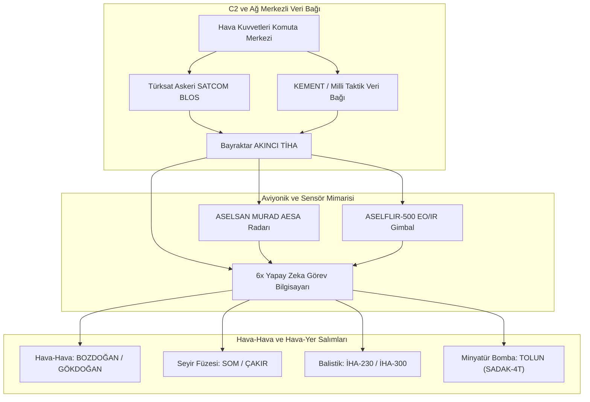

# 🐳 Proje: Bayraktar AKINCI TİHA (Taarruzi İnsansız Hava Aracı)

  

## 🛡️ Stratejik Tanım & Doktriner Öncelik
**Bayraktar AKINCI TİHA**, Türk havacılık ve savunma doktrininde stratejik bombardıman ve havadan havaya muharebe görevlerini insansız platformlara aktaran en üst sınıf Yüksek İrtifa Uzun Dayanım (HALE) taarruzi sistemdir. 6.000 kg azami kalkış ağırlığı ve 1.500 kg faydalı yük taşıma kapasitesi ile "Uçan Balina" olarak nitelendirilen AKINCI, savaş uçaklarının icra ettiği kritik derin darbe sortilerini devralarak hava kuvvetlerinin operasyonel esnekliğini ve filo bekasını katlamaktadır.

Çift turboprop motor mimarisi (AKINCI-A 2x450 HP, AKINCI-B 2x750 HP, AKINCI-C 2x850 HP) ile donatılan platform, AESA radarı (MURAD), elektro-optik keşif podları ve 6 adet yapay zeka bilgisayarı ile desteklenmiştir. Stratejik seyir füzeleri (SOM, ÇAKIR), havadan havaya füzeler (GÖKDOĞAN, BOZDOĞAN) ve süpersonik balistik füzeler (İHA-230, İHA-300) ateşleyebilen dünyadaki ilk ve tek operasyonel İHA'dır.

## 📊 Kapsamlı Teknik Özellikler

| Parametre | Değer / Özellik | Açıklama |
| :--- | :--- | :--- |
| **Sınıfı** | HALE (Yüksek İrtifa Uzun Dayanım) Taarruzi İHA | Stratejik taarruz ve elektronik istihbarat |
| **Maksimum Kalkış Ağırlığı (MTOW)** | 6.000 kg | Sınıfının en yüksek yük kapasiteli platformu |
| **Faydalı Yük Kapasitesi** | 1.500 kg (400 kg gövde içi + 1.100 kg harici) | Çoklu mühimmat istasyonları (8 pylon) |
| **Kanat Açıklığı / Uzunluk** | 20.0 m / 12.2 m / 4.1 m yükseklik | Bükümlü kanat yapısı ile yüksek süzülme verimi |
| **Motor Seçenekleri** | 2 x 450 HP (AI-450T) / 2 x 750 HP / 2 x 850 HP | İki bağımsız turboprop güç ünitesi |
| **Operasyonel İrtifa / Tavan** | 30.000 - 40.000 Feet (Servis Tavanı: 45.118 Feet) | Türk havacılık irtifa rekoru |
| **Havada Kalış Süresi** | 25+ Saat | Sürekli devriye ve derin gözetleme |
| **Seyir / Azami Hız** | 150 - 195 Knot / 250+ Knot (460+ km/s) | Yüksek süratli intikal ve kaçınma |
| **Haberleşme Menzili** | Uydu Haberleşmesi (SATCOM) ile Küresel | Görüş Hattı (LOS) + BLOS uydu linki |
| **Radar & Sensör** | ASELSAN MURAD AESA Radarı + ASELFLIR-500 | Hava-hava, SAR/GMTI ve hedefleme |

## 🧩 Alt Sistemler ve Aviyonik/Elektronik Entegrasyonu
- **MURAD AESA Radarı:** Çok modlu aktif elektronik faz dizili radar; aynı anda birden fazla hava ve yer hedefini tespit, teşhis ve takip edebilme, SAR (Sentetik Açıklıklı Radar) ile bulut altı haritalama.
- **ASELFLIR-500 / CATS Gimbal:** Yüksek çözünürlüklü termal ve gündüz kameraları, lazer hedef işaretleyici ve telemetre ile 360° elektro-optik durumsal farkındalık.
- **6 Adet Yapay Zeka Bilgisayarı:** Uçuş bilgisayarlarından bağımsız çalışan yapay zeka işlemcileri ile gerçek zamanlı nesne tanıma, sensör füzyonu, otomatik iniş/kalkış ve rota optimizasyonu.
- **Çift Yedekli SATCOM & KEMENT:** BLOS (Ufuk Ötesi) operasyonlar için uydu bağı ve ağ merkezli muharebe için KEMENT taktik veri bağı entegrasyonu.

## 🎯 Görev Profili, Muharebe Senaryoları & Mühimmat Yelpazesi
- **Stratejik Derin Darbe (SOM & ÇAKIR):** Düşman derinliğindeki komuta merkezleri ve kritik altyapı tesislerini stand-off seyir füzeleriyle imha etme.
- **Hava-Hava Önleme:** AESA radar ve GÖKDOĞAN / BOZDOĞAN füzeleriyle düşman İHA, helikopter ve seyir füzelerini havada önleme.
- **Süpersonik Balistik Taarruz (İHA-230/300):** Yüksek irtifadan bırakılan aero-balistik füzelerle düşman SAM sistemlerini dakikalar içinde vurma.
- **Entegre Mühimmat Yelpazesi:**
  - *Füzeler:* SOM, SOM-J, ÇAKIR, İHA-230, İHA-300, GÖKDOĞAN, BOZDOĞAN, KEMANKEŞ, KEMANKEŞ 2.
  - *Güdümlü Bombalar:* TOLUN, TEBER-82, HGK-84, LGK-82, KGK-82/83, MAM-C, MAM-L, MAM-T.

## 📐 Mimari ve Görev Akış Şeması

## 🚀 TRL Seviyesi ve Gelişim Yol Haritası
- **Mevcut Seviye: TRL 9 (Saha Kanıtlanmış & Seri Üretim)**
- [x] İlk Uçuş ve Prototip Doğrulama (Aralık 2019)
- [x] TSK Envanterine Giriş ve Kabul Testleri (Ağustos 2021)
- [x] 45.118 Feet Türk Havacılık İrtifa Rekoru (AKINCI-B)
- [x] Süpersonik İHA-230, TOLUN ve ÇAKIR Atışlı Test Başarıları
- [x] 10+ Ülkeye Başarılı İhracat ve 50.000+ Uçuş Saati (Combat Proven)
- [ ] MURAD AESA Radarı ile Canlı Hava-Hava Angajman Testleri
- [ ] TEI-TF6000 / Yerli Turboprop Motor Entegrasyon Opsiyonları

---
[⬅️ Üst Dizine](../README.md) | [🏛️ Dominion Hub](../../README.md) | [🏠 Ana Sayfa](../../../README.md)
