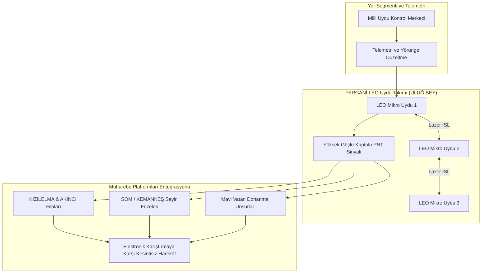

# 🛰️ Proje: FERGANİ Küresel Konumlama Sistemi (ULUĞ BEY Ağı)

  

## 🛡️ Stratejik Tanım & Doktriner Öncelik
**FERGANİ Küresel Konumlama Sistemi**, Baykar'ın uzay ve uydu teknolojileri ekosistemi bünyesinde hayata geçirilen, Türkiye'nin bağımsız Alçak Yörünge (LEO - Low Earth Orbit) takım uydu takımyıldızı ve milli PNT (Konum, Navigasyon ve Zamanlama) altyapısıdır. Modern harekât sahasında GPS, GLONASS veya Galileo gibi yabancı uydu takımlarına olan stratejik bağımlılığı sonlandırmayı amaçlamaktadır.

"ULUĞ BEY Gözlem ve Konumlama Ağı" çatısı altında geliştirilen FERGANİ, mikro ve küp uydu sürüleri üzerinden milli İHA, SİHA, seyir füzeleri ve kara-deniz muharebe unsurlarına yoğun elektronik karıştırma şartlarında dahi kesintisiz ve kriptolu konumlandırma verisi temin eder. Alçak yörünge mimarisi, GEO/MEO uydularına kıyasla çok daha güçlü sinyal seviyesi üreterek düşman elektronik karıştırma (Jamming ve Spoofing) girişimlerini etkisiz kılmaktadır.

## 📊 Kapsamlı Teknik Özellikler

| Parametre | Değer / Standart | Açıklama |
| :--- | :--- | :--- |
| **Yörünge Tipi** | LEO (Alçak Dünya Yörüngesi) | 500 - 1.200 km irtifa aralığı |
| **Takım Uydu Mimarisi** | ULUĞ BEY Takımyıldızı (100+ Mikro Uydu) | Küresel ve bölgesel kesintisiz kapsama |
| **Hizmet Sınıfı** | PNT (Positioning, Navigation, Timing) + Veri Bağı | Yüksek hassasiyetli zamanlama ve seyrüsefer |
| **Sinyal Gücü & Direnç** | Klasik GNSS'e kıyasla +30 dB daha güçlü yer sinyali | Karıştırma ve sahte sinyal (Spoofing) bağışıklığı |
| **Kriptolama Standartları** | Milli Kuantum-Dirençli Donanımsal Kripto | Tamamen milli algoritmalar ile şifrelenmiş veri |
| **Gecikme Süresi** | < 20 Milisaniye | Düşük yörünge sayesinde ultra düşük gecikme |
| **Uydu Kütlesi** | 50 - 100 kg (Mikro Uydu Sınıfı) | Seri üretime ve çoklu fırlatmaya uygun gövde |
| **Görev Ömrü** | 5 - 7 Yıl (Sürekli rotasyonlu yenileme) | İyon/Elektrik itki motoru ile yörünge koruma |
| **Kullanıcı Terminalleri** | İHA, SİHA, Seyir Füzeleri, Akıllı Mühimmatlar, Birlikler | Minyatürleştirilmiş alıcı anten entegrasyonu |

## 🧩 Alt Sistemler ve Aviyonik/Elektronik Entegrasyonu
- **Atomik Saat ve Zamanlama Modülleri:** Milisaniyenin milyarda biri hassasiyetinde senkronizasyon sağlayan milli minyatür rubidyum/sezyum atomik saat üniteleri.
- **Faz Dizili İletim Antenleri:** Yer yüzeyine yöneltilmiş yüksek kazançlı hüzme yönlendirme (Beamforming) antenleri ile muharebe sahasına odaklanmış kesintisiz sinyal.
- **Lazer Uydular Arası Veri Bağı (ISL):** Uyduların kendi aralarında optik lazer linkleri ile veri alışverişi yaparak yer istasyonu görmeden dünya genelinde anlık telemetri aktarımı.
- **Kriptolu Görev Bilgisayarı:** Siber taarruzlara karşı izole edilmiş, Baykar Uzay mimarisi milli uçuş kontrol ve şifreleme modülleri.

## 🎯 Görev Profili, Muharebe Senaryoları & Mühimmat Yelpazesi
- **Anti-Jamming Muharebe Ortamı:** Düşman GPS karıştırıcılarının yoğun olduğu harekat bölgelerinde AKINCI, KIZILELMA ve TB2'lerin tam doğrulukla hedefe ulaşmasını sağlama.
- **Seyir Füzelerine Terminal Kılavuzluk:** SOM, KEMANKEŞ ve ÇAKIR füzelerinin düşman elektronik taarruzu altında dahi milimetrik rota takibi yapabilmesi.
- **Ağ Merkezli Mavi Vatan & Sınır Güvenliği:** TCG ANADOLU, MİLGEM gemileri ve sınır karakolları arasında güvenli zaman damgalı ortak durumsal farkındalık resmi.

## 📐 Mimari ve Görev Akış Şeması

## 🚀 TRL Seviyesi ve Gelişim Yol Haritası
- **Mevcut Seviye: TRL 8 (Sistem Kalifiye / Yörünge Hazırlığı)**
- [x] Sistem Mimarisi, PNT Algoritmaları ve Görev Bilgisayarı Doğrulaması
- [x] LEO Takım Uydu Prototip Üretimi ve Vakum Odası Çevre Testleri
- [x] İlk Test Uydularının Yörüngeye Fırlatılması ve Sinyal Doğrulama Fazı
- [ ] Takımyıldızın Çoklu Fırlatmalar ile Yörüngeye Yerleştirilmesi (2025+)
- [ ] TSK Bütünleşik Komuta Kontrol Ağına Tam Operasyonel Entegrasyon

---
[⬅️ Üst Dizine](../README.md) | [🏛️ Dominion Hub](../../README.md) | [🏠 Ana Sayfa](../../../README.md)
