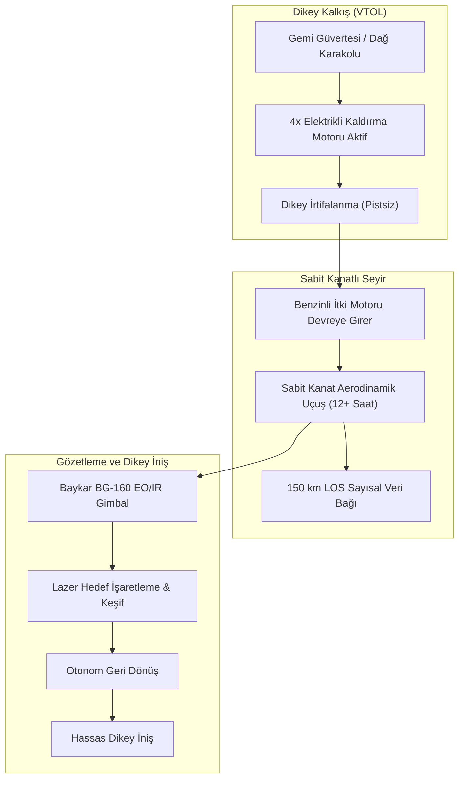

# 🦅 Proje: Bayraktar KALKAN DİHA (Dikey İniş Kalkışlı İHA)

  

## 🛡️ Stratejik Tanım & Doktriner Öncelik
**Bayraktar KALKAN DİHA**, sarp ve engebeli arazi şartlarında, dağ karakollarında, fırkateyn, korvet ve amfibi çıkarma gemilerinde pist gereksinimi olmaksızın dikey kalkış ve iniş (VTOL) yapabilen taktik sınıf keşif, gözetleme ve hedef tespit insansız hava aracıdır.

Platform, 4 adet bağımsız elektrikli kaldırma motoru ve arkada itki sağlayan düşük yakıt tüketimli içten yanmalı benzin motorunun birleştiği yenilikçi **hibrit tahrik mimarisine** sahiptir. Dikey olarak havalandıktan sonra sabit kanatlı bir uçak formunda yüksek aerodinamik verimlilikle süzülen KALKAN, Baykar üretimi **BG-160 Termal/Gündüz Elektro-Optik Gimbal** sistemi ile birliklere anlık taktik istihbarat ve lazer hedef işaretleme sağlar.

## 📊 Kapsamlı Teknik Özellikler

| Parametre | Değer / Özellik | Açıklama |
| :--- | :--- | :--- |
| **Kalkış / İniş Mimarisi** | Tam Otonom Dikey İniş Kalkış (VTOL) | Piste, mancınığa veya yakalama ağına ihtiyaç duymaz |
| **Haberleşme Menzili** | 150+ km Görüş Hattı (LOS) | Yedekli sayısal veri bağı mimarisi |
| **Havada Kalış Süresi** | 12+ Saat | Hibrit güç mimarisi ile uzun süreli taktik gözetleme |
| **Operasyonel / Tavan İrtifa** | 9.000 - 14.500 Feet / 15.000 Feet | Düşük ses izi ve taktik gizlilik |
| **Seyir / Maksimum Sürat** | 45 - 50 Knot / 80+ Knot | Yüksek aerodinamik kararlılık |
| **Kanat Açıklığı / Boyutlar** | ~5.0 Metre / Kompakt Gövde | Katlanabilir kanat yapısı ile dar alanlarda depolama |
| **Faydalı Yük Kapasitesi** | ~5 - 10 kg | Baykar BG-160 Elektro-Optik Kamera Sistemi |
| **Tahrik Sistemi** | Hibrit: 4x Elektrikli VTOL Motoru + 1x Benzinli İtki Motoru | Kalkışta elektrik, seyirde benzinli içten yanmalı motor |
| **Yapısal Malzeme** | Karbon Fiber Kompozit | Zorlu deniz tuzu ve çöl koşullarına dayanıklı gövde |

## 🧩 Alt Sistemler ve Aviyonik/Elektronik Entegrasyonu
- **Baykar BG-160 Elektro-Optik Pod:** Termal kızılötesi kamera, gündüz gözetleme kamerası, lazer mesafe ölçer ve lazer işaretleyici entegreli minyatür gimbal.
- **Üç Yedekli Uçuş Kontrol Bilgisayarı:** Tam otonom kalkış, rota takibi, gemi güvertesine iniş ve acil durum geri dönüş algoritmaları.
- **Anti-Jamming GNSS & Optik Akış (Optical Flow):** GPS karartması uygulanan harekat alanlarında görsel referanslar ve yer haritalama ile seyrüsefer kabiliyeti.
- **Mobil Yer Kontrol İstasyonu:** Birkaç çanta içerisinde taşınabilen, tek er veya iki kişilik tim tarafından kurulabilen taktik C2 konsolu.

## 🎯 Görev Profili, Muharebe Senaryoları & Mühimmat Yelpazesi
- **Mavi Vatan Donanma Karakolu:** Fırkateyn ve hücumbotların güvertesinden havalanarak ufuk ötesi yüzey hedeflerini tespit etme ve ATMACA füzeleri için hedef aydınlatma.
- **Dağ Karakolları & Sınır Güvenliği:** Yolu bulunmayan yüksek irtifa üs bölgelerinden havalanıp sızma girişimlerini termal kamerayla gece-gündüz gözetleme.
- **Topçu ve SİHA İleri Gözcülüğü:** Hedef koordinatlarını anlık çıkararak Fırtına obüsleri ve Bayraktar TB2'ler için hassas koordinat paylaşımı.

## 📐 Mimari ve Görev Akış Şeması

## 🚀 TRL Seviyesi ve Gelişim Yol Haritası
- **Mevcut Seviye: TRL 8 (Sistem Kalifiye / Envanter Dağıtımında)**
- [x] Hibrit İtki ve Aerodinamik Tasarım Doğrulaması
- [x] Tam Otonom Dikey Kalkış-İniş Uçuş Testleri
- [x] Baykar BG-160 Kamera Entegrasyonu ve Gece Uçuşları
- [x] Deniz Kuvvetleri Gemileri Güverte Testleri Başarısı
- [x] Kara Kuvvetleri ve Sahil Güvenlik Komutanlığı Kabul Süreçleri
- [ ] Sürü Zekası ile Çoklu Taktik Keşif Entegrasyonu

---
[⬅️ Üst Dizine](../README.md) | [🏛️ Dominion Hub](../../README.md) | [🏠 Ana Sayfa](../../../README.md)
