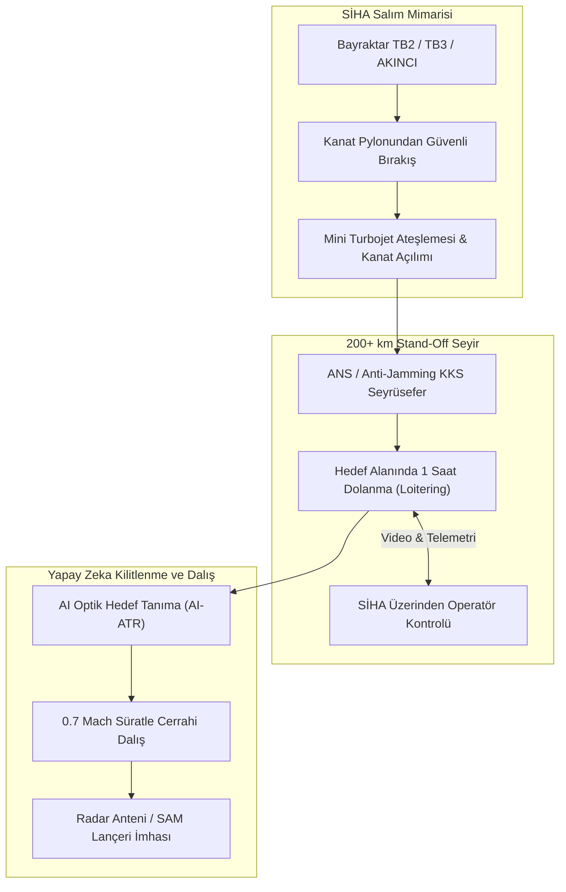

# 🏹 Proje: Bayraktar KEMANKEŞ Mini Akıllı Seyir Füzesi

  

## 🛡️ Stratejik Tanım & Doktriner Öncelik
**Bayraktar KEMANKEŞ**, adını tarihteki usta Türk okçularından alan, insansız hava araçlarının düşman hava savunma şemsiyesine girmeden stratejik hedefleri stand-off menzilinden vurabilmesi amacıyla Baykar tarafından öz kaynaklarla geliştirilen yapay zeka destekli bir mini akıllı seyir füzesidir.

Bayraktar TB2, TB3 ve AKINCI platformlarından salınabilen KEMANKEŞ, kendi bünyesindeki mini turbojet motoruyla 200+ km operasyonel menzile ulaşır. 1 saat havada kalış kabiliyeti ile hedef bölge üzerinde dolanarak keşif yapabilen (Loitering Munition) füze, 2 eksenli stabilize optik arayıcı başlığı ve yapay zeka destekli otonom optik güdüm sistemi sayesinde yoğun elektronik karıştırma şartlarında dahi hedefi tespit edip cerrahi dalışla imha eder.

## 📊 Kapsamlı Teknik Özellikler

| Parametre | Değer / Özellik | Açıklama |
| :--- | :--- | :--- |
| **Sınıfı** | Mini Akıllı Seyir Füzesi / Loitering Munition | Havadan atılan mini jet seyir füzesi |
| **Operasyonel Menzil** | 200+ km | SİHA'lara güvenli stand-off mesafesi sağlar |
| **Uçuş Süresi / Havada Kalış** | ~1 Saat | Hedef üzerinde dolanma ve teşhis imkanı |
| **Tahrik Sistemi** | Sıvı Yakıtlı Mini Turbojet Motoru | Kompakt ve yüksek itki-ağırlık oranı |
| **Maksimum / Seyir Sürati** | 0.7 Mach (720 km/s) / 0.3 Mach (360 km/s) | Yüksek terminal dalış sürati |
| **Toplam Ağırlık** | ~30 - 35 kg | Bayraktar TB2 dahil her SİHA'ya uygun |
| **Faydalı Yük / Harp Başlığı** | 6 kg Yüksek İnfilaklı Zırh Delici Başlık | Hassas taktik hedefleri imha kabiliyeti |
| **Boyutlar** | Uzunluk: 1.73 m / Yükseklik: 0.4 m / Açıklık: 1.25 m | Katlanır kanat ve aerodinamik gövde |
| **Arayıcı Başlık** | 2 Eksenli Stabilize Elektro-Optik Arayıcı | 36x Optik Yakınlaştırma ve Gece/Gündüz Modu |
| **Taşıyıcı Platformlar** | Bayraktar TB2, Bayraktar TB3, Bayraktar AKINCI | Çoklu SİHA entegrasyonu |

## 🧩 Alt Sistemler ve Aviyonik/Elektronik Entegrasyonu
- **Yapay Zeka Destekli Optik Güdüm Sistemi (AI-ATR):** Görüntü işleme tabanlı otomatik hedef tanıma yazılımı; GPS sinyali kesilse dahi arazi şekillerini ve hedef siluetini izleyerek terminal dalışa geçer.
- **2 Eksenli Stabilize Kamera Gimbali:** Füze yüksek süratle seyrederken operatöre titreşimsiz, kristal netliğinde anlık telemetri ve video aktarımı.
- **Kriptolu Sayısal Görüş Hattı Veri Bağı:** 50+ km menzilde SİHA ile doğrudan veri alışverişi yaparak Man-in-the-Loop kontrolü temin eder.
- **GNSS Karıştırma Dirençli ANS (INS/GPS):** Anti-jamming algoritmaları ile karıştırıcılara karşı yüksek bağışıklık.

## 🎯 Görev Profili, Muharebe Senaryoları & Mühimmat Yelpazesi
- **Hava Savunma Bataryalarını Avlama:** Pantsir, Tor veya Buk gibi düşman mobil hava savunma radarlarını radar menzili dışından tespit edip imha etme.
- **İleri Komuta Karargahları ve Lojistik:** Derinlikteki düşman toplanma alanlarını ve muhabere merkezlerini sürpriz jet taarruzu ile felç etme.
- **Dolanarak Hedef Arama:** Kritik hedefin yeri tam bilinmediğinde bölge üzerinde süzülerek hedefi bulma, pilota teyit ettirme ve dalış emri alma.

## 📐 Mimari ve Görev Akış Şeması

## 🚀 TRL Seviyesi ve Gelişim Yol Haritası
- **Mevcut Seviye: TRL 7 (Operasyonel Ortamda Prototip Doğrulandı)**
- [x] Konsept Tasarım ve Rüzgar Tüneli Testleri (2022)
- [x] TEKNOFEST 2023'te İlk Kez Halka Tanıtıldı
- [x] Bayraktar TB2'den İlk Başarılı Atış ve Jet Motoru Uçuş Testi (Haziran 2023)
- [x] Optik Hedef Takip ve Telemetri Doğrulama Uçuşları
- [ ] Canlı Harp Başlığı ile Hedef İmha Testleri
- [ ] Seri Üretim Hattı Kurulumu ve Envantere Kabul

---
[⬅️ Üst Dizine](../README.md) | [🏛️ Dominion Hub](../../README.md) | [🏠 Ana Sayfa](../../../README.md)
