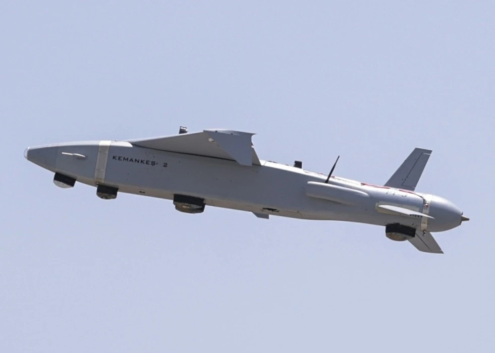
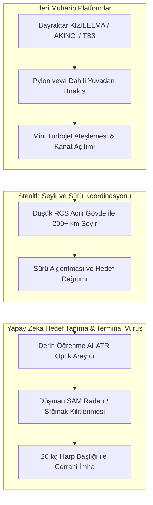

# 🎯 Proje: Bayraktar KEMANKEŞ 2 (Yeni Nesil Mini Seyir Füzesi)

  

## 🛡️ Stratejik Tanım & Doktriner Öncelik
**Bayraktar KEMANKEŞ 2**, Bayraktar TB2, TB3, AKINCI ve KIZILELMA gibi insansız muharip hava platformlarından salınabilen, jet motoru tahrikli, yapay zeka destekli optik güdüm mimarisine sahip yeni nesil bir mini akıllı seyir füzesidir.

KEMANKEŞ 1'e kıyasla artırılmış menzil, daha yüksek transonik seyir sürati, büyütülmüş 20 kg harp başlığı ve düşük radar kesit alanı (RCS) sağlayan açılı kompozit gövdesiyle öne çıkar. Düşman elektronik karıştırma şemsiyesinin en yoğun olduğu ortamlarda dahi yerleşik derin öğrenme algoritmalarıyla kara hedeflerini otonom olarak teşhis edip takip eden KEMANKEŞ 2, hava savunma koridorlarını yararak derinlikteki stratejik radarları, komuta sığınaklarını ve lojistik merkezleri nokta atışıyla imha eder.

## 📊 Kapsamlı Teknik Özellikler

| Parametre | Değer / Özellik | Açıklama |
| :--- | :--- | :--- |
| **Sınıfı** | Yeni Nesil Yapay Zeka Destekli Mini Seyir Füzesi | Havadan salınan stand-off taarruz füzesi |
| **Operasyonel Menzil** | 200+ km | Düşman SAM menzili dışından güvenli taarruz |
| **Uçuş Süresi / Havada Kalış** | ~1 Saat | Hedef sahasında otonom seyrüsefer ve teşhis |
| **Tahrik Ünitesi** | İleri Seviye Sıvı Yakıtlı Mini Turbojet Motoru | Kompozit hava alıklı entegre jet itkisi |
| **Seyir / Dalış Sürati** | 0.6+ Mach / Terminal Safhada Yüksek Dalış Hızı | Hava savunma önleme süresini minimize eder |
| **Harp Başlığı** | ~20 kg Yüksek İnfilaklı Zırh Delici / Parçacıklı | Güçlendirilmiş beton ve zırhlı hedeflere etkili |
| **Güdüm Mimarisi** | Yapay Zeka Destekli Optik Arayıcı + ANS / KKS | Tam otonom AI-ATR görüntü tabanlı kilitlenme |
| **Radar İzi (RCS)** | Düşük Görünürlüklü Açılı Kompozit Tasarım | Radar tespitini geciktiren gövde geometrisi |
| **Taşıyıcı Platformlar** | Bayraktar TB2, TB3, AKINCI, KIZILELMA | Çoklu SİHA ve İnsansız Savaş Uçağı uyumu |

## 🧩 Alt Sistemler ve Aviyonik/Elektronik Entegrasyonu
- **Gelişmiş AI-ATR (Otomatik Hedef Tanıma):** Milyonlarca askeri araç ve radar görseliyle eğitilmiş derin öğrenme modelleri; füzenin insan müdahalesi olmadan hedefi teşhis edip kilitlenmesini sağlar.
- **Termal / Gündüz Çift Modlu Optik Sensör:** Gece, sis, duman ve zorlu atmosferik koşullarda termal imza üzerinden hedef ayrımı.
- **Kriptolu Sürü Veri Bağı:** Çoklu fırlatılan KEMANKEŞ 2 mühimmatlarının birbirleriyle ve ana platformla haberleşerek hedef paylaşımı yapabilmesi.
- **Anti-Jamming Donanımlı ANS:** Kasıtlı GPS yanıltma ve karıştırma bölgelerinde ataletsel referanslarla rotadan sapmama garantisi.

## 🎯 Görev Profili, Muharebe Senaryoları & Mühimmat Yelpazesi
- **Sürü Halinde Hava Savunma Doyurma:** Tek bir AKINCI veya KIZILELMA'dan bırakılan 4 adet KEMANKEŞ 2'nin hedef bataryaya farklı açılardan eşzamanlı dalışı.
- **Gizli Gövde İçi Salım (KIZILELMA Entegrasyonu):** KIZILELMA'nın dahili silah yuvasından stealth profilde fırlatılarak radar izi bırakmadan hedefi imha etmesi.
- **Yüksek Öncelikli Mobil Hedef İmhası:** Hareket halindeki mobil füze rampaları, radar istasyonları ve komuta kontrol tırlarının tespiti ve imhası.

## 📐 Mimari ve Görev Akış Şeması

## 🚀 TRL Seviyesi ve Gelişim Yol Haritası
- **Mevcut Seviye: TRL 7 (Operasyonel Ortamda Prototip Doğrulandı)**
- [x] Aerodinamik Gövde Tasarımı ve Rüzgar Tüneli Doğrulamaları
- [x] Mini Turbojet Motoru Yer ve Statik İtki Testleri
- [x] 2024 Yılı Başarılı İlk Uçuş ve Hedef Vuruş Test İcrası
- [ ] Çoklu Mühimmat ile Sürü Angajman Gösterimleri
- [ ] KIZILELMA Dahili İstasyon Uçuş Ayrılma Testleri
- [ ] Seri Üretim Hattının Devreye Alınması

---
[⬅️ Üst Dizine](../README.md) | [🏛️ Dominion Hub](../../README.md) | [🏠 Ana Sayfa](../../../README.md)
