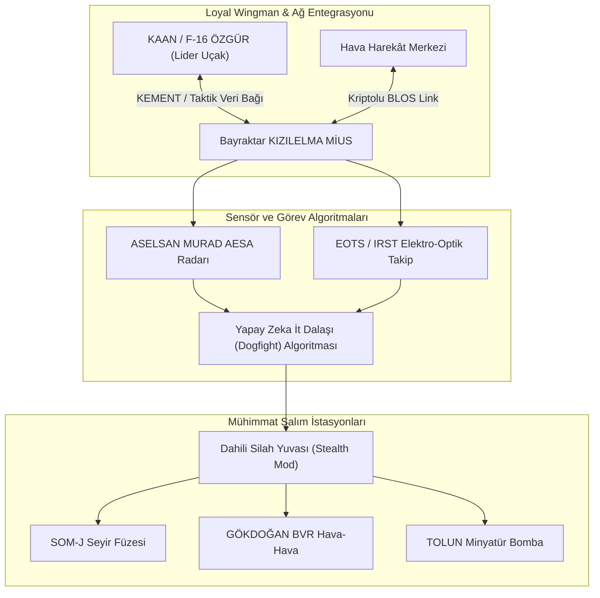

# 🦅 Proje: Bayraktar KIZILELMA (Muharip İnsansız Uçak Sistemi - MİUS)

  

## 🛡️ Stratejik Tanım & Doktriner Öncelik
**Bayraktar KIZILELMA (MİUS)**, Türk askeri havacılık tarihinde yeni bir çağ açan, agresif manevra kabiliyeti, düşük radar kesit alanı (Stealth mimarisi), dahili silah istasyonları ve süpersonik/transonik hız potansiyeline sahip Türkiye'nin ilk muharip insansız savaş uçağıdır.

Klasik İHA konseptinin çok ötesinde, insanlı 5. nesil savaş uçakları ile hava-hava muharebesi (Dogfight ve BVR) yapabilecek şekilde tasarlanan KIZILELMA, TCG ANADOLU gibi kısa pistli amfibi hücum gemilerinden katapultsuz iniş-kalkış yapabilen dünyadaki ilk insansız savaş jetidir. ASELSAN MURAD AESA radarı, elektro-optik hedefleme sistemleri ve milli hava-hava füzeleri (GÖKDOĞAN, BOZDOĞAN) ile donatılan platform, Türk Hava Kuvvetleri'nin **Loyal Wingman** doktrininde KAAN'ın en kritik harekât ortağıdır.

## 📊 Kapsamlı Teknik Özellikler

| Parametre | Değer / Sınıf | Operasyonel Detay |
| :--- | :--- | :--- |
| **Sınıfı** | MİUS (Muharip İnsansız Uçak Sistemi / Loyal Wingman) | İnsansız Jet Savaş Uçağı |
| **Maksimum Kalkış Ağırlığı (MTOW)** | 6.000 - 8.500 kg | Genişletilmiş gövde ve yakıt kapasitesi |
| **Faydalı Yük Kapasitesi** | 1.500 kg (Dahili Silah İstasyonları + Harici Pylonlar) | Stealth mühimmat taşınabilirlik |
| **Tahrik Ünitesi** | AI-25TLT / AI-322F (Art Yakıcılı) / TEI-TF6000 | Subsonik (KIZILELMA-A) ve Süpersonik (KIZILELMA-B/C) |
| **Seyir / Azami Hız** | 0.6 - 0.9 Mach (KIZILELMA-A) / 1.2+ Mach Süpersonik | Transonik ve süpersonik avcı kabiliyeti |
| **Operasyonel İrtifa / Tavan** | 35.000 - 45.000 Feet (Servis Tavanı) | Yüksek irtifa hava hakimiyeti |
| **Havada Kalış / Yarıçap** | 5+ Saat / 500+ NM Muharip Harekât Yarıçapı | Derin harekât ve filo koruma |
| **Kalkış / İniş Pist Kabiliyeti** | Kısa Pistli Uçak Gemileri (TCG ANADOLU) ve Meydanlar | Katapultsuz kalkış ve yakalama kancalı iniş |
| **Radar Kesit Alanı (RCS)** | Çok Düşük Görünürlük (VLO / Stealth) | Açılı gövde, V-kuyruk ve dahili istasyonlar |
| **Sensör Mimarisi** | ASELSAN MURAD AESA Radarı + ASELFLIR-500 + EOTS/IRST | Çok kanallı sensör füzyonu |

## 🧩 Alt Sistemler ve Aviyonik/Elektronik Entegrasyonu
- **ASELSAN MURAD AESA Radarı:** Çok kanallı elektronik tarama, hava-hava BVR hedef takibi, SAR haritalama ve elektronik harp taarruz modülleri.
- **KEMENT & Milli Taktik Veri Bağı:** KAAN, F-16 ÖZGÜR, HAVA SOJ ve yer istasyonları ile mikro saniye düzeyinde senkronize veri paylaşımı (Loyal Wingman mimarisi).
- **Yapay Zeka Muharebe Beyni:** İnsan pilotların G limitlerinin (9G+) üzerinde +10G/-5G agresif manevraları otonom icra eden derin öğrenme tabanlı it dalaşı algoritmaları.
- **Dahili Silah Yuvası ve Pnömatik Salıcılar:** Radar izini minimumda tutarak gövde içinden SOM-J, TOLUN ve hava-hava füzelerini yüksek süratte fırlatabilen salım mekanizması.

## 🎯 Görev Profili, Muharebe Senaryoları & Mühimmat Yelpazesi
- **İtiraz Edilen Hava Sahasına Giriş (SEAD/DEAD):** Düşman erken ihbar radarlarının kapsama alanına stealth profilde sızarak hava savunma sistemlerini SOM-J veya KEMANKEŞ 2 ile etkisiz kılma.
- **Görüş Ötesi Hava-Hava Muharebesi (BVR):** AESA radar tespitiyle onlarca mil uzaktan GÖKDOĞAN füzeleri fırlatarak düşman savaş uçaklarını önleme.
- **TCG ANADOLU Donanma Hava Şemsiyesi:** Mavi Vatan üzerinde açık deniz görevlerinde düşman deniz karakol ve taarruz uçaklarına karşı hava savunma devriyesi.
- **Mühimmat Yelpazesi:**
  - *Hava-Hava:* GÖKDOĞAN, BOZDOĞAN, AKDOĞAN.
  - *Hava-Yer:* SOM-J, ÇAKIR, TOLUN, TEBER-82, MAM-T, KUZGUN, KEMANKEŞ 2.

## 📐 Mimari ve Görev Akış Şeması

## 🚀 TRL Seviyesi ve Gelişim Yol Haritası
- **Mevcut Seviye: TRL 8 (Sistem Kalifiye / Seri Üretim Hazırlığı)**
- [x] Kavramsal Tasarım ve İmalat Fazı Tamamlandı (2021-2022)
- [x] İlk Uçuş Başarıyla Gerçekleştirildi (14 Aralık 2022)
- [x] Kol Uçuşları (AKINCI ile Formasyon Uçuş Testleri)
- [x] İkinci Prototip Uçuşları ve Sistem Doğrulamaları (2023-2024)
- [x] Art Yakıcılı (Afterburner) Süpersonik Motor Uçuş Testleri
- [ ] TCG ANADOLU Güverte İniş ve Kalkış Testleri
- [ ] Seri Üretim Teslimatları ve Hava Kuvvetleri Envanterine Giriş (2025-2026)

---
[⬅️ Üst Dizine](../README.md) | [🏛️ Dominion Hub](../../README.md) | [🏠 Ana Sayfa](../../../README.md)
