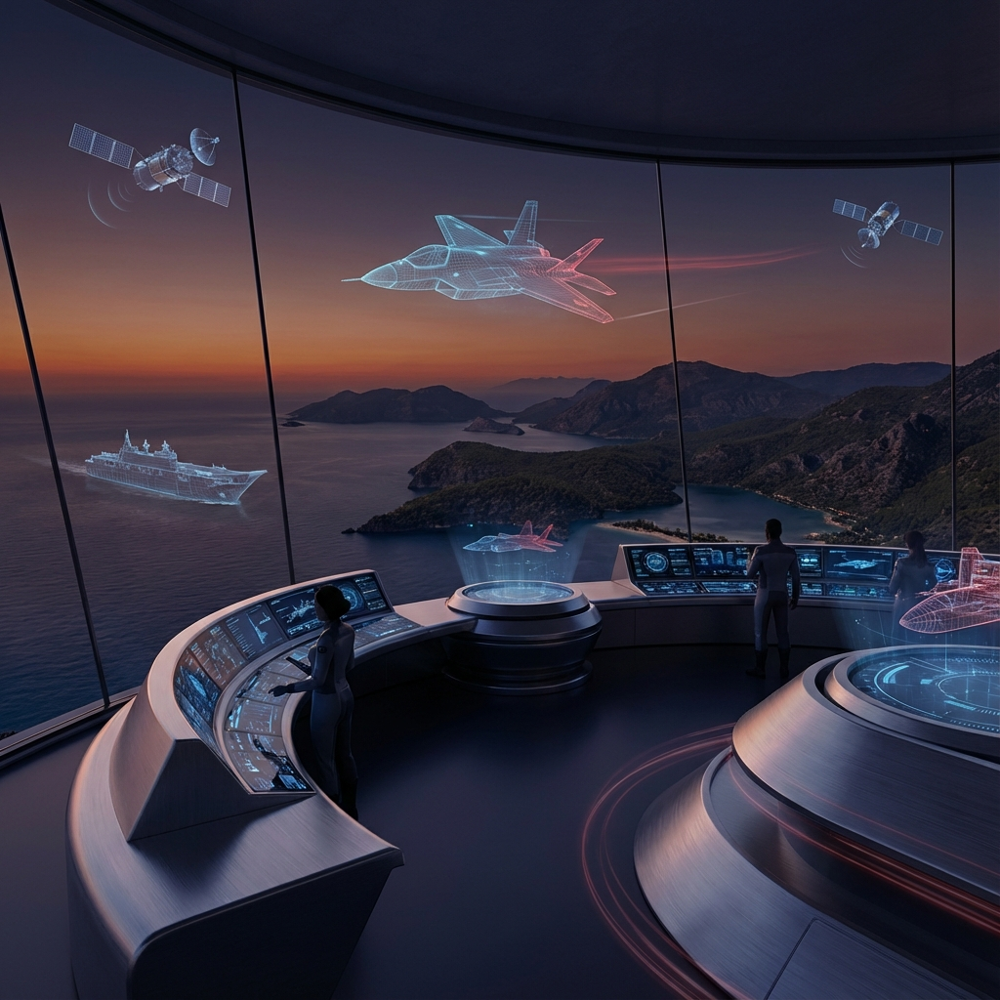

# 🦅 Proje: KIZILELMA (Muharip İnsansız Uçak Sistemi)

> **"İnsansız Savaşın Yeni Şafağı: Agresif Manevra ve Görünmez Güç"**

KIZILELMA, Türkiye'nin insansız savaş uçağı konseptinde dünya liderliğine oynayan hamlesidir. Klasik İHA'ların ötesinde, agresif manevra kabiliyeti ve stealth mimarisiyle hava-hava muharebesi yapabilen bir platformdur.

## 🛠 Teknik Kapasite Özeti

| Parametre | Detay | Özellik |
| :--- | :--- | :--- |
| **Tür** | MİUS (Muharip İnsansız Uçak Sistemi) | Tam Otonom Operasyon |
| **Maksimum Kalkış** | 6.000 kg | TCG Anadolu'dan İniş-Kalkış |
| **Hız** | 0.6 - 0.9 Mach (Transonik) | Süpersonik modeller planlanıyor |
| **Faydalı Yük** | 1.500 kg | Dahili ve Harici İstasyonlar |
| **Menzil** | 500+ nm (Muharip Yarıçap) | 5 Saat Havada Kalış |

## 🕹️ Operasyonel Yetenekler ve Yapay Zeka
KIZILELMA, BAYKAR'ın geliştirdiği gelişmiş yapay zeka algoritmaları sayesinde:
- **Otonom Agresif Manevralar:** İnsanlı savaş uçaklarının G-kuvveti limitlerinin ötesinde manevra yapabilme.
- **TCG Anadolu Entegrasyonu:** Kısa pistli gemilerden herhangi bir yakalama ekipmanı olmadan iniş ve kalkış yapabilen dünyadaki ilklerden biri.
- **Akıllı Sürü Operasyonu:** Diğer İHA/SİHA'lar ve KAAN ile senkronize görev icrası.

## 💥 Mühimmat Enformasyonu
- **Hava-Hava:** GÖKDOĞAN, BOZDOĞAN.
- **Hava-Yer:** SOM-J, MAM Serisi (L/T), KUZGUN.
- **Elektronik Taarruz:** Minyatür bombalar ve EH podları.

## 🌐 Ekosistem Entegrasyonu (Aggressive Synergy)
KIZILELMA, Türkiye'nin "İnsansız Hava Muharebesi" doktrininin öncü kuvvetidir:
- **KAAN & Loyal Wingman:** KAAN pilotu tarafından yönlendirilen, en riskli görevlere (İtirazlı Hava Sahası) önden giren agresif saldırı ortağı.
- **TCG ANADOLU:** Dünyada bir ilk olarak, kısa pistli bir gemiden katapult yardımı olmadan otonom operasyon yapabilme kabiliyeti.
- **AKINCI ile Sürü Operasyonu:** AKINCI'nın sensör gücünü, KIZILELMA'nın yüksek hızı ve manevra kabiliyetiyle birleştiren karma sürüler.

## 📊 Alt Sistemler ve Yerlilik
- **Motor:** Ukrayna menşeli AI-25TLT/AI-322F ile başlayan seri, ileride TEI tarafından geliştirilen milli turbofan motorlarla (TF6000) devam edecektir.
- **Aviyonik Sistemler:** Tamamen BAYKAR bünyesinde geliştirilen, yapay zeka destekli otonom uçuş ve görev yönetim yazılımları.
- **AESA Radar:** Milli MURAD AESA radar entegrasyonu ile kendi başına hedef tespit ve angajman kapasitesi.

## 🔮 Gelecek Vizyonu ve Blok Modernizasyonu
- **KIZILELMA-A:** Mevcut transonik prototip üzerinden seri üretim başlangıcı.
- **KIZILELMA-B:** Süpersonik hıza ulaşabilen, daha güçlü motor ve stealth özellikleri artırılmış model.
- **İnsansız İt dalaşı (Dogfight):** Yapay zekanın limitlerini zorlayan, insanlı uçakların yapamayacağı manevraları otonom icra eden varyant.
- **Uzay Entegrasyonu:** Alçak dünya yörüngesi uydularıyla (FERGANİ) doğrudan veri bağı üzerinden küresel operasyon kapasitesi.

## 🚀 Geliştirme Durumu (TRL 8)

### 📈 Milat Çizgisi
- [x] Kavramsal Tasarım ve İmalat
- [x] Teker Kesme ve İlk Uçuş (14 Aralık 2022)
- [x] Orta İrtifa Sistem Tanımlama Testleri
- [/] Seri Üretim Hazırlıkları (A Blok)
- [ ] Operasyonel Göreve Kabul

## 📁 Proje Varlıkları (Project Assets)
- (Bu proje dizininde henüz ek dosya bulunmamaktadır.)
---
[⬅️ BAYKAR Ana Sayfası](../README.md) | [🏠 Ana Sayfa](../../../README.md)
