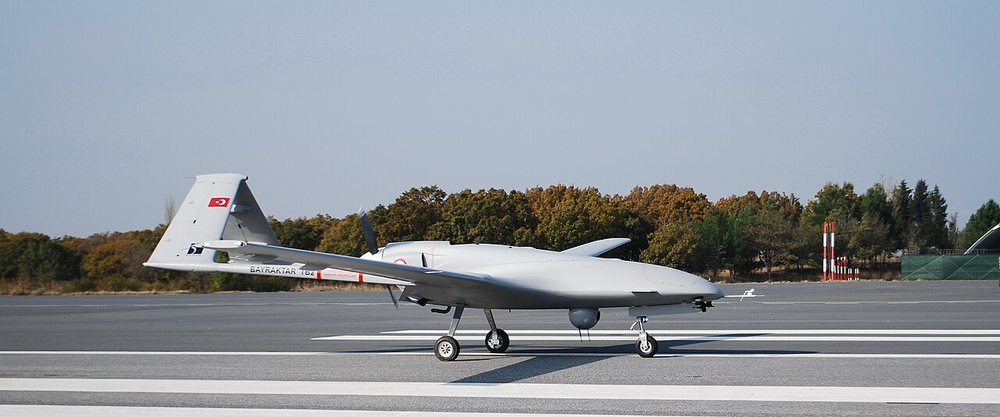
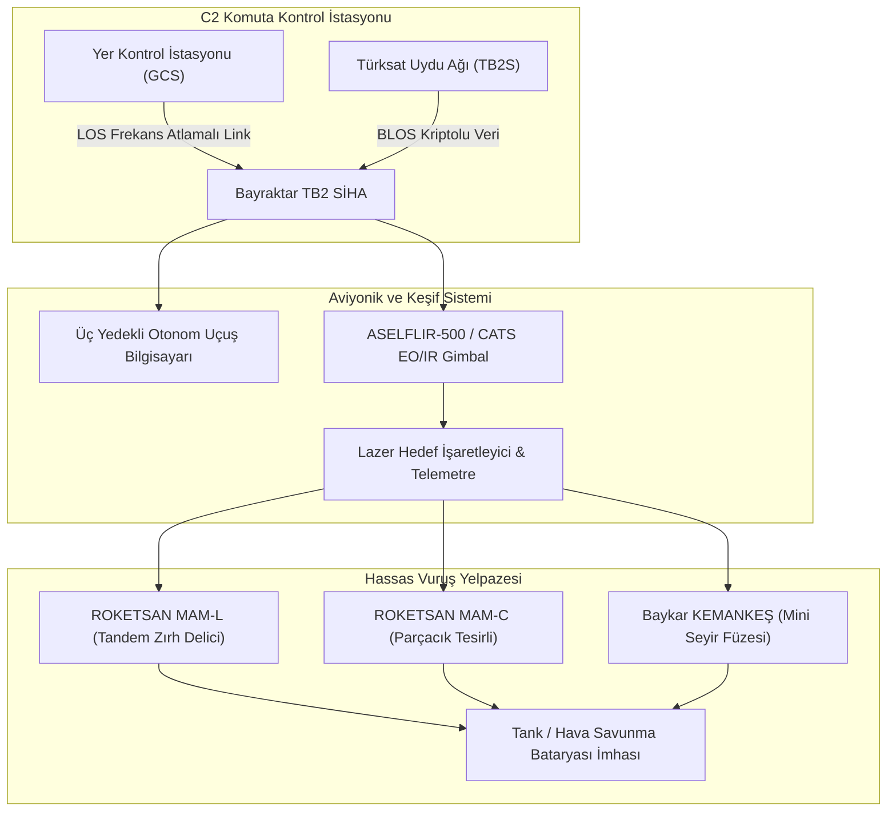

# 🦅 Proje: Bayraktar TB2 SİHA (Silahlı İnsansız Hava Aracı)

  

## 🛡️ Stratejik Tanım & Doktriner Öncelik
**Bayraktar TB2 SİHA**, dünya askeri havacılık ve harp doktrinlerinde devrim yaratan, operasyonel başarılarıyla modern savaş sahasının kurallarını baştan yazan orta irtifa uzun havada kalışlı (MALE) taktik insansız hava aracı sistemidir. 

Karabağ, Ukrayna, Suriye ve Libya gibi yüksek yoğunluklu elektronik harp ve hava savunma tehditlerinin bulunduğu harekat alanlarında Pantsir, Tor ve Buk gibi modern SAM sistemlerini, yüzlerce tank ve zırhlı muharebe aracını cerrahi hassasiyetle imha ederek küresel bir fenomene dönüşmüştür. 750.000'den fazla operasyonel uçuş saati ve 30'un üzerinde ülkeye ihraç başarısıyla Türkiye'nin bayrak taşıyıcı savunma platformudur. TB2S versiyonunda entegre edilen SATCOM anteni ile menzil sınırlaması olmaksızın küresel ufuk ötesi harekât icra edebilmektedir.

## 📊 Kapsamlı Teknik Özellikler

| Parametre | Değer / Standart | Açıklama |
| :--- | :--- | :--- |
| **Sınıfı** | MALE (Orta İrtifa Uzun Havada Kalış) Taktik SİHA | Muharebe sahasında kanıtlanmış taktik vuruş |
| **Maksimum Kalkış Ağırlığı (MTOW)** | 700 kg | Hafif kompozit gövde yapısı |
| **Faydalı Yük Kapasitesi** | 150 kg | EO/IR Sensör Podu + 4 Kanat Altı İstasyonu |
| **Kanat Açıklığı / Uzunluk** | 12.0 Metre / 6.5 Metre / 2.2 Metre Yükseklik | Ters V-kuyruk ve entegre kanat gövde |
| **Motor Tipi** | 100 - 105 HP İçten Yanmalı Benzinli Motor | Yüksek yakıt verimliliği |
| **Operasyonel / Servis İrtifası** | 18.000 - 25.000 Feet / 27.030 Feet (Sınıf Rekoru) | Düşük optik ve termal iz |
| **Havada Kalış Süresi** | 27 Saat 3 Dakika | Kesintisiz 7/24 hava karakolu |
| **Seyir / Azami Sürat** | 70 Knot / 120 Knot (220 km/s) | Kararlı aerodinamik seyir |
| **Haberleşme Menzili** | 300+ km (LOS) / Sınırsız (TB2S Uydu/SATCOM) | Röle yeteneği ile ağ genişletme |
| **Sensör Donanımı** | ASELSAN ASELFLIR-500 / CATS / WESCAM MX-15D | Lazer işaretleme ve termal hedefleme |

## 🧩 Alt Sistemler ve Aviyonik/Elektronik Entegrasyonu
- **Üç Yedekli Uçuş Kontrol Bilgisayarı:** Tam otonom taksi, kalkış, seyir, iniş ve acil durum algoritmaları; hiçbir harici insan müdahalesine gerek duymayan otonomi mimarisi.
- **ASELFLIR-500 Elektro-Optik Keşif Podu:** Yüksek çözünürlüklü HD gündüz kamerası, kızılötesi termal kamera, lazer mesafe ölçer ve lazer hedef aydınlatıcı.
- **Çift Yedekli Sayısal Veri Bağı:** Düşman karıştırmalarına karşı frekans atlamalı (Frequency Hopping) ve kriptolu LOS komuta-kontrol linki.
- **Anti-Jamming GNSS Mimarisi:** Elektronik harp saldırılarında dahi uydulardan gelen sinyalleri filtreleyen akıllı anten modülleri.

## 🎯 Görev Profili, Muharebe Senaryoları & Mühimmat Yelpazesi
- **Cerrahi Nokta Taarruzu:** Lazer güdümlü mühimmatlarla düşman kritik komuta heyetlerini, sığınakları ve silah mevzilerini sivil zayiat olmaksızın vurma.
- **Zırhlı Birlikleri Avlama:** ROKETSAN MAM-L tandem harp başlıklı mühimmatı ile reaktif zırhlı ana muharebe tanklarını saf dışı bırakma.
- **Mühimmat Yelpazesi:**
  - *ROKETSAN MAM-L:* Tandem zırh delici / termobarik / yüksek infilaklı (15+ km).
  - *ROKETSAN MAM-C:* Çok maksatlı zırh delici ve parçacıklı (8+ km).
  - *TÜBİTAK SAGE BOZOK:* Lazer güdümlü minyatür mühimmat.
  - *Baykar KEMANKEŞ:* 200+ km mini seyir füzesi.

## 📐 Mimari ve Görev Akış Şeması

## 🚀 TRL Seviyesi ve Gelişim Yol Haritası
- **Mevcut Seviye: TRL 9 (Saha Kanıtlanmış & Seri Üretim)**
- [x] İlk Uçuş ve Prototip Doğrulama (2014)
- [x] Silahlı Uçuş ve MAM-L İlk Atış Başarısı (2015)
- [x] TSK ve Emniyet Genel Müdürlüğü Envanterine Giriş (2015-2016)
- [x] 34+ Ülkeye İhracat ve 750.000+ Operasyonel Uçuş Saati (Combat Proven)
- [x] TB2S Uydu Haberleşmeli Varyantının Sahaya Sürülmesi
- [x] ASELFLIR-500 Yeni Nesil Milli Kamera Entegrasyonu
- [ ] Yapay Zeka Destekli Otonom Kol Uçuşu Yazılım Güncellemeleri

---

### 📸 Taktik ve Operasyonel Görseller / Saha Galerisi

  
  

---
[⬅️ Üst Dizine](../README.md) | [🏛️ Dominion Hub](../../README.md) | [🏠 Ana Sayfa](../../../README.md)
