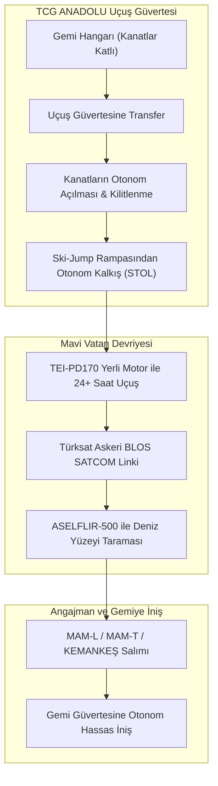

# 🚢 Proje: Bayraktar TB3 SİHA (Gemi Konuşlu Taktik SİHA)

  

  

## 🛡️ Stratejik Tanım & Doktriner Öncelik
**Bayraktar TB3 SİHA**, TCG ANADOLU gibi kısa pistli amfibi hücum ve helikopter gemilerinden harici mancınık veya yakalama ağına ihtiyaç duymaksızın kendi motor gücüyle kalkış ve iniş (STOL) yapabilen dünyanın ilk silahlı insansız deniz havacılığı platformudur.

Bayraktar TB2'nin muharebe tecrübesi üzerine inşa edilen ancak çok daha güçlü gövde mimarisi, katlanabilir kanat mekanizması, deniz korozyonuna tam dayanıklı kompozit yapısı ve TEI tarafından milli olarak geliştirilen **PD170 turbo dizel havacılık motoru** ile donatılan TB3, Türkiye'nin Mavi Vatan ve denizaşırı güç aktarımı doktrininde oyun kurucu bir kuvvettir. Görüş ötesi SATCOM uydu bağı sayesinde okyanuslarda kıtalararası menzillerde keşif, gözetleme ve taarruz icra edebilir.

## 📊 Kapsamlı Teknik Özellikler

| Parametre | Değer / Özellik | Operasyonel Açıklama |
| :--- | :--- | :--- |
| **Sınıfı** | Kısa Pistli Gemi Konuşlu MALE Taktik SİHA (STOL) | Dünyada deniz havacılığında ilk |
| **Maksimum Kalkış Ağırlığı (MTOW)** | 1.450 kg | TB2'nin iki katından fazla kalkış ağırlığı |
| **Faydalı Yük Kapasitesi** | 280 kg | 6 mühimmat pylonu + ASELFLIR-500 |
| **Kanat Açıklığı / Uzunluk** | 14.0 Metre (Katlanabilir) / 8.35 Metre / 2.6 m Yükseklik | Gemi asansör ve hangarlarına tam uyum |
| **Motor Ünitesi** | TEI-PD170 Çift Turboşarjlı Dizel Havacılık Motoru | 170 HP yerli motor, düşük yakıt sarfiyatı |
| **Seyir / Maksimum Sürat** | 125 Knot / 160 Knot (300 km/s) | Yüksek rüzgar direnci ve deniz kararlılığı |
| **Havada Kalış Süresi** | 24+ Saat | Kesintisiz açık deniz devriyesi |
| **Kalkış / İniş Mimarisi** | Ski-Jump Rampalı Kısa Pist (STOL) | Katapultsuz kalkış ve otonom hassas iniş |
| **Haberleşme** | BLOS / SATCOM (Uydu Haberleşmesi) | Okyanus ötesi küresel operasyon erimi |
| **Sensör Paketi** | ASELSAN ASELFLIR-500 EO/IR + Deniz Arama Radarı | Su üstü hedefleri tespit ve lazer aydınlatma |

## 🧩 Alt Sistemler ve Aviyonik/Elektronik Entegrasyonu
- **TEI-PD170 Motor Entegrasyonu:** Yüksek irtifa performansı sağlayan çift turbo beslemeli, JP-8 ve dizel yakıtla çalışabilen yerli motor kontrol elektroniği.
- **Otonom Gemi İniş-Kalkış Algoritmaları:** Geminin yalpa ve çalkalanma hareketlerini hesaplayarak güvertedeki sanal glide-slope hattını takip eden gelişmiş otonom seyrüsefer.
- **Katlanır Kanat Mekatronik Sistemi:** Hangar alanı verimliliğini artıran, kilit mekanizmalı güvenli kanat açma-kapama hidrolik ve elektrik aktüatörleri.
- **Deniz Şartlarına Dayanıklılık (Marinize Yapı):** Tuzlu su sisi ve neme karşı korozyon önleyici özel kaplamalar ve sızdırmaz aviyonik kompartımanlar.

## 🎯 Görev Profili, Muharebe Senaryoları & Mühimmat Yelpazesi
- **Mavi Vatan Açık Deniz Taarruzu:** TCG ANADOLU'dan kalkarak düşman hücumbot ve fırkateynlerine karşı MAM-L, MAM-T ve KEMANKEŞ ile stand-off saldırı.
- **Denizaltı Savunma Harbi (DSH) Desteği:** Sonoboy atımı ve deniz yüzeyi periskop izi takibi ile denizaltı avlama faaliyetlerine katkı.
- **Amfibi Harekât Yakın Hava Desteği:** Çıkarma birliklerine kıyı savunma mevzilerini yumuşatmak için lazer güdümlü kesintisiz hava desteği.
- **Mühimmat Yelpazesi:**
  - MAM-C, MAM-L, MAM-T.
  - KEMANKEŞ & KEMANKEŞ 2 mini seyir füzeleri.
  - TOLUN ve TEBER-82 güdümlü mühimmatları.

## 📐 Mimari ve Görev Akış Şeması

## 🚀 TRL Seviyesi ve Gelişim Yol Haritası
- **Mevcut Seviye: TRL 7 (Operasyonel Ortamda Prototip Doğrulandı)**
- [x] Katlanır Kanat ve Gövde Tasarımı Tamamlandı (2022)
- [x] TEI-PD170 Motor Entegrasyonu ve Yer Testleri (2023)
- [x] İlk Uçuş Başarıyla Gerçekleştirildi (Ekim 2023)
- [x] 30.000+ Feet İrtifa Sistem Tanımlama ve Uçuş Dayanım Testleri
- [x] Kara Tabanlı Ski-Jump Rampasından Kalkış Doğrulamaları (2024)
- [ ] TCG ANADOLU Üzerinde Canlı Gemiye İniş-Kalkış Testleri
- [ ] Türk Deniz Kuvvetleri Envanterine Giriş ve Seri Üretim Dağıtımı

---
[⬅️ Üst Dizine](../README.md) | [🏛️ Dominion Hub](../../README.md) | [🏠 Ana Sayfa](../../../README.md)
