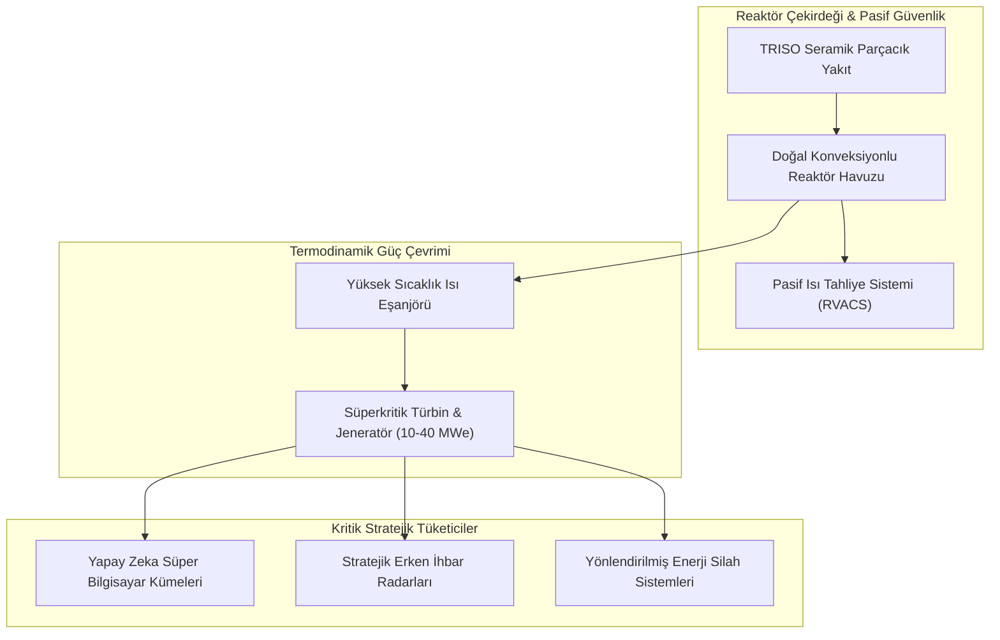

# ⚛️ Proje: BAYKAR TOMRİS (Küçük Modüler Reaktör - SMR)

  

## 🛡️ Stratejik Tanım & Doktriner Öncelik
**TOMRİS**, Baykar Enerji mühendisliği bünyesinde yürütülen, kritik askeri harekât üsleri, stratejik hava savunma radarları, derin öğrenme süper bilgisayar veri merkezleri ve ileri kara/deniz konuşlanma bölgelerinin kesintisiz, temiz ve harici şebekelerden tamamen bağımsız baz yük elektrik ihtiyacını karşılamak üzere geliştirilen yeni nesil bir Küçük Modüler Nükleer Reaktör (SMR / Mikro Reaktör) projesidir.

Fabrika ortamında üretilip standart ISO konteyner boyutlarında karayolu, demiryolu veya deniz yolu ile istenilen stratejik noktaya nakledilebilen TOMRİS, fosil yakıt lojistiğine olan bağımlılığı sıfırlar. 4. nesil pasif güvenlik felsefesiyle tasarlanan sistem, herhangi bir elektrik kesintisi veya insan müdahalesi olmaksızın doğal termal konveksiyonla kendiliğinden soğuyarak çekirdek erimesi riskini fiziksel olarak ortadan kaldırır. 10 ila 40 MWe elektrik çıktısı ve 10+ yıl kesintisiz yakıt döngüsü ile Türkiye'nin teknolojik egemenliğinde kritik bir enerji kalkanıdır.

## 📊 Kapsamlı Teknik Özellikler

| Parametre | Değer / Özellik | Operasyonel Detay |
| :--- | :--- | :--- |
| **Teknoloji Sınıfı** | Küçük Modüler Reaktör (SMR) / Mikro Reaktör | 4. Nesil Yüksek Sıcaklık Gaz/Sıvı Soğutmalı |
| **Termal / Elektrik Gücü** | 30 - 100 MWth (Termal) / 10 - 40 MWe (Elektrik) | Modüler paralel bağlanabilir üniteler |
| **Çekirdek Yakıt Ömrü** | 10+ Yıl (Yakıt Değişimi Gerektirmez) | Zenginleştirilmiş TRISO tipi seramik kaplı yakıt |
| **Güvenlik Mimarisi** | Tam Pasif Güvenlik (Inherent Safety) | Doğal sirkülasyon, sıfır harici güç gereksinimi |
| **Taşınabilirlik** | Standart Konteyner / Ağır Nakliye Tırı | Hızlı kurulum ve tak-çalıştır altyapısı |
| **Kullanım Ömrü** | 40 - 60 Yıl | Yüksek korozyon dayanımlı reaktör kabı |
| **Isı Çıktısı** | 500°C - 750°C Yüksek Sıcaklık Proses Isısı | Sentetik yakıt üretimi ve tuzdan arındırma |
| **Hedef Alanlar** | Askeri Üsler, Veri Merkezleri, Uzay Fırlatma Tesisleri | Şebekeden izole (Island Mode) operasyon |

## 🧩 Alt Sistemler ve Aviyonik/Elektronik Entegrasyonu
- **TRISO Güvenlikli Yakıt Çakılları:** Binlerce derece sıcaklığa dayanıklı, nükleer fisyon ürünlerini içine hapseden silisyum karbür kaplı parçacık yakıt mimarisi.
- **Doğal Dolaşımlı Pasif Isı Tahliye Sistemi (RVACS):** Harici elektrik ve su pompalarına ihtiyaç duymadan, atmosferik hava akımıyla çekirdek artık ısısını tahliye eden mimari.
- **Süperkritik CO2 / Gaz Türbin Güç Çevrim Ünitesi:** Yüksek termodinamik verimlilik sağlayan kompakt mikro türbin jeneratör modülü.
- **Yapay Zeka Destekli Otonom Reaktör Kontrol Elektroniği:** Nötron akısını, sıcaklık ve basınç parametrelerini mikro saniyelerde izleyip dengeleyen otonom kontrol çubukları mekanizması.

## 🎯 Görev Profili, Muharebe Senaryoları & Mühimmat Yelpazesi
- **Süper Bilgisayar Kümelerine Kesintisiz Güç:** Baykar yapay zeka eğitim sunucularına ve milli savunma veri merkezlerine 7/24 kesintisiz baz yük temiz enerji.
- **İleri Harekât Üssü Enerji Desteği:** Şebekeden uzak sınır veya denizaşırı üslerde mazot konvoyu ihtiyacını ve lojistik zafiyeti tamamen ortadan kaldırma.
- **Yönlendirilmiş Enerji Silahları (Lazer & RF) Beslemesi:** ALKA ve benzeri yüksek güç tüketen lazer/elektromanyetik hava savunma silahları için anlık şarj kapasitesi.

## 📐 Mimari ve Görev Akış Şeması

## 🚀 TRL Seviyesi ve Gelişim Yol Haritası
- **Mevcut Seviye: TRL 3 (Analitik ve Deneysel Fonksiyon Kanıtı)**
- [x] Kavramsal Çekirdek Fizik Tasarımı ve Nötronik Modelleme
- [x] Termal-Hidrolik Simülasyonlar ve Pasif Güvenlik Doğrulamaları
- [ ] Soğuk Test Döngüsü (Hidrolik ve Isı Transfer Laboratuvarı)
- [ ] Kritik Olmayan Parçaların Prototip İmalatı (TRL 4)
- [ ] Pilot Mikro Reaktör Saha Gösterimi (2028-2030)

---
[⬅️ Üst Dizine](../README.md) | [🏛️ Dominion Hub](../../README.md) | [🏠 Ana Sayfa](../../../README.md)
