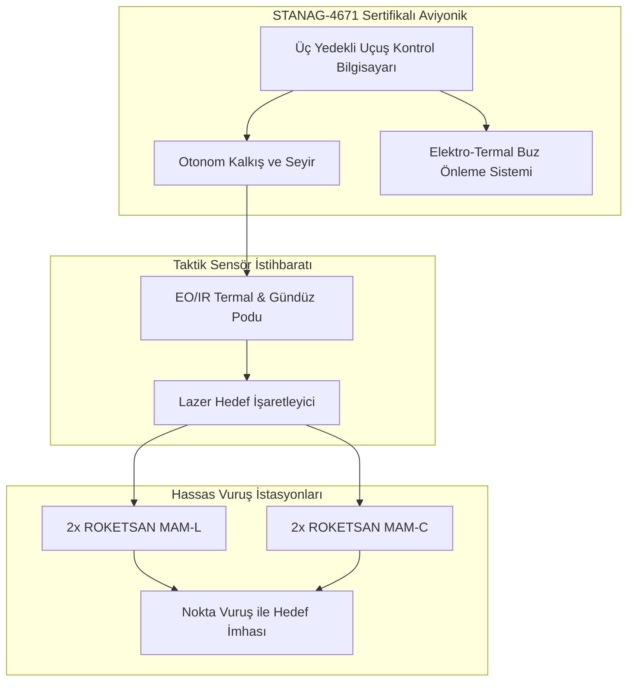

# 🦅 Proje: Lentatek KARAYEL-SU (Silahlı Taktik İHA)

  

## 🛡️ Stratejik Tanım & Doktriner Öncelik
**Lentatek KARAYEL-SU**, Türk savunma sanayiinde NATO sivil ve askeri havacılık uçuşa elverişlilik standartlarına (**STANAG-4671**) bütünüyle uyumlu olarak sıfırdan tasarlanan ve üretilen ilk taktik sınıf silahlı insansız hava aracı sistemidir.

Taktik keşif, gözetleme, hedef tespit ve ROKETSAN akıllı mühimmatları ile cerrahi taarruz icra etmek üzere geliştirilen KARAYEL-SU, kanat hücum kenarlarında yer alan **elektro-termal buz önleme ve giderme membranları** sayesinde en zorlu dondurucu kış koşullarında dahi görev icra edebilmektedir. Üç yedekli aviyonik mimarisi, otonom kalkış-iniş (ATOL) kabiliyeti ve Suudi Arabistan Askeri Sanayii (SAMI / NCMS) ile yapılan ortak üretim ve teknoloji transferi anlaşması (Haboob adıyla) kapsamında binlerce saat muharebe ortamında kanıtlanmış (Combat Proven) yüksek operasyonel güvenilirliğe sahiptir.

## 📊 Kapsamlı Teknik Özellikler

| Parametre | Değer / Özellik | Açıklama |
| :--- | :--- | :--- |
| **Sınıfı** | NATO STANAG-4671 Uyumlu Taktik SİHA | Sivil ve askeri hava sahasında uçuş sertifikalı |
| **Kanat Açıklığı / Uzunluk** | 13.0 Metre / 6.5 Metre | Geniş kanat profili ile yüksek taşıma verimi |
| **Azami Kalkış Ağırlığı (MTOW)** | 630 kg | Optimize edilmiş kompozit gövde yapısı |
| **Faydalı Yük Kapasitesi** | 120 kg (Gövde içi kamera + 4 Kanat Pylonu) | Çoklu mühimmat ve elektro-optik gimbal |
| **Motor Gücü** | 97 HP İçten Yanmalı Havacılık Motoru | Düşük yakıt tüketimi |
| **Havada Kalış Süresi** | 20+ Saat | Kesintisiz taktik hava gözetleme |
| **Servis Tavanı** | 22.500 Feet | Taktik hava savunma menzili üzerinde seyir |
| **Seyir / Azami Sürat** | 60 - 80 Knot / 110 Knot | Kararlı hedef takip sürati |
| **Buz Önleme Sistemi** | Elektro-Termal Kanat Hücum Kenarı Isıtma | Buzlanma şartlarında kesintisiz uçuş |
| **Güdümlü Mühimmat** | ROKETSAN MAM-L ve MAM-C Akıllı Mühimmatları | 4 adede kadar lazer güdümlü mühimmat |

## 🧩 Alt Sistemler ve Aviyonik/Elektronik Entegrasyonu
- **Üç Yedekli Uçuş Kontrol Sistemi:** Sensör, aktüatör ve bilgisayar arızalarında dahi görevi emniyetle tamamlayan hata toleranslı aviyonik mimari.
- **Kritik Buz Giderme Elektroniği:** Kanat yüzeyindeki buzlanmayı otomatik algılayıp ısıtıcı membranları devreye sokan milli buz koruma sistemi.
- **Milli EO/IR Hedefleme Podu:** HD gündüz, soğutmalı termal kamera, lazer mesafe ölçer ve STANAG uyumlu lazer hedef işaretleyici.
- **Kayıp Link Güvenlik Protokolü:** Veri bağı kesilmesi durumunda otonom olarak belirlenen alternatif acil iniş meydanına güvenle geri dönüş.

## 🎯 Görev Profili, Muharebe Senaryoları & Mühimmat Yelpazesi
- **Zorlu Kış ve Dağ Harekâtı:** Kar fırtınası ve buzlanma riski bulunan sınır dağ karakollarında kesintisiz gözetleme ve vuruş desteği.
- **Zırhlı Hedef İmhası:** Kanat altındaki MAM-L mühimmatları ile tespit edilen düşman zırhlı unsurlarını ve mevzilerini cerrahi hassasiyetle vurma.
- **Ortak İhracat Operasyonları:** Yurt dışında Haboob adı altında icra edilen sınır ötesi operasyonel devriyeler.

## 📐 Mimari ve Görev Akış Şeması

## 🚀 TRL Seviyesi ve Gelişim Yol Haritası
- **Mevcut Seviye: TRL 9 (Saha Kanıtlanmış & Seri Üretim)**
- [x] NATO STANAG-4671 Uyumlu Tasarım ve Sertifikasyon
- [x] TSK Kabul Testleri ve Operasyonel Kullanım (2016+)
- [x] ROKETSAN MAM-L ve MAM-C Entegrasyonu ve Başarılı Atışlar
- [x] Yurt Dışı İhracat ve Lisans Altında Ortak Seri Üretim (Combat Proven)
- [ ] SATCOM Uydu Entegrasyonu ve Genişletilmiş Faydalı Yük Varyantı

---
[⬅️ Üst Dizine](../README.md) | [🏛️ Dominion Hub](../../README.md) | [🏠 Ana Sayfa](../../../README.md)
