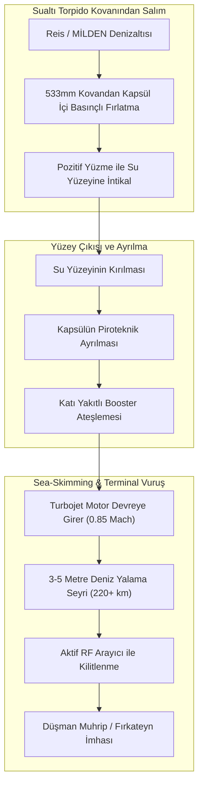

# 🛳️ Proje: ROKETSAN AKATA (Denizaltından Atılan Gemisavar Füzesi)

  

  

## 🛡️ Stratejik Tanım & Doktriner Öncelik
**ROKETSAN AKATA**, Türk Deniz Kuvvetleri'nin modern denizaltı filosu için geliştirilen, denizaltıların dalış derinliğini ve gizliliğini koruyarak su yüzeyine çıkmaksızın 533 mm standart torpido kovanlarından fırlatılabilen kapsüllü bir gemisavar seyir füzesi sistemidir (Sub-surface to Surface).

ATMACA güdümlü mermisi baz alınarak geliştirilen AKATA, hidrodinamik olarak optimize edilmiş özel bir su altı fırlatma kapsülü içerisine yerleştirilmiştir. Kapsül, denizaltı kovanından basınçlı su/gaz marifetiyle fırlatıldıktan sonra su yüzeyine doğru pozitif eğimle yükselir. Su yüzeyini kırdığı anda füzenin katı yakıtlı fırlatma motoru (booster) ateşlenir, kapsül gövdeden ayrılarak turbojet motoru devreye girer. Deniz yüzeyinin birkaç metre üzerinden uçan (Sea-Skimming) AKATA, 220+ km mesafedeki düşman fırkateyn, muhrip ve amfibi çıkarma gemilerini 220 kg harp başlığı ile vurarak Mavi Vatan'ın su altındaki caydırıcı yumruğunu oluşturur.

## 📊 Kapsamlı Teknik Özellikler

| Parametre | Değer / Özellik | Açıklama |
| :--- | :--- | :--- |
| **Fırlatma Platformu** | 533 mm Standart Torpido Kovanı | Sualtı kapsülü ile gizli fırlatma |
| **Operasyonel Menzil** | 220+ km | Düşman filo savunma menzili dışından vuruş |
| **Seyir Hızı** | 0.85 Mach (Yüksek Subsonik) | Radara yakalanmadan hızlı yaklaşma |
| **Seyir İrtifası** | Deniz Yalama (Sea-Skimming - 3 ila 5 Metre) | Radar ufku altında tespit edilemez profil |
| **Güdüm Mimarisi** | ANS + KKS + Radar Altimetre + Aktif RF Başlık | Karıştırmaya tam dayanıklı terminal güdüm |
| **Harp Başlığı** | 220 kg Yüksek İnfilaklı Zırh Delici Başlık | Savaş gemisi omurgasını kırıcı tahrip gücü |
| **Tahrik Ünitesi** | Katı Yakıtlı Booster + Sıvı Yakıtlı Turbojet Motoru | Çift kademeli su üstü ivmelenme ve seyir |
| **Uyumlu Denizaltılar** | Reis Sınıfı (Tip 214 AIP), MİLDEN, Preveze/Gür Sınıfı | Türk Donanması denizaltı envanteri |

## 🧩 Alt Sistemler ve Aviyonik/Elektronik Entegrasyonu
- **Hidrodinamik Sualtı Fırlatma Kapsülü:** Denizaltı kovan basıncına dayanıklı, yüzeye çıkış açısını dengeleyen kanatçıklı özel kapsül yapısı.
- **Su Çıkış Sensörü & Ayrılma Mekaniği:** Kapsülün su yüzeyine çıktığı milisaniyede burun kapağını fırlatarak füzeyi serbest bırakan piroteknik sistem.
- **Aktif RF Arayıcı Başlık:** ASELSAN tasarımı gelişmiş hedef tespit ve elektronik karşı-karşı tedbirlere (ECCM) sahip radar başlık.
- **MÜREN & ADVENT Denizaltı Savaş Yönetim Sistemi Entegrasyonu:** Torpido kovanından fırlatılmadan önce son hedef koordinatlarının füzeye yüklenmesi.

## 🎯 Görev Profili, Muharebe Senaryoları & Mühimmat Yelpazesi
- **Derin Sualtı Pusu Harekâtı:** Denizaltı derin dalışta beklerken yüzlerce mil uzaktaki düşman uçak gemisi görev grubuna gizli taarruz.
- **Kıyı Kuşatmasını Yarma:** Düşman deniz devriye uçakları havada cirit atarken konumunu ifşa etmeksizin kritik su üstü hedeflerini saf dışı bırakma.
- **Düşman Liman ve Lojistik Hatlarını Vurma:** Stratejik düşman deniz üslerinin girişindeki koruma korvetlerine stand-off saldırı.

## 📐 Mimari ve Görev Akış Şeması

## 🚀 TRL Seviyesi ve Gelişim Yol Haritası
- **Mevcut Seviye: TRL 7 (Operasyonel Ortamda Prototip Doğrulandı)**
- [x] Kapsül Hidrodinamik ve Akışkanlar Dinamiği Analizleri
- [x] Karadan ve Test Havuzundan Kapsül Ayrılma Doğrulamaları
- [x] Denizaltı Torpido Kovanı Entegrasyon Testleri
- [ ] Denizaltından Canlı Atış ve Su Üstü Hedef İmha Fazı
- [ ] Reis Sınıfı Denizaltılar ile Operasyonel Göreve Başlama

---
[⬅️ Üst Dizine](../README.md) | [🏛️ Dominion Hub](../../README.md) | [🏠 Ana Sayfa](../../../README.md)
