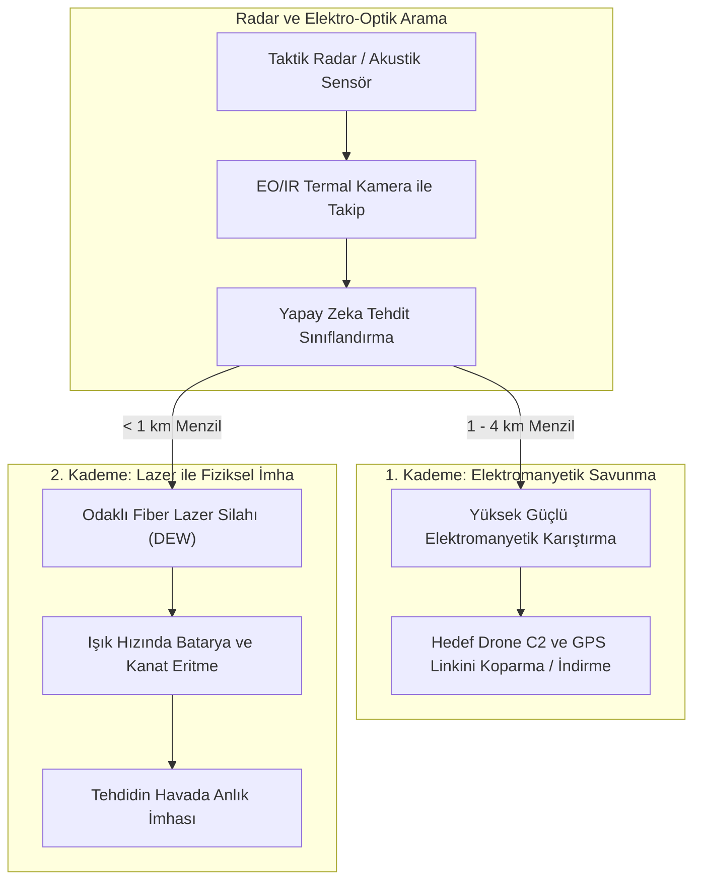

# ⚡ Proje: ROKETSAN ALKA Yönlendirilmiş Enerji Silah Sistemi (YESS)

[

  

](../../../docs/TRL_GUIDE.md)

## 🛡️ Stratejik Tanım & Doktriner Öncelik
**ROKETSAN ALKA Yönlendirilmiş Enerji Silah Sistemi (YESS)**, modern harekât sahasında asimetrik bir tehdide dönüşen mikro ve mini insansız hava araçları (İHA/Drone sürüleri), el yapımı patlayıcılar (EYP) ve yol kenarı bombalarına karşı geliştirilmiş, elektromanyetik karıştırma ve yüksek güçlü lazer teknolojisini tek bir platformda birleştiren hibrit bir yakın hava ve üs savunma sistemidir.

ALKA, iki kademeli savunma konseptine sahiptir: Birinci kademede **Yüksek Güçlü Elektromanyetik Karıştırma (HPEM)** teknolojisiyle hedef droneların komuta-kontrol ve seyrüsefer frekanslarını kör ederek güvenli bir mesafede etkisiz kılar veya sürüleri dağıtır. İkinci kademede ise yüksek hassasiyetli odaklama yeteneğine sahip **Lazer Silahı (Laser DEW)** devreye girerek ışık hızında tehdidin gövdesini ve bataryasını eritir, saniyeler içinde fiziksel olarak imha eder. Düşük atım maliyeti (yalnızca elektrik enerjisi) ve sınırsız mühimmat kapasitesi ile kritik tesislerin vazgeçilmez kalkanıdır.

## 📊 Kapsamlı Teknik Özellikler

| Parametre | Değer / Özellik | Açıklama |
| :--- | :--- | :--- |
| **Sistem Türü** | Yönlendirilmiş Enerji Silah Sistemi (YESS / DEW) | Çift kademeli Lazer + Elektromanyetik Hibrit |
| **Lazer Güç Çıktısı** | 2.5 kW - 10+ kW Ölçeklenebilir Fiber Lazer | Hedef malzemeyi anında eritebilen odaklanma |
| **Lazer İmha Menzili** | 500 m - 1.000 m (Mini İHA ve EYP Fiziksel İmha) | Işık hızında cerrahi müdahale |
| **Elektromanyetik (HPEM) Menzil** | 1.000 m - 4.000 m (Yönlü Frekans Karıştırma) | Sürü İHA'ları ve C2 bağlarını engelleme |
| **Hedef Takip Sistemi** | Entegre Elektro-Optik Takip Radarı ve Termal Kamera | Yapay zeka destekli otonom hedef tespiti |
| **Reaksiyon Süresi** | Milisaniye Düzeyinde Anlık Angajman | Işık hızında hedef transferi |
| **Platform Seçenekleri** | Zırhlı Kara Aracı Üzeri Mobil veya Sabit Kule | Taktik tekerlekli zırhlı araç entegrasyonu |
| **Mühimmat Maliyeti** | Atım Başına Yalnızca Elektrik Tüketimi (Sıfır Mühimmat) | Konvansiyonel mermilere kıyasla ultra ekonomik |

## 🧩 Alt Sistemler ve Aviyonik/Elektronik Entegrasyonu
- **Yüksek Güçlü Katı Hal / Fiber Lazer Ünitesi:** ROKETSAN mühendisliği odaklanabilir optik ayna grubu ve su soğutmalı lazer rezonatörü.
- **Yapay Zeka Destekli Otomatik Hedef Tespit ve Takip (EO/IR):** Gökyüzündeki kuşlar ile droneları ayırt eden, hedefin en zayıf noktasına (batarya veya motor bloğu) kilitlenen akıllı kamera mimarisi.
- **HPEM Yönlendirilmiş Elektromanyetik Jammer:** Geniş spektrumda GNSS ve ISM bantlarını eşzamanlı karıştırabilen mikrodalga hüzmeleyiciler.
- **Enerji Depolama ve Hızlı Deşarj Modülü:** Süperkapasitör ve yüksek yoğunluklu lityum batarya bankası ile jeneratörden bağımsız sürekli atış kabiliyeti.

## 🎯 Görev Profili, Muharebe Senaryoları & Mühimmat Yelpazesi
- **Drone Sürüsü Doygunluk Savunması:** Askeri üslere yaklaşan koordineli 20+ mini dronun HPEM ile dağıtılması ve lazerle tek tek yakılması.
- **Tuzaklanmış EYP ve Mayınların Uzaktan İmhası:** Bomba imha ekiplerini riske atmadan güvenli mesafeden lazerle patlatılarak nötralize edilmesi.
- **Havalimanı ve Kritik Enerji Rafinerisi Koruma:** Sivil hava trafiğini aksatmadan sadece tehdit oluşturan yetkisiz droneları cerrahi olarak düşürme.

## 📐 Mimari ve Görev Akış Şeması

## 🚀 TRL Seviyesi ve Gelişim Yol Haritası
- **Mevcut Seviye: TRL 8 (Sistem Kalifiye / Ön Seri Üretim)**
- [x] Lazer ve HPEM Laboratuvar Doğrulamaları Tamamlandı
- [x] Hareketli Drone ve EYP Hedeflerine Karşı Atışlı Saha Testleri
- [x] Zırhlı Araç Üzerine Mobil Entegrasyon Başarısı
- [x] Cumhurbaşkanlığı ve Kritik Tesis Koruma Görevlerinde Saha Dağıtımı
- [ ] Gemi Konuşlu Marinize ALKA Sisteminin Donanmaya Entegrasyonu

---
[⬅️ Üst Dizine](../README.md) | [🏛️ Dominion Hub](../../README.md) | [🏠 Ana Sayfa](../../../README.md)
