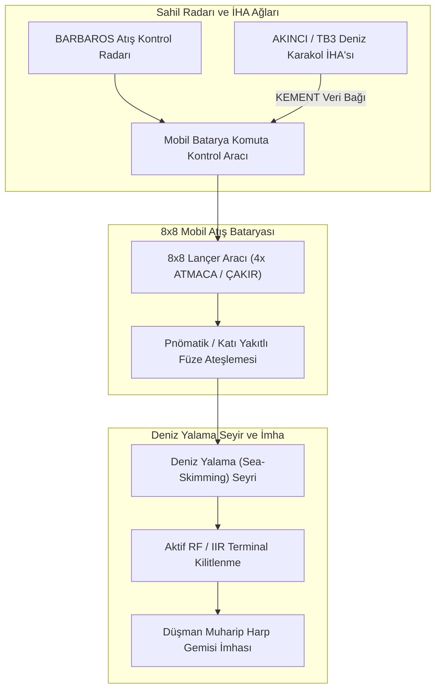

# 🛳️ Proje: ROKETSAN BARBAROS Kıyı Savunma Sistemi

[

  

](../../../docs/TRL_GUIDE.md)

## 🛡️ Stratejik Tanım & Doktriner Öncelik
**ROKETSAN BARBAROS Kıyı Savunma Sistemi**, Türkiye'nin Mavi Vatan kıyı şeritlerini, stratejik adalarını, boğazlarını ve deniz yetki alanlarını düşman su üstü muharip gemilerine, korvetlerine, fırkateynlerine ve amfibi çıkarma filolarına karşı korumak üzere geliştirilmiş yüksek hareket kabiliyetine sahip taktik mobil batarya sistemidir.

BARBAROS, Türk Donanması'nın milli vuruş gücü olan **ATMACA** (220+ km) ve yeni nesil çok maksatlı **ÇAKIR** (150+ km) seyir füzelerini tek bir komuta kontrol çatısı altında ateşleyebilme esnekliğine sahiptir. 8x8 taktik tekerlekli ağır arazi araçları üzerine konuşlu fırlatma lançerleri, kıyı gözetleme radarları ve sahil gözetleme uçakları/İHA'lar ile taktik veri bağı (KEMENT/Link-16) üzerinden tam entegre çalışır. "Vur-Kaç" kabiliyeti sayesinde ateşleme yaptıktan dakikalar sonra mevzi değiştirerek düşman hava ve karşı-batarya taarruzlarından sıyrılır.

## 📊 Kapsamlı Teknik Özellikler

| Parametre | Değer / Özellik | Operasyonel Açıklama |
| :--- | :--- | :--- |
| **Sistem Konfigürasyonu** | Mobil Kıyı Savunma Bataryası | Komuta Aracı + Radar Aracı + 4x Fırlatma Aracı |
| **Entegre Mühimmatlar** | ROKETSAN ATMACA & ROKETSAN ÇAKIR | Çift füze ailesi ile kademeli kıyı kalkanı |
| **Maksimum Angajman Menzili**| 220+ km (ATMACA ile) / 150+ km (ÇAKIR ile) | Açık deniz kontrolü ve boğaz emniyeti |
| **Taşıyıcı Platform** | 8x8 Ağır Taktik Tekerlekli Lançer Aracı | Zorlu arazi şartlarında yüksek sürat ve mobilite |
| **Lançer Başına Füze Kapasitesi**| 4 Adet ATMACA Konteyneri veya 6+ ÇAKIR Konteyneri| Yüksek salvo ateş gücü |
| **Güdüm Mimarisi** | ANS + KKS + Radar Altimetre + Aktif RF / IIR | Terminal deniz yalama ve elektronik harp bağışıklığı |
| **Harekete Geçme Süresi** | < 15 Dakika (Mevzilenme ve Atışa Hazır Olma) | Hızlı intikal ve atış sonrası süratli mevzi terk |
| **Haberleşme & Link** | KEMENT Güvenli Taktik Veri Bağı + Askeri Telsiz | Deniz Kuvvetleri ADVENT C2 ağına tam entegre |

## 🧩 Alt Sistemler ve Aviyonik/Elektronik Entegrasyonu
- **Mobil Batarya Komuta Kontrol Aracı:** Kıyı radarları, İHA ve uydu verilerini füzyonlayarak taktik deniz resmini oluşturan ve atış emrini yöneten harekat merkezi.
- **Kıyı Gözetleme ve Atış Kontrol Radarı:** Düşman su üstü filolarını ufuk ötesinden tespit edip füzeler için ara safha koordinat üreten faz dizili radar.
- **KEMENT Veri Bağı Entegrasyonu:** Füze fırlatıldıktan sonra havada iken yeni hedef bilgisi gönderebilme, hedef güncelleme veya görevi iptal etme yeteneği.
- **Stabilize Hidrolik Lançer Ünitesi:** Arazi eğimini otomatik dengeleyerek konteynerleri atış açısına kaldıran bağımsız hidrolik ayaklar.

## 🎯 Görev Profili, Muharebe Senaryoları & Mühimmat Yelpazesi
- **Stratejik Boğazların Kapatılması:** Çanakkale ve İstanbul Boğazı yaklaşımlarında düşman muharip gemilerinin geçişini 220 km uzaktan kilitleme.
- **Adalar Denizi & Kıyı Kalkanı:** Dağlık ve ormanlık kıyı girintilerine gizlenerek fırkateynleri radar ufku altından deniz yalama uçuşuyla vurma.
- **Amfibi Harekât Önleme:** Düşman çıkarma gemileri ve refakat korvetlerini kıyıya yaklaşmadan salvo taarruzla imha etme.

## 📐 Mimari ve Görev Akış Şeması

## 🚀 TRL Seviyesi ve Gelişim Yol Haritası
- **Mevcut Seviye: TRL 8 (Sistem Kalifiye / Envanter Dağıtımında)**
- [x] Mobil Lançer ve Komuta Aracı Entegrasyonu Tamamlandı
- [x] Kıyıdan Deniz Hedefine ATMACA Atışlı Test Başarısı
- [x] ÇAKIR Füzesi Kıyı Lançeri Doğrulama Testleri
- [x] Deniz Kuvvetleri Kabul Süreçleri ve İlk Batarya Teslimatları
- [ ] Mavi Vatan Kıyı Hatlarında Tam Bütünleşik Batarya Konuşlandırmaları

---
[⬅️ Üst Dizine](../README.md) | [🏛️ Dominion Hub](../../README.md) | [🏠 Ana Sayfa](../../../README.md)
