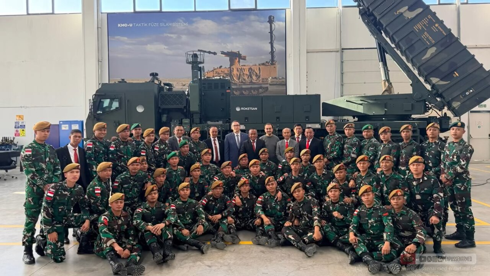
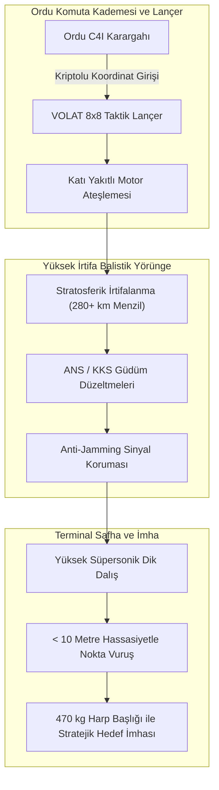

# 🚀 Proje: ROKETSAN BORA Taktik Balistik Füze Sistemi (SRBM)

  

## 🛡️ Stratejik Tanım & Doktriner Öncelik
**ROKETSAN BORA**, Türk Kara Kuvvetleri'nin derin harekât sahasında yüksek öncelikli düşman stratejik hedeflerini, komuta kontrol karargahlarını, hava savunma radar tesislerini, mühimmat depolarını ve toplanma alanlarını her türlü hava koşulunda nokta atışıyla imha etmek üzere geliştirilmiş kısa menzilli taktik balistik füze (SRBM - Short-Range Ballistic Missile) sistemidir.

610 mm çapı, yaklaşık 2.500 kg fırlatma ağırlığı ve 470 kg yüksek infilaklı parçacık tesirli/delici harp başlığı ile BORA, VOLAT 8x8 taktik tekerlekli fırlatma aracı üzerinden süratle intikal edip mevzilenir. Küresel Konumlama Destekli Ataletsel Navigasyon Sistemi (ANS/KKS) ve ASELSAN tasarımı çok kanallı CRPA Anti-Jamming anten koruması sayesinde yoğun elektronik karıştırma şartlarında dahi 10 metrenin altında dairesel sapma (CEP) ile cerrahi vuruş gerçekleştirir. Sınır ötesi operasyonlarda başarıyla kullanılmış (Combat Proven) ve uluslararası pazarda **KHAN** adıyla ihraç edilmiştir.

## 📊 Kapsamlı Teknik Özellikler

| Parametre | Değer / Standart | Açıklama |
| :--- | :--- | :--- |
| **Sınıfı** | SRBM (Kısa Menzilli Taktik Balistik Füze) | Yüksek tahrip güçlü stratejik caydırıcı |
| **Çap / Ağırlık** | 610 mm / ~2.500 kg | Ağır balistik roket geometrisi |
| **Operasyonel Menzil** | 280+ km | Düşman derinliklerindeki stratejik hedeflere erişim |
| **Harp Başlığı** | 470 kg Yüksek İnfilaklı Parçacıklı veya Delici | Geniş alan tahribatı ve beton korugan delme |
| **Güdüm Mimarisi** | ANS (RLG) + KKS (GPS/GLONASS) + CRPA Anti-Jam | Karıştırmaya dayanıklı yüksek hassasiyet |
| **Hassasiyet (CEP)** | < 10 Metre | Balistik sınıfta cerrahi nokta vuruş |
| **Tahrik Ünitesi** | İleri Kompozit Katı Yakıtlı Roket Motoru | Hızlı ateşleme ve yüksek ivmelenme |
| **Fırlatma Aracı** | VOLAT 8x8 Ağır Taktik Tekerlekli Araç | İki adet füze taşıma ve fırlatma podu |
| **Terminal Dalış Sürati** | Yüksek Süpersonik / Hipersonik Geçiş | Hava savunma önleme ihtimalini sıfırlayan profil |

## 🧩 Alt Sistemler ve Aviyonik/Elektronik Entegrasyonu
- **Gelişmiş Ataletsel Seyrüsefer Ünitesi (ANS):** Lazer halkalı jiroskoplar (RLG) ile uydudan bağımsız olarak yüksek hassasiyetli balistik yörünge takibi.
- **Anti-Jamming CRPA Donanımı:** Düşman elektronik harp sistemlerinin GPS sinyallerini bastırma veya yanıltma girişimlerini filtreleyen çoklu hüzme anteni.
- **Elektro-Mekanik Aerodinamik Kontrol Kanatçıkları:** Atmosfer içi ve terminal dalış safhasında füzeye milimetrik yörünge düzeltmesi yaptıran servo aktüatörler.
- **VOLAT 8x8 Atış Kontrol ve Lançer Elektroniği:** Dijital harita üzerinden koordinat alan, otomatik hidrolik seviyeleme yapan zırhlı kabinli lançer.

## 🎯 Görev Profili, Muharebe Senaryoları & Mühimmat Yelpazesi
- **Hava Üslerinin Felç Edilmesi:** Düşman savaş uçaklarının konuşlandığı pistleri, taksi yollarını ve hangarları dik açılı balistik vuruşla kullanılmaz hale getirme.
- **Stratejik C4I Merkezlerinin İmhası:** Derin karargah binalarını ve radar kulelerini yoğun hava savunma korumasına rağmen yüksek süratle vurma.
- **Karşı-Batarya ve Lojistik Taarruzu:** Düşman çok namlulu roketatar mevzilerini ve yakıt/mühimmat lojistik merkezlerini tek atışla imha etme.

## 📐 Mimari ve Görev Akış Şeması

## 🚀 TRL Seviyesi ve Gelişim Yol Haritası
- **Mevcut Seviye: TRL 9 (Saha Kanıtlanmış & Seri Üretim)**
- [x] Tasarım, Motor Doğrulama ve İlk Atış Testleri Tamamlandı
- [x] Kalifikasyon Testleri ve Sinop Atış Alanı Başarıları
- [x] TSK Envanterine Giriş ve Seri Üretim Dağıtımı (2017+)
- [x] Sınır Ötesi Terörle Mücadele Harekâtlarında Başarılı Kullanım (Combat Proven)
- [x] KHAN Versiyonu ile Dost ve Müttefik Ülkelere Başarılı İhracat

---
[⬅️ Üst Dizine](../README.md) | [🏛️ Dominion Hub](../../README.md) | [🏠 Ana Sayfa](../../../README.md)
