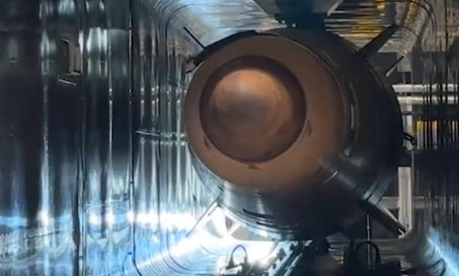
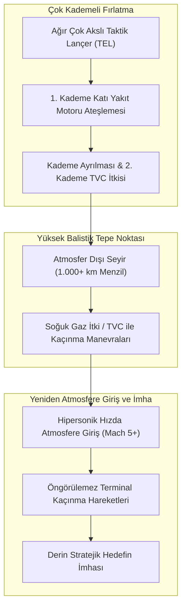

# 🎯 Proje: ROKETSAN CENK Orta Menzilli Balistik Füze (MRBM)

  

## 🛡️ Stratejik Tanım & Doktriner Öncelik
**ROKETSAN CENK**, Türkiye'nin BORA ve TAYFUN balistik füze programları ile elde ettiği kompozit roket gövdesi, katı yakıt kimyası, aerodinamik kontrol ve yüksek irtifa atmosfer dışı seyrüsefer yetkinliklerini kıtalararası eşiğe taşıyan **Orta Menzilli Balistik Füze (MRBM - Medium-Range Ballistic Missile)** sistemidir.

1.000+ km hedef menzil skalası ile Türkiye'nin bölgesel jeopolitik caydırıcılık doktrininde en üst seviye stratejik vurucu gücü temsil eden CENK, ağır çok akslı taktik taşıyıcı-fırlatıcı (TEL) aracı üzerinden fırlatılır. Çok kademeli ileri katı yakıtlı itki mimarisi, itki vektör yönlendirme (TVC) nozulları ve atmosfer dışı manevra kanatçıkları ile donatılan sistem, terminal safhada anti-balistik füze (ABM) hava savunma sistemlerinin önleme yörüngelerini boşa çıkaran kaçınma manevraları icra ederek hedefe hipersonik süratle dik dalış yapar.

## 📊 Kapsamlı Teknik Özellikler

| Parametre | Değer / Özellik | Açıklama |
| :--- | :--- | :--- |
| **Sınıfı** | MRBM (Orta Menzilli Balistik Füze) | Stratejik bölgesel caydırıcılık |
| **Operasyonel Menzil Hedefi**| 1.000+ km | Bölgesel güç dengesini değiştiren menzil |
| **Tahrik Mimarisi** | Çok Kademeli İleri Kompozit Katı Yakıtlı Motor | Yüksek yanma verimi ve spesifik itki |
| **Güdüm ve Kontrol** | Gaz Dinamiği Kanatçıklar + İtki Vektör Yönlendirme (TVC) | Atmosfer içi ve dışı tam üç eksenli yönelim |
| **Seyrüsefer Mimarisi** | ANS (Lazer Jiroskop) + KKS + Terminal Arayıcı | Elektronik harbe tam bağışık seyrüsefer |
| **Harp Başlığı** | Özel Geometrik Nüfuz Edici ve Parçacıklı Başlık | Stratejik derin komuta sığınaklarını delme |
| **Terminal Hız** | Hipersonik (Mach 5+) | Düşman füze savunma sistemlerini aşma |
| **Fırlatma Aracı** | Çok Akslı Ağır Arazi Lançeri (TEL) | Yüksek mobilite ve süratli atış kabiliyeti |

## 🧩 Alt Sistemler ve Aviyonik/Elektronik Entegrasyonu
- **İtki Vektör Kontrol Sistemi (TVC):** Roket motor nozullarını elektro-mekanik aktüatörlerle hareket ettirerek roketin fırlatma ve kademe ayrılma fazında yönlendirilmesi.
- **Atmosfer Dışı Soğuk Gaz İtki Sistemi:** Füzenin atmosferin en üst katmanlarında ve uzay sınırında yörünge düzeltme ve kaçınma manevraları yapabilmesini sağlayan mikro iticiler.
- **Milli Katı Yakıt Kimyası:** ROKETSAN tesislerinde sentezlenen yüksek enerji yoğunluklu kompozit yakıt kimyası.
- **Milli Görev Bilgisayarı ve Şifreli Veri Bağı:** Düşman elektronik saldırılarına karşı donanımsal olarak izole edilmiş yedekli aviyonik mimari.

## 🎯 Görev Profili, Muharebe Senaryoları & Mühimmat Yelpazesi
- **Bölgesel Stratejik Caydırıcılık:** Türkiye'ye yönelebilecek kitle imha silahı veya balistik tehdit kaynaklarını kendi sahasında etkisiz kılma taahhüdü.
- **Derin Sığınak ve Nükleer Tesis İmhası:** Hipersonik terminal kinetik enerji ve delici başlık kombinasyonuyla onlarca metre yer altındaki korunakları yok etme.
- **Balistik Füze Savunmalarını Doyurma ve Aşma:** Öngörülemez terminal manevralar ile Patriot, Arrow veya S-400 benzeri sistemlerin angajman algoritmalarını kırma.

## 📐 Mimari ve Görev Akış Şeması

## 🚀 TRL Seviyesi ve Gelişim Yol Haritası
- **Mevcut Seviye: TRL 6 (İlgili Ortamda Sistem Modeli Doğrulandı)**
- [x] Çok Kademeli Motor Tasarımı ve Statik Yer Testleri
- [x] İtki Vektör Kontrol (TVC) Mekanizması Doğrulamaları
- [x] Lançer ve Test Uçuşları Gösterimi
- [ ] Tam Menzilli Uçuş ve Yörünge Doğrulama Atışları
- [ ] Seri Üretim Hattı Kurulumu ve TSK Stratejik Kuvvetlerine Teslimat

---
[⬅️ Üst Dizine](../README.md) | [🏛️ Dominion Hub](../../README.md) | [🏠 Ana Sayfa](../../../README.md)
