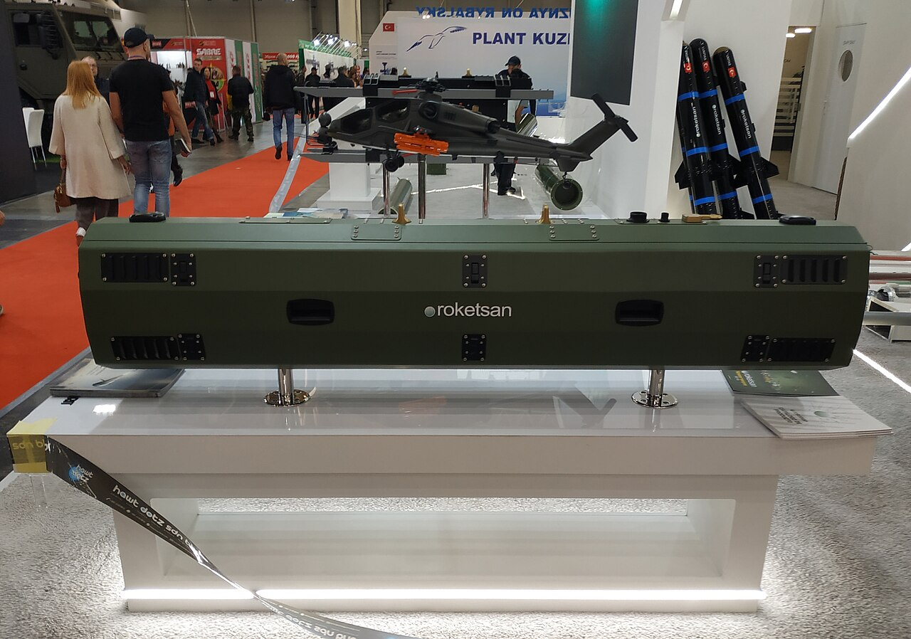
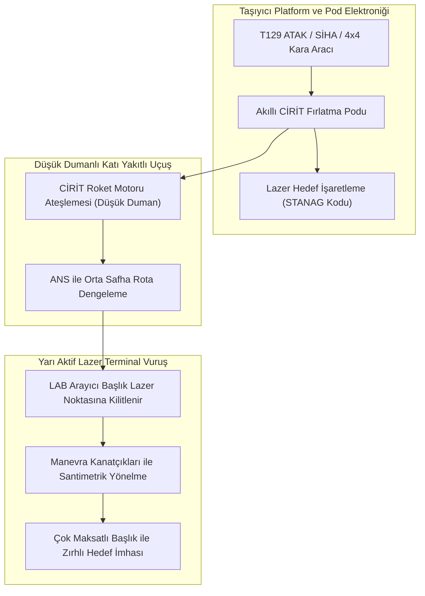

# 🚀 Proje: ROKETSAN CİRİT 2.75" Lazer Güdümlü Füze

  

## 🛡️ Stratejik Tanım & Doktriner Öncelik
**ROKETSAN CİRİT**, dünya havacılık ve mühimmat pazarında 2.75 inç (70 mm) kalibrede geliştirilmiş ilk lazer güdümlü helikopter füzesi olma unvanına sahip, küresel savunma çevrelerinde bir dönüm noktası kabul edilen hafif taarruz mühimmatıdır.

Klasik güdümsüz roketlerin düşük maliyet ve yüksek atım adedi avantajı ile akıllı tanksavar füzelerinin hassas vuruş üstünlüğü arasındaki boşluğu kapatmak üzere tasarlanmıştır. Yarı aktif lazer arayıcı başlığı (LAB) sayesinde 1.5 ila 8 km menzildeki sabit ve hareketli hafif zırhlı araçları, koruganları, keskin nişancı mevzilerini ve sürat botlarını metre altı hassasiyetle imha eder. T129 ATAK taarruz helikopterleri, SİHA'lar, hafif zırhlı taktik kara araçları, sabit kanatlı yakın hava destek uçakları (HÜRKUŞ-C) ve hücumbotlara entegre edilebilen çok platformlu mimarisiyle yaygın uluslararası ihracat başarısına sahiptir.

## 📊 Kapsamlı Teknik Özellikler

| Parametre | Değer / Özellik | Açıklama |
| :--- | :--- | :--- |
| **Kalibre / Çap** | 70 mm (2.75 Inç) | Standart NATO roket tüpü boyutları |
| **Operasyonel Menzil** | 1.5 km - 8.0 km | Helikopter ve SİHA'lar için ideal taktik menzil |
| **Toplam Ağırlık** | ~15 kg | Kompakt ve hafif füze mimarisi |
| **Güdüm Mimarisi** | ANS Destekli Yarı Aktif Lazer Arayıcı (LAB) | Karıştırmaya karşı kodlu lazer darbe takibi |
| **Harp Başlığı Tipleri**| Çok Maksatlı (Zırh Delici, Anti-Personel, Yangın Çıkarıcı) | Esnek hedef imha kabiliyeti |
| **Motor Tipi** | Düşük Dumanlı Kompozit Katı Yakıtlı Roket Motoru | Görünür iz bırakmayan gizli atış |
| **Atış Platformları** | T129 ATAK, AH-1W Cobra, AKINCI, KARAYEL, HÜRKUŞ, Zırhlı 4x4 | Kara, deniz ve hava çoklu entegrasyon |
| **Akıllı Pod Seçenekleri**| 2'li, 4'lü ve MIL-STD-1760 Akıllı Salan Tüpleri | Mühimmat veri arayüzü ve durum takibi |

## 🧩 Alt Sistemler ve Aviyonik/Elektronik Entegrasyonu
- **Yarı Aktif Lazer Arayıcı Başlık (LAB):** Hedefe yöneltilen STANAG 3733 uyumlu lazer noktasını algılayarak füzeyi santimetre hassasiyetle yönlendiren dedektör.
- **Orta Safha Ataletsel Düzeltme (ANS):** Lazer kilidi geçici olarak duman veya toz nedeniyle kesilse dahi füzeyi hedefin öngörülen rotasında tutan ataletsel algoritmalar.
- **Düşük Dumanlı Katı Yakıtlı Motor:** Helikopter motorlarının duman yutmasını (Flameout) engelleyen ve fırlatıldığı noktayı düşmana ifşa etmeyen ileri kimyasal yakıt.
- **Akıllı Pod Mimarisi:** Helikopter kokpitindeki sayısal görev bilgisayarına her bir CİRİT füzesinin envanter, sıcaklık ve kilitlenme hazır durumunu ileten pod elektroniği.

## 🎯 Görev Profili, Muharebe Senaryoları & Mühimmat Yelpazesi
- **Asimetrik Tehditlerin İmhası:** Mağara ağızları, hafif zırhlı pikaplar ve terör unsurlarına karşı sivil çevreye minimum ikincil hasarla cerrahi vuruş.
- **Deniz Karakol Botlarının Korunması:** Hücumbotlara yaklaşan düşman asimetrik intihar botlarını 8 km mesafeden lazerle avlama.
- **SİHA'lardan Hafif Zırhlı Konvoy Taarruzu:** AKINCI ve diğer platformlardan tek sortide onlarca CİRİT atarak konvoyları durdurma.

## 📐 Mimari ve Görev Akış Şeması

## 🚀 TRL Seviyesi ve Gelişim Yol Haritası
- **Mevcut Seviye: TRL 9 (Saha Kanıtlanmış & Seri Üretim)**
- [x] Dünyanın İlk Lazer Güdümlü 70mm Helikopter Füzesi Olarak Kalifiye Edildi
- [x] T129 ATAK ve AH-1W Cobra Envanterine Standart Mühimmat Olarak Girdi
- [x] Birleşik Arap Emirlikleri ve Çok Sayıda Müttefik Ülkeye İhraç Edildi
- [x] SİHA, İnsansız Kara Aracı ve Hücumbot Entegrasyonları Başarıyla Tamamlandı
- [ ] Yeni Nesil Genişletilmiş Menzil ve Gelişmiş Lazer Arayıcı Başlık Çalışmaları

---
[⬅️ Üst Dizine](../README.md) | [🏛️ Dominion Hub](../../README.md) | [🏠 Ana Sayfa](../../../README.md)
