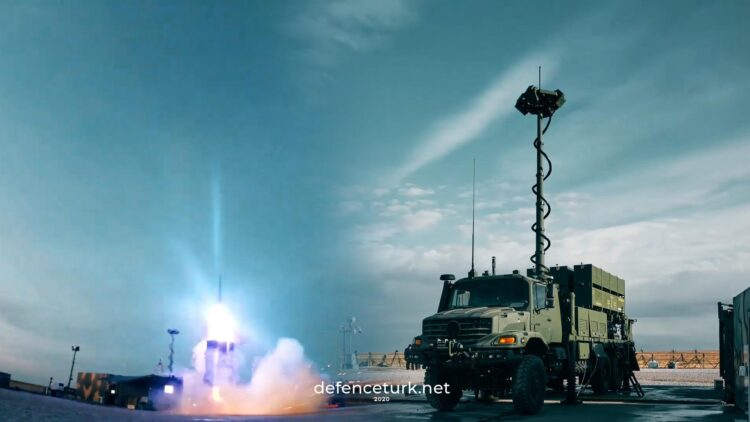
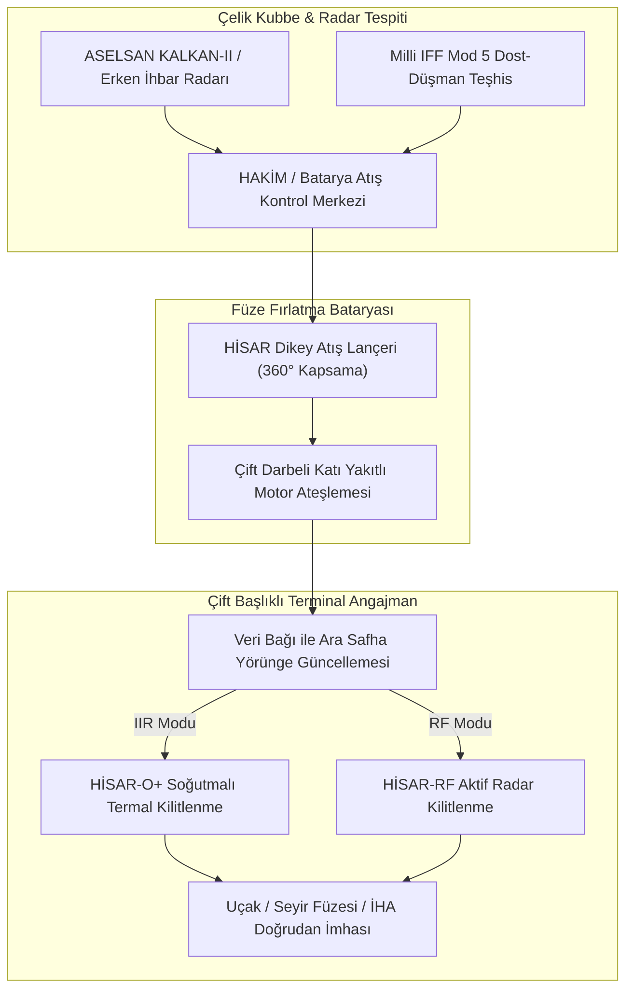

# 🛡️ Proje: ROKETSAN & ASELSAN HİSAR Hava Savunma Füze Ailesi (A+ / O+ / RF)

  

## 🛡️ Stratejik Tanım & Doktriner Öncelik
**HİSAR Hava Savunma Füze Ailesi**, Türkiye'nin milli entegre katmanlı hava savunma şemsiyesi olan **Çelik Kubbe** mimarisinin alçak ve orta irtifadaki bel kemiğini oluşturan, ROKETSAN ve ASELSAN ortaklığı ile geliştirilmiş milli füze sistemidir.

Askeri üslerin, limanların, kritik sanayi tesislerinin ve zırhlı birliklerin hava tehditlerinden korunması amacıyla geliştirilen sistem; savaş uçakları, taarruz helikopterleri, seyir füzeleri, insansız hava araçları ve havadan karaya fırlatılan mühimmatlara karşı 360 derece kesintisiz koruma sağlar. **HİSAR-A+** (paletli zırhlı araç üzeri, alçak irtifa), **HİSAR-O+** (6x6 taktik tekerlekli, orta irtifa) ve aktif radar arayıcı başlıklı **HİSAR-RF** konfigürasyonları ile her türlü arazi ve harekât şartında tam bağımsız batarya ve filo düzeyinde görev icra eder.

## 📊 Kapsamlı Teknik Özellikler

| Model / Varyant | Önleme Menzili | Servis İrtifası | Arayıcı Başlık Mimarisi | Taşıyıcı Platform |
| :--- | :--- | :--- | :--- | :--- |
| **HİSAR-A+** | 15+ km | 8 km | Soğutmalı IIR (Kızılötesi Görüntüleyici) | FNSS Zırhlı Paletli Şasi |
| **HİSAR-O+** | 25+ km | 15 km | Soğutmalı IIR (Kızılötesi Görüntüleyici) | BMC 6x6 Taktik Tekerlekli Lançer |
| **HİSAR-RF** | 35+ km | 20 km | Aktif RF (Milimetrik Dalga Radar Başlık) | BMC 6x6 / Konteyner Lançer |
| **Fırlatma Şekli** | Dikey Fırlatma (360° Tehdit Karşılama) | Dikey Soğuk/Sıcak Fırlatma | Anlık reaksiyon |
| **Tahrik Mimarisi**| Çift Darbeli (Dual-Pulse) Katı Yakıtlı Motor | Terminal fazda ikinci darbe ile yüksek G manevrası |
| **Harp Başlığı** | Yüksek İnfilaklı Parçacık Tesirli Başlık | Lazer yaklaşma tapası ile doğrudan veya yakın vuruş |
| **Entegrasyon** | Çelik Kubbe / HAKİM C2 / Link-16 / KEMENT | Milli hava resmi üzerinden ağ merkezli angajman |

## 🧩 Alt Sistemler ve Aviyonik/Elektronik Entegrasyonu
- **Çift Darbeli (Dual-Pulse) Roket Motoru:** ROKETSAN tasarımı; ilk darbe ile füzeyi fırlatıp irtifa kazandıran, terminal aşamada ikinci darbeyi ateşleyerek hedefe yaklaşırken maksimum manevra enerjisi sağlayan motor mimarisi.
- **ASELSAN KALKAN / Erken İhbar Radarı:** Hedefleri 60+ km menzilden tespit eden, çoklu hedef takibi ve dost-düşman teşhisi (IFF) yapan 3 boyutlu radar.
- **IIR & RF Arayıcı Başlık Seçenekleri:** Yoğun elektronik karıştırmada IIR (kızılötesi) başlıkla hedefin sıcak noktasına yönelme; kötü hava koşullarında ise RF radar başlıkla tam otonom güdüm.
- **Çift Yönlü RF Veri Bağı:** Füze uçuş esnasındayken yer atış kontrol merkezinden hedef koordinat güncellemeleri alma ve füze telemetrisi iletme.

## 🎯 Görev Profili, Muharebe Senaryoları & Mühimmat Yelpazesi
- **Zırhlı Mekanize Birlik Hava Koruması (HİSAR-A+):** İlerleyen tank ve zırhlı birliklerle birlikte paletleri üzerinde intikal ederek yakın hava desteği uçaklarını ve helikopterleri önleme.
- **Stratejik Tesis ve Şehir Koruma (HİSAR-O+ / RF):** Kritik barajları, hava üslerini ve başkenti alçaktan uçan seyir füzelerine ve İHA sürülelerine karşı savunma.
- **Çelik Kubbe Katmanlı Kalkan:** SİPER uzun menzilli hava savunmasının kaçırdığı sızan hedefleri orta ve alçak irtifada kesin imha etme.

## 📐 Mimari ve Görev Akış Şeması

## 🚀 TRL Seviyesi ve Gelişim Yol Haritası
- **Mevcut Seviye: TRL 9 (Saha Kanıtlanmış & Seri Üretim)**
- [x] HİSAR-A+ Sistem Tasarımı, Atışlı Testleri ve TSK Envanterine Girişi (2021)
- [x] HİSAR-O+ Seri Üretime Alınması ve Birliklere Teslimatı (2022)
- [x] HİSAR-RF Başarılı Harp Başlıklı Test Atışları ve Envantere Kabulü (2023)
- [x] Çelik Kubbe Bütünleşik Mimari Entegrasyon Tatbikatları
- [ ] Deniz Platformları için Dikey Lançer (MİDLAS) Entegrasyonları

---
[⬅️ Üst Dizine](../README.md) | [🏛️ Dominion Hub](../../README.md) | [🏠 Ana Sayfa](../../../README.md)
