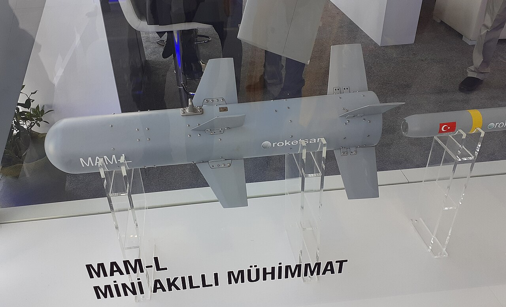
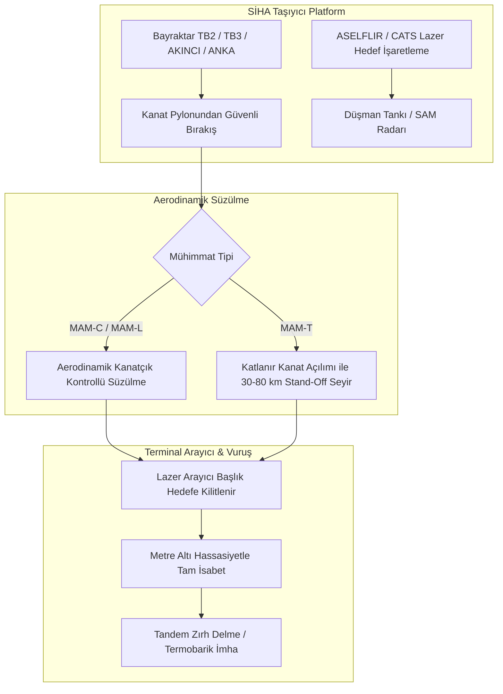

# 🚀 Proje: ROKETSAN MAM Ailesi (Mini Akıllı Mühimmat: MAM-C / MAM-L / MAM-T)

  

## 🛡️ Stratejik Tanım & Doktriner Öncelik
**ROKETSAN MAM (Mini Akıllı Mühimmat) Ailesi**, dünya askeri doktrinlerinde ve insansız hava aracı harp taktiklerinde çığır açan, hafif ağırlıkları ile yüksek vuruş hassasiyetini birleştiren Türkiye'nin küresel ölçekte en tanınmış akıllı mühimmat serisidir.

Suriye, Libya, Karabağ ve Ukrayna muharebe alanlarında Pantsir, Tor ve Buk gibi modern hava savunma sistemlerini, yüzlerce reaktif zırhlı ana muharebe tankını, radar istasyonlarını ve lojistik konvoyları cerrahi hassasiyetle imha ederek "Sessiz Ölüm" unvanını kazanmıştır. İnsansız hava araçlarının faydalı yük kapasiteleri gözetilerek optimize edilen MAM ailesi; **MAM-C** (hafif taktik), **MAM-L** (zırh delici orta sıklet) ve **MAM-T** (uzun menzilli kanatlı ağır sıklet) üyeleriyle Türk Silahlı Kuvvetleri'nin ve 30'u aşkın müttefik ülkenin hava taarruz gücünün omurgasıdır.

## 📊 Kapsamlı Teknik Özellikler

| Model | Ağırlık / Çap | Menzil | Güdüm Mimarisi | Harp Başlığı Tipleri |
| :--- | :--- | :--- | :--- | :--- |
| **MAM-C** | 6.5 kg / 70 mm | 8+ km | Yarı Aktif Lazer (LAB) | Çok Maksatlı (Zırh Delici, Parçacıklı, Yangın) |
| **MAM-L** | 22 kg / 160 mm | 15+ km | Yarı Aktif Lazer (LAB) + ANS | Tandem Reaktif Zırh Delici, Termobarik, Yüksek İnfilak |
| **MAM-T** | 94 kg / 230 mm | 30 - 80 km (Platform irtifasına bağlı) | GPS / INS + Yarı Aktif Lazer (LAB) | Yüksek İnfilaklı Parçacık Tesirli Ağır Başlık |
| **Taşıyıcı Platformlar** | Bayraktar TB2, TB3, AKINCI, ANKA, AKSUNGUR, HÜRKUŞ | Kanat altı standart pylon ve akıllı salanlar | Çoklu platform esnekliği |
| **Hassasiyet (CEP)** | Metre Altı (< 1 Metre) | Terminal safhada lazer noktasını milimetrik takip | Cerrahi nokta vuruş |
| **Süzülme Mimarisi** | Serbest Düşüş / Süzülme (MAM-T Kanat Açılımlı) | Motorsuz aerodinamik süzülme ile sessiz yaklaşma | Radar ve akustik tespit imkansızlığı |

## 🧩 Alt Sistemler ve Aviyonik/Elektronik Entegrasyonu
- **Yarı Aktif Lazer Arayıcı Başlık:** Düşman elektronik karşı tedbirlerine karşı kodlanmış lazer hüzmesini takip eden yüksek hassasiyetli optik arayıcı.
- **Tandem Zırh Delici Başlık (MAM-L):** Reaktif zırh (ERA) plakalarını önden patlatıp ana gövde zırhını delen çift kademeli şekillendirilmiş patlayıcı.
- **MAM-T Katlanır Kanat Mekatronik Yapısı:** Bırakıldıktan hemen sonra açılarak mühimmata 80 km'ye varan stand-off süzülme menzili kazandıran yüksek L/D kanat profili.
- **Çift Emniyetli Akıllı Tapa Mimarisi:** İstenen patlama moduna (çarpma anında infilak, gecikmeli sığınak içi patlama veya havada parçalanma) göre programlanabilen elektronik tapa.

## 🎯 Görev Profili, Muharebe Senaryoları & Mühimmat Yelpazesi
- **Zırhlı Birlik ve Tank Avcılığı (MAM-L):** Reaktif zırhlı düşman tanklarını kulenin en zayıf tavan noktasından vurarak tek atışta saf dışı bırakma.
- **Hava Savunma Bataryalarını Stand-Off Avlama (MAM-T):** Düşman SAM füzelerinin menzili dışından 40+ km mesafeden bırakılarak radarları vurma.
- **Hafif Piyade ve Silah Mevzileri (MAM-C):** Personel toplanma alanlarını ve hafif araçları sıfır ikincil hasarla hassas vurma.

## 📐 Mimari ve Görev Akış Şeması

## 🚀 TRL Seviyesi ve Gelişim Yol Haritası
- **Mevcut Seviye: TRL 9 (Saha Kanıtlanmış & Seri Üretim)**
- [x] MAM-C ve MAM-L İlk Seri Üretimleri ve TSK Envanterine Girişi (2016)
- [x] Karabağ, Libya, Suriye ve Ukrayna Muharebelerinde Efsanevi Başarı (Combat Proven)
- [x] MAM-T Uzun Menzilli Varyantının Geliştirilmesi ve AKINCI'dan Başarılı Atışları (2021)
- [x] 30'dan Fazla Ülkeye On Binlerce Adetlik İhracat Başarısı
- [ ] IIR Arayıcı Başlıklı ve Veri Bağlı Yeni MAM Varyantları Geliştirme Çalışmaları

---
[⬅️ Üst Dizine](../README.md) | [🏛️ Dominion Hub](../../README.md) | [🏠 Ana Sayfa](../../../README.md)
