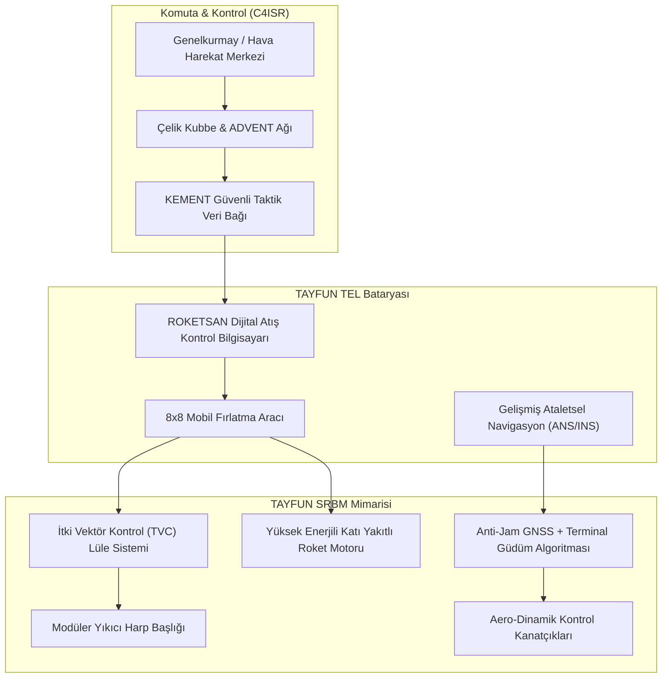

# 🚀 Proje: TAYFUN Kısa Menzilli Balistik Füze (SRBM)

<div align="center">

[

<p align="center">
  
</p>
](../../README.md)
[](../README.md)
[-00E676?style=for-the-badge&logo=speedtest&logoColor=black)](../../../docs/TRL_GUIDE.md)
[](#)


</div>

---

## 🛡️ Stratejik Tanım & Doktriner Öncelik
**TAYFUN**, Türkiye Cumhuriyeti'nin milli imkânlarla geliştirdiği ilk kısa menzilli balistik füze (SRBM) sistemidir. ROKETSAN'ın BORA füzesiyle elde ettiği katı yakıtlı roket motoru ve hassas güdüm teknolojileri mirası üzerine inşa edilen TAYFUN; Türk Silahlı Kuvvetleri'ne stratejik derinlikte caydırıcılık, yüksek yoğunluklu muharebe sahasında zaman kısıtlı kritik hedeflere ani müdahale ve düşman hava savunma şemsiyesini aşarak derin darbe (Deep Strike) indirme yeteneği kazandırmıştır. 2022 yılındaki tarihi Rize-Sinop test atışıyla 561 km menzili aşarak varlığını kanıtlayan sistem, Türkiye'nin taktik füze liginden balistik füze ve stratejik caydırıcılık ligine geçişinin simgesidir.

---

## 📊 Kapsamlı Teknik Özellikler Tablosu

| Parametre | Değer / Özellik | Açıklama |
| :--- | :--- | :--- |
| **Sistem Sınıfı** | Kısa Menzilli Balistik Füze (SRBM) | Taktik / Tiyatro Seviyesi Balistik Füze |
| **Operasyonel Menzil** | 560+ km (Kanıtlanan) / 1000+ km (Gelişmiş Varyantlar) | Düşman derinliğindeki C4I ve lojistik üsleri kapsar |
| **Terminal Hız** | Mach 5+ (Süpersonik / Hipersonik Giriş) | Hava savunma reaksiyon süresini asgariye indirir |
| **Güdüm Sistemi** | Entegre ANS + Çok Kanallı Anti-Jam KKS/GNSS | Yoğun EW ortamında güvenilir yörünge takibi |
| **Hassasiyet (CEP)** | < 10 Metre | Nokta vuruş hassasiyeti (Pinpoint Accuracy) |
| **Harp Başlığı Tipi** | Yüksek İnfilaklı Parçacıklı / Nüfuz Edici (Sığınak Delici) | Ağır tahkimat ve pist imha kabiliyeti |
| **Harp Başlığı Ağırlığı** | ~450+ kg | Yıkıcı terminal kinetik ve patlama enerjisi |
| **Fırlatma Aracı (TEL)** | 8x8 Taktik Tekerlekli Ağır Taşıyıcı Araç | "Vur-Kaç" (Shoot-and-Scoot) doktrinine tam uyum |
| **Reaksiyon Süresi** | < 15 Dakika (İntikalden Ateşlemeye) | Hızlı konuşlanma ve ani karşı saldırı |

---

## 🧩 Alt Sistemler ve Aviyonik/Elektronik Entegrasyonu



- **Milli Katı Yakıtlı İtki Sistemi:** ROKETSAN tarafından formüle edilen yüksek yanma hızlı kompozit katı yakıt kimyası ve karbon elyaf sarımlı motor gövdesi.
- **İtki Vektör Kontrol (TVC):** Fırlatma anında ve atmosferik tırmanma safhasında füzenin açısal kararlılığını sağlayan elektromekanik nozul yönlendirme.
- **Elektronik Harbe Dirençli GNSS:** Anti-jamming ve anti-spoofing CRPA anten dizilimi ile düşman karıştırıcılarının yörüngeyi saptırmasını engeller.
- **Çelik Kubbe Ağı Entegrasyonu:** Taktik ve stratejik hava resmine tam entegre, merkezi ağ merkezli komuta kontrol yapısıyla hedeflenme.

---

## 🎯 Görev Profili, Muharebe Senaryoları & Mühimmat Yelpazesi

### 1. Stratejik Tesis ve Komuta Merkezi İmhası
Düşman hava sahasının derinliklerindeki radar mevkileri, yeraltı C4I sığınakları ve stratejik mühimmat depoları balistik yörüngeden gelen dik dalış açısıyla imha edilir.

### 2. Hava Savunma Bataryalarını Bastırma ve Yok Etme (SEAD/DEAD)
Uzun menzilli düşman hava savunma sistemleri (örneğin S-300/S-400 veya Patriot türevleri), radar ve fırlatma rampaları açık pozisyondayken ani balistik darbeyle reaksiyon gösteremeden etkisiz hale getirilir.

### 3. Deniz Üsleri ve Liman Tahkimatlarına Yönelik Angajman
Düşmanın donanma üsleri, kuru havuzları ve kıyı lojistik merkezleri, yüksek patlayıcı ve parça tesirli harp başlığı ile vurularak deniz kontrolü zafiyete uğratılır.

---

## 🚀 TRL Seviyesi ve Gelişim Yol Haritası

```
[██████████] TRL 9 - Operasyonel ve Seri Üretimde
```

- [x] **TRL 1-3:** Konsept tasarımı, aerodinamik simülasyonlar ve itki kimyası laboratuvar doğrulaması.
- [x] **TRL 4-6:** Statik motor ateşleme testleri, prototip TEL entegrasyonu ve alt sistem kalifikasyonu.
- [x] **TRL 7:** 2022 Rize-Sinop ilk uzun menzilli uçuş ve telemetri doğrulaması (561 km menzil).
- [x] **TRL 8:** İkinci başarılı atış testi (Mayıs 2023), terminal vuruş hassasiyeti ve harp başlığı patlama testleri.
- [x] **TRL 9:** Seri üretim fazına geçiş, Türk Silahlı Kuvvetleri envanterine teslimat ve operasyonel konuşlanma.
- [ ] **Gelecek Vizyonu:** Blok-2 / Blok-3 varyantları ile 1.000+ km menzil ve MaRV (Manevralı Yeniden Giriş Aracı) entegrasyonu.

---

## 🔗 İç Dizin Navigasyonu
[⬅️ Üst Dizine](../README.md) | [🏛️ Dominion Hub](../../README.md) | [🏠 Ana Sayfa](../../../README.md)
