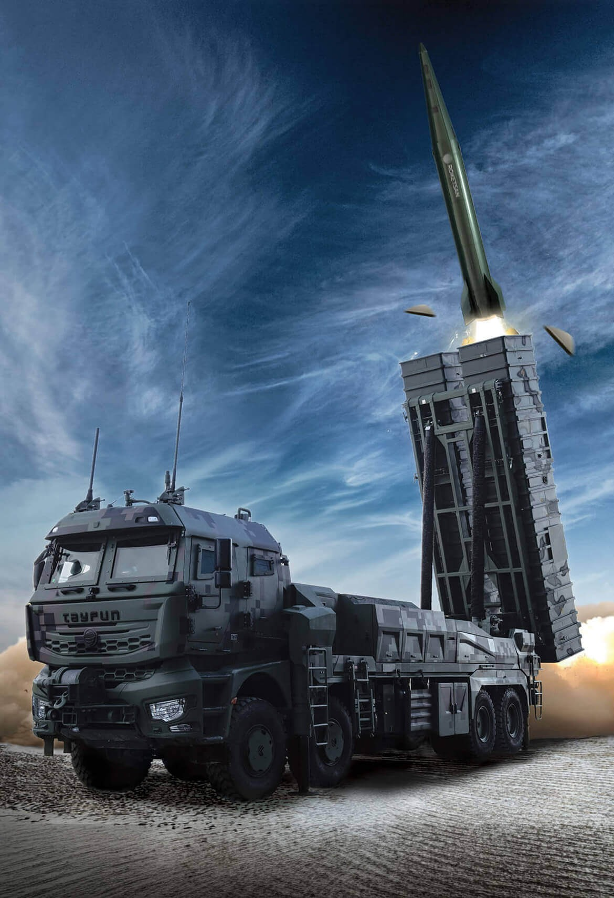
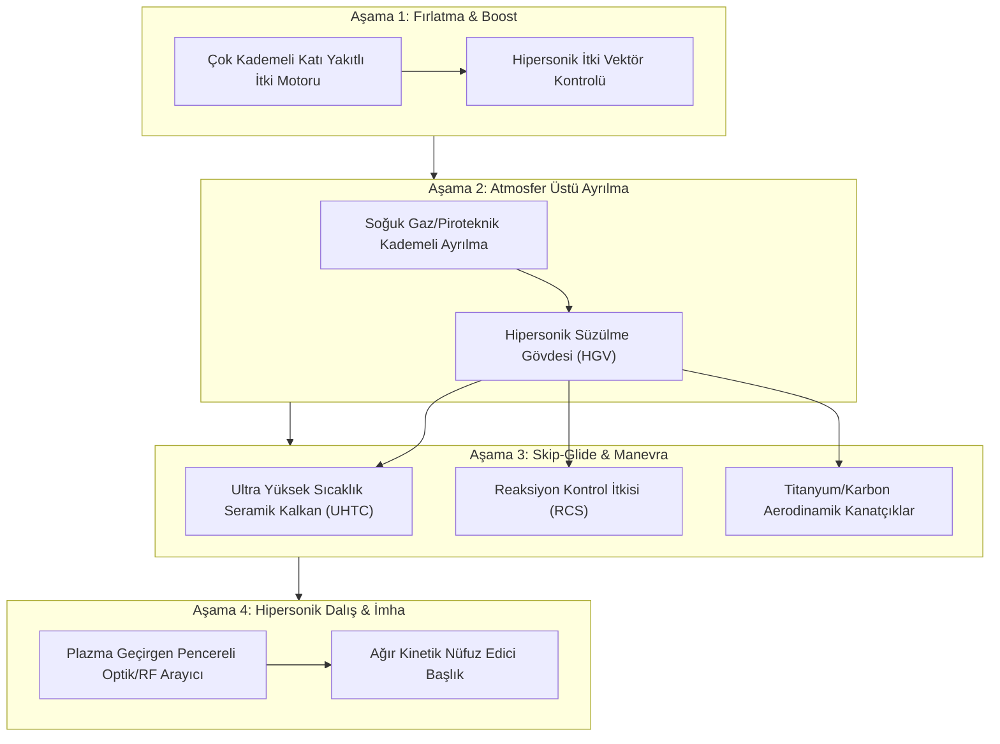

# 🚀 Proje: TAYFUN Blok-4 (Milli Hipersonik Füze Sistemi)

<div align="center">

[](../../README.md)
[](../README.md)
[-yellow?style=for-the-badge&logo=speedtest&logoColor=black)](../../../docs/TRL_GUIDE.md)
[](#)

<p align="center">
  
</p>

</div>

---

## 🛡️ Stratejik Tanım & Doktriner Öncelik
**TAYFUN Blok-4**, ROKETSAN tarafından geliştirilmekte olan, Türkiye'nin ilk gerçek manevra kabiliyetine sahip hipersonik süzülme ve derin taarruz füze sistemidir (Hypersonic Glide Vehicle / MaRV). Standart parabolik balistik yörüngeler modern balistik füze savunma sistemleri (SM-3, THAAD, Arrow-3, S-500) tarafından hesaplanıp önlenebilirken; Blok-4 atmosferin üst katmanlarında Mach 5+ hızlarda öngörülemez zigzag ve irtifa manevraları yaparak düşman erken ihbar radarlarının takip algoritmalarını felç eder. 1.500+ km menziliyle bölgesel güç dengesini Türkiye lehine değiştirecek mutlak bir stratejik caydırıcı unsurdur.

---

## 📊 Kapsamlı Teknik Özellikler Tablosu

| Parametre | Değer / Özellik | Açıklama |
| :--- | :--- | :--- |
| **Sistem Sınıfı** | Hipersonik Manevralı Balistik Füze (HGV / MaRV) | Aerodinamik Kontrollü Hipersonik Başlık |
| **Operasyonel Menzil** | 1.500+ km | Tiyatro ötesi stratejik etki sahası |
| **Maksimum Sürat** | Mach 5 - Mach 7+ (Hipersonik) | 6.000+ km/s terminal vuruş sürati |
| **Güdüm ve Kontrol** | Hibrit ANS + Dayanıklı GNSS + Optik/Kızılötesi Terminal Arayıcı | Plazma kılıfı geçişinde kesintisiz kontrol |
| **Yörünge Tipi** | Aero-Balistik Yarı Süzülme (Skip-Glide) | Öngörülemez yanal ve dikey manevralar |
| **Gövde Malzemesi** | Karbon-Karbon Kompozitler & Ultra Yüksek Sıcaklık Seramikleri (UHTC) | 2.000°C+ sürtünme ısısına tam dayanım |
| **Harp Başlığı** | Özel Şekillendirilmiş Nüfuz Edici / Çoklu Harp Başlığı | Ağır korunaklı yeraltı stratejik hedefleri |
| **Platform Tipi** | Ağır Çok Dingilli Özel Taktik TEL Aracı | Mobil konuşlanma, yüksek gizlenme kabiliyeti |

---

## 🧩 Alt Sistemler ve Aviyonik/Elektronik Entegrasyonu



- **UHTC Termal Koruma Kalkanı:** Mach 5 üzeri hızlarda atmosferle sürtünmeden doğan 2.000°C'yi aşan sıcaklıklara karşı milli zirkonyum diborit ve silisyum karbür kompozit kaplamalar.
- **Plazma Kılıfı İletişim Mimarisi:** Hipersonik hızda füze çevresinde oluşan iyonize plazma tabakasına rağmen sinyal geçirgenliği sağlayan özel frekans ve anten teknolojisi.
- **Reaksiyon Kontrol İtkisi (RCS):** Havanın çok ince olduğu üst atmosferde yön değişimini sağlayan minyatür gaz nozulları.
- **Milli Görev Bilgisayarı:** TÜBİTAK BİLGEM & ROKETSAN ortaklığıyla geliştirilen radyasyona ve aşırı g kuvvetine dayanıklı entegre işlemci mimarisi.

---

## 🎯 Görev Profili, Muharebe Senaryoları & Mühimmat Yelpazesi

### 1. Balistik Füze Savunma (BMD) Şemsiyesini Etkisiz Kılma
Düşmanın en korunaklı hava savunma mevkilerini, geleneksel balistik füze rotasından saparak radarların kapsama kör noktalarından hipersonik dalışla vurur.

### 2. Kritik Enerji ve C4ISR Merkezlerini Felç Etme
1.500 km derinlikteki stratejik nükleer tesisler, komuta kontrol karargâhları ve erken ihbar radar istasyonları tek bir atışla imha edilir.

### 3. Yüksek Kinetik Nüfuz Etkisi
Mach 5+ hızın getirdiği devasa kinetik enerji sayesinde patlayıcıya ek olarak sığınakların derinliklerine inerek yeraltı hedeflerini parçalama yeteneği sunar.

---

## 🚀 TRL Seviyesi ve Gelişim Yol Haritası

```
[█████░░░░░] TRL 5 - Bileşen Doğrulama ve Prototip İmalat Safhası
```

- [x] **TRL 1-2:** Hipersonik aerodinamik profil ve aerotermal modelleme çalışmaları.
- [x] **TRL 3:** UHTC kompozit malzeme laboratuvar fırın ve ark-tünel testleri.
- [x] **TRL 4:** Laboratuvar ortamında ölçekli kanatçık ve RCS kontrol mimarisi simülasyonları.
- [x] **TRL 5:** Prototip süzülme başlığı rüzgar tüneli testleri ve katı motor entegrasyon doğrulaması.
- [ ] **TRL 6:** Gerçek atmosfer testinde booster ayrılma ve atmosferik süzülme denemesi (2025).
- [ ] **TRL 7:** Tam sistem hipersonik uçuş testi ve telemetri doğrulaması.
- [ ] **TRL 8-9:** Seri üretim ve Türk Silahlı Kuvvetleri stratejik füze tugaylarına teslimat.

---

## 🔗 İç Dizin Navigasyonu
[⬅️ Üst Dizine](../README.md) | [🏛️ Dominion Hub](../../README.md) | [🏠 Ana Sayfa](../../../README.md)
