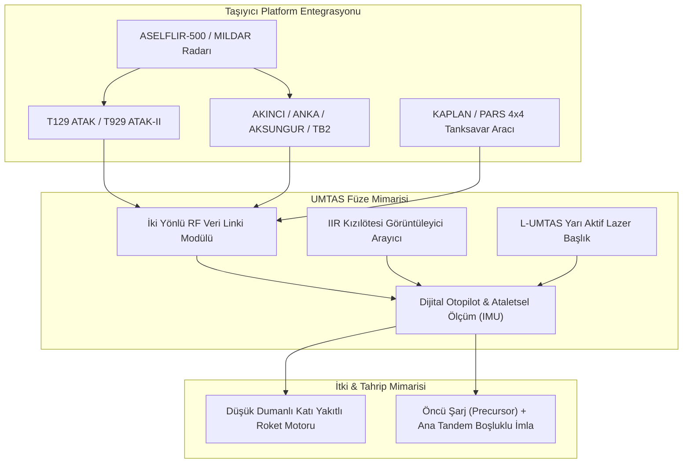

# 🎯 Proje: ROKETSAN UMTAS & L-UMTAS (Uzun Menzilli Tanksavar Füzesi)

<div align="center">

[

<p align="center">
  
</p>
](../../README.md)
[](../README.md)
[-00E676?style=for-the-badge&logo=speedtest&logoColor=black)](../../../docs/TRL_GUIDE.md)
[](#)


</div>

---

## 🛡️ Stratejik Tanım & Doktriner Öncelik
**UMTAS** (Uzun Menzilli Tanksavar Füze Sistemi) ve yarı aktif lazer arayıcı başlıklı varyantı **L-UMTAS**, modern muharebe sahasındaki tüm reaktif zırhlı ana muharebe tanklarına (MBT) ve ağır tahkimatlara karşı geliştirilmiş birincil milli tanksavar vurucu gücüdür. T129 ATAK taarruz helikopterinin ana mühimmatı olarak tasarlanan sistem; günümüzde SİHA'lar (Bayraktar TB2/TB3/AKINCI, ANKA/AKSUNGUR), hafif taarruz uçakları, zırhlı kara araçları ve hücumbotlara entegre edilmiştir. Sütre gerisinden atış ve uçuş esnasında çift yönlü RF veri bağı ile hedef güncelleme yetenekleri, dost unsurları düşman menziline girmeden mutlak zaferle buluşturur.

---

## 📊 Kapsamlı Teknik Özellikler Tablosu

| Parametre | Değer / Özellik | Açıklama |
| :--- | :--- | :--- |
| **Sistem Sınıfı** | Uzun Menzilli Hassas Güdümlü Tanksavar Füzesi (ATGM) | Havadan-Karaya ve Karadan-Karaya |
| **Füze Çapı** | 160 mm | Yüksek tandem patlayıcı çapı |
| **Füze Uzunluğu** | 1.75 Metre | Aerodinamik katlanır kanat mimarisi |
| **Toplam Ağırlık** | 37.5 kg | Helikopter ve SİHA pylonları için optimize |
| **Etkili Menzil** | 500 m - 8.000 m (8 km) | Helikopter stand-off taarruz kabiliyeti |
| **Güdüm Tipleri** | IIR (Görüntüleyici Kızılötesi) / YAL (L-UMTAS Yarı Aktif Lazer) | Gece/gündüz ve her türlü hava şartı |
| **Harp Başlığı** | Çift Kademeli Tandem Zırh Delici / Parçacık Etkili | Reaktif Zırh (ERA) arkasındaki ana zırhı eritir |
| **Kullanım Modları** | At-Unut (Fire & Forget) / At-Güncelle (Fire & Update) | LOBL (Atış Öncesi Kilit) / LOAL (Atış Sonrası Kilit) |
| **Veri Bağı** | Çift Yönlü RF Taktik Veri Bağı | Füze kamerasından kokpite anlık video aktarımı |

---

## 🧩 Alt Sistemler ve Aviyonik/Elektronik Entegrasyonu



- **IIR Görüntüleyici Arayıcı:** Termal kontrast farkından yararlanarak kamuflajlı, duman perdesi ardındaki veya ağaçlık alandaki araçları anında filtreleyip takip eder.
- **Sütre Gerisinden Atış (LOAL):** Helikopter dağın ardında gizlenirken füze ateşlenir; füze tepeyi aştığında kokpitteki pilota hedefin görüntüsünü yansıtır ve pilot ekrandan hedef tankı seçerek vuruşu tamamlar.
- **Tandem Zırh Delici Başlık:** Birinci kademe patlayıcı tankın üzerindeki patlayıcı reaktif zırhı (ERA) nötralize eder, ana şekillendirilmiş zırh delici mühimmat ise 1.000 mm+ haddelenmiş homojen çelik zırhı (RHA) delip içeri nüfuz eder.

---

## 🎯 Görev Profili, Muharebe Senaryoları & Mühimmat Yelpazesi

### 1. Zırhlı Birliklerin Karşı Taarruzunun Kırılması
Düşman tank taburları ve zırhlı muharebe araçları, 8 km mesafeden ATAK helikopterlerinin 4'lü lançerlerinden art arda ateşlenen UMTAS füzeleriyle imha edilir.

### 2. Kıyı Savunması ve Hücumbot Engelleme
Deniz platformlarına yerleştirilen L-UMTAS lançerleri, adalar ve dar boğazlarda yaklaşan düşman hücumbotlarını ve amfibi çıkarma gemilerini lazer işaretleme ile batırır.

### 3. Taktik SİHA Hassas Angajmanı
AKINCI ve AKSUNGUR SİHA'ları yüksek irtifadan lazerle işaretlenen korunaklı komuta mevzilerini ve düşman havan mevzilerini L-UMTAS ile imha eder.

---

## 🚀 TRL Seviyesi ve Gelişim Yol Haritası

```
[██████████] TRL 9 - Seri Üretim ve Muharebe Kanıtlanmış (Combat Proven)
```

- [x] **TRL 1-6:** ROKETSAN Ar-Ge laboratuvarlarında motor, kanatçık ve arayıcı başlık tasarımı.
- [x] **TRL 7:** T129 ATAK üzerinden canlı atış testleri ve hareketli hedeflere doğrudan isabet.
- [x] **TRL 8:** Zırh delme kalifikasyonu ve zorlu çevre koşulları (çöl sıcağı, dondurucu soğuk) testleri.
- [x] **TRL 9:** Türk Kara Kuvvetleri, Deniz Kuvvetleri ve Jandarma envanterine giriş; sınır ötesi harekâtlarda yoğun kullanım ve dost ülkelere ihracat.
- [ ] **Gelecek Vizyonu:** UMTAS-GM (Genişletilmiş Menzil) varyantı ile karadan 16+ km, havadan 30+ km menzile erişim.

---

## 🔗 İç Dizin Navigasyonu
[⬅️ Üst Dizine](../README.md) | [🏛️ Dominion Hub](../../README.md) | [🏠 Ana Sayfa](../../../README.md)
