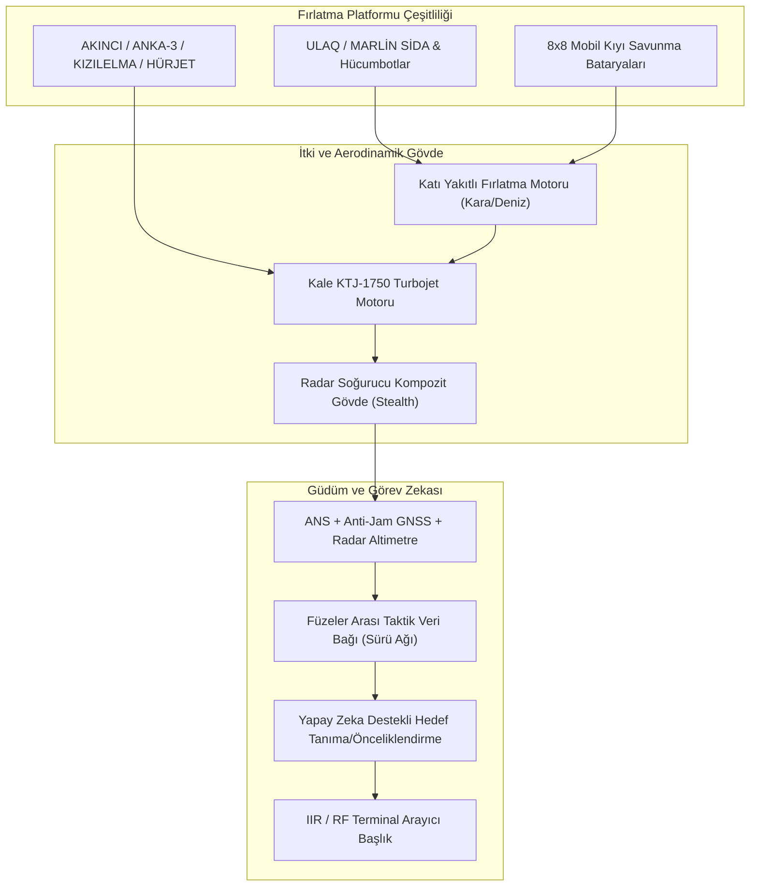

# 🦅 Proje: ROKETSAN ÇAKIR Modüler Seyir Füzesi

<div align="center">

[

<p align="center">
  
</p>
](../../README.md)
[](../README.md)
[-00E676?style=for-the-badge&logo=speedtest&logoColor=black)](../../../docs/TRL_GUIDE.md)
[](#)


</div>

---

## 🛡️ Stratejik Tanım & Doktriner Öncelik
**ÇAKIR**, ROKETSAN tarafından kara, deniz ve hava platformlarından ateşlenebilecek şekilde tasarlanan yeni nesil modüler taktik seyir füzesidir. Yerli turbojet motoru (Kale Arge KTJ-1750) ile güçlendirilen ÇAKIR; 150+ kilometrelik menzili, radar soğurucu gövde geometrisi, su üstü hedeflere karşı süper deniz yalama (Super Sea-Skimming) uçuş profili ve ağ merkezli sürü zekası (Swarm Intelligence) ile çağdaş muharebe sahasının en esnek taarruz mühimmatıdır. SİHA'lardan (AKINCI, AKSUNGUR), İUSV/SİDA'lardan (MARLİN, ULAQ), taktik tekerlekli kara araçlarından ve fırkateynlerden aynı mühimmat ailesinin ateşlenebilmesi lojistik standartlaşmada devrim yaratmıştır.

---

## 📊 Kapsamlı Teknik Özellikler Tablosu

| Parametre | Değer / Özellik | Açıklama |
| :--- | :--- | :--- |
| **Sistem Sınıfı** | Yeni Nesil Modüler Taktik Seyir Füzesi | Kara / Deniz / Hava Ortak Mühimmatı |
| **Menzil** | 150+ km | Stand-off derin taarruz kabiliyeti |
| **Füze Ağırlığı** | ~275 kg (Booster Hariç) / ~330 kg (Booster ile) | Hafif ve kompakt seyir füzesi sınıfı |
| **Harp Başlığı** | 70 kg Yarı Zırh Delici / Parça Tesirli / Termobarik | Korunaklı kıyı hedefleri ve savaş gemileri için |
| **Seyir Hızı** | Yüksek Subsonik (0.75 - 0.85 Mach) | ~900 - 1.040 km/s yüksek intikal hızı |
| **İtki Sistemi** | Kale Arge KTJ-1750 Milli Turbojet Motoru | Yerli ve bağımsız itki ünitesi |
| **Güdüm Mimarisi** | Hibrit: ANS/INS + Anti-Jam GNSS + TRN/TERCOM | Yeryüzü referanslı radara yakalanmayan seyrüsefer |
| **Terminal Arayıcı** | IIR (Kızılötesi) / RF (Aktif Radar) / Hibrit Çift Mod | Karıştırmaya karşı tam bağışıklık |
| **Uçuş İrtifası** | Deniz Yalama (Sea-Skimming) < 3-5 Metre | Radar ufkunun altında görünmez intikal |

---

## 🧩 Alt Sistemler ve Aviyonik/Elektronik Entegrasyonu



- **Sürü Zekası ve İşbirlikçi Taarruz:** Füzeler uçuş esnasında birbirleriyle veri paylaşarak hedef savunmasını doyurmak üzere farklı yönlerden aynı anda varış (Time-on-Target) senaryoları kurgular.
- **Yapay Zeka Destekli Otomatik Hedef Tanıma (ATR):** Görüntüleyici kızılötesi veya aktif radar arayıcıdan gelen hedef verisi, dahili kütüphanedeki gemi silüetleri ile eşleştirilerek kritik komuta köprüsü veya makine dairesi noktadan hedeflenir.
- **Düşük Radar Kesit Alanı (RCS):** Füzenin keskin gövde açısı ve kompozit kaplaması düşman gemi radarlarının tespit menzilini kritik eşiklerin altına indirir.

---

## 🎯 Görev Profili, Muharebe Senaryoları & Mühimmat Yelpazesi

### 1. Su Üstü Harp ve Gemi Savar (ASuW)
Düşman korvet, fırkateyn ve lojistik ikmal gemilerine karşı dalgaların sadece birkaç metre üzerinden radar ufkunun altında süzülerek süper deniz yalama profiliyle taarruz eder.

### 2. Kıyı Tahkimatı ve Stratejik Radar İmhası
Karadaki kıyı gözetleme radarları, komuta merkezleri ve füze rampaları, hava savunma koridorlarının dışından dolaşarak (Waypoint Seyrüseferi) beklenmeyen açılardan vurulur.

### 3. SİDA ve İHA Ortak Görev Paketi
MARLİN SİDA tarafından fırlatılan ÇAKIR füzeleri ile havadaki AKINCI TİHA'dan ateşlenen ÇAKIR füzeleri havada sürü oluşturarak düşman filosunu eş zamanlı ateş altına alır.

---

## 🚀 TRL Seviyesi ve Gelişim Yol Haritası

```
[██████████] TRL 9 - Seri Üretim ve Operasyonel Dağıtım Aşaması
```

- [x] **TRL 1-4:** ROKETSAN bünyesinde modüler füze konsepti ve Kale KTJ-1750 motor tasarımı.
- [x] **TRL 5-6:** Rüzgar tüneli, aviyonik donanım ve prototip fırlatma testleri.
- [x] **TRL 7:** AKINCI TİHA'dan yapılan ilk canlı atış testi (Karadeniz hedefi doğrudan vuruş - 2023).
- [x] **TRL 8:** Su üstü platformlardan booster ile atış ve sürü veri bağı kalifikasyonu.
- [x] **TRL 9:** Seri üretim hattının kurulması, Türk Silahlı Kuvvetleri'ne teslimat ve ihracat sözleşmeleri.
- [ ] **Gelecek Vizyonu:** Genişletilmiş ÇAKIR-L (LIR) varyantı ile 250+ km menzil ve denizaltı torpido kovanından atış kabiliyeti.

---

## 🔗 İç Dizin Navigasyonu
[⬅️ Üst Dizine](../README.md) | [🏛️ Dominion Hub](../../README.md) | [🏠 Ana Sayfa](../../../README.md)
