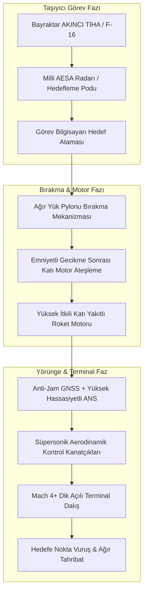

# 🦅 Proje: ROKETSAN İHA-300 Havadan Atılan Balistik Füze (ALBM)

<div align="center">

[

<p align="center">
  
</p>
](../../README.md)
[](../README.md)
[-00E676?style=for-the-badge&logo=speedtest&logoColor=black)](../../../docs/TRL_GUIDE.md)
[](#)


</div>

---

## 🛡️ Stratejik Tanım & Doktriner Öncelik
**İHA-300**, ROKETSAN'ın sahadaki başarısını kanıtlamış 300 mm'lik TRG-300 KAPLAN füze teknolojisini ağır SİHA ve savaş uçağı platformlarına uyarladığı Havadan Atılan Balistik Füze (Air-Launched Ballistic Missile - ALBM) sistemidir. Yüksek irtifadan (30.000 - 40.000 ft) devriye gezen Bayraktar AKINCI TİHA, AKSUNGUR veya modernize F-16'lardan ateşlenen İHA-300; uçağın irtifa ve hız enerjisini arkasına alarak menzilini 150-250+ kilometreye çıkarır. Terminal safhada Mach 4+ süpersonik hızla dik dalış yaparak düşman hava savunma radarları, C4I karargahları ve korunaklı sığınaklarını reaksiyon şansı tanımadan yok eder.

---

## 📊 Kapsamlı Teknik Özellikler Tablosu

| Parametre | Değer / Özellik | Açıklama |
| :--- | :--- | :--- |
| **Sistem Sınıfı** | Havadan Atılan Taktik Balistik Füze (ALBM) | Stand-Off Süpersonik Derin Darbe |
| **Füze Çapı** | 300 mm | Ağır tahrip güçlü süpersonik gövde |
| **Operasyonel Menzil** | 150 - 250+ km | Bırakma irtifası ve taşıyıcı uçağın hızına bağlı |
| **Terminal Sürat** | Mach 4+ (Süpersonik / Hipersonik Giriş) | Dik açılı dalışta reaksiyon süresi bırakmaz |
| **Güdüm Mimarisi** | KKS / ANS Destekli Ataletsel Navigasyon + Lazer/Optik Başlık | Yoğun EW karıştırmasına dirençli |
| **Hassasiyet (CEP)** | < 5 Metre | Nokta vuruş kabiliyeti |
| **Harp Başlığı** | 105 - 190 kg Yüksek İnfilaklı Parçacıklı / Nüfuz Edici | Kalınlaştırılmış betonarme sığınak imhası |
| **Taşıyıcı Platformlar** | Bayraktar AKINCI TİHA, AKSUNGUR, F-16 ÖZGÜR | Ağır silah istasyonlarına entegre |
| **Fırlatma İrtifası** | 25.000 - 40.000 Feet | SİHA'nın düşman SAM menzili dışından atışı |

---

## 🧩 Alt Sistemler ve Aviyonik/Elektronik Entegrasyonu



- **Havadan Ayrılma Emniyet Algoritması:** SİHA'nın pylonundan serbest bırakılan füze, aerodinamik olarak uçağın girdap alanından yeterli mesafeye uzaklaştıktan milisaniyeler sonra roket motorunu ateşler.
- **Aero-Balistik Uçuş Profili:** Atmosferin üst tabakasında parabolik yörüngesini tamamlayarak hedef üzerine 80 derecelik dik açıyla dalar; böylece düşman radarının görüş açısından sıyrılır.
- **Elektronik Harbe Karşı Anti-Jam GNSS:** ROKETSAN'ın milli anti-jam anten mimarisi düşman GPS bozucularını filtreler.

---

## 🎯 Görev Profili, Muharebe Senaryoları & Mühimmat Yelpazesi

### 1. Düşman Uzun Menzilli Hava Savunma Bataryalarını İmha (DEAD)
S-300, Patriot gibi yüksek tehditli sistemlerin kapsama alanı dışından ateşlenerek, dik dalış sürati sayesinde hava savunma füzelerinin önleme yapmasına fırsat tanımadan radar ünitelerini yok eder.

### 2. Kritik Komuta ve Lojistik Boğazları Kesme
Stratejik köprüler, demiryolu kavşakları ve tünel girişleri ağır delici harp başlığı ile vurularak düşman takviye hatları koparılır.

### 3. Zaman Duyarlı Stratejik Hedeflere Anında Müdahale
Havadaki AKINCI'dan alınan anlık istihbaratla belirlenen balistik füze rampaları veya konvoy liderleri dakikalar içinde Mach 4 süratle imha edilir.

---

## 🚀 TRL Seviyesi ve Gelişim Yol Haritası

```
[████████░░] TRL 8 - Canlı Uçuş ve Hedef Vuruş Testleri Doğrulandı
```

- [x] **TRL 1-4:** TRG-300 teknolojisinin havadan bırakılma simülasyonları ve aerodinamik kanat optimizasyonu.
- [x] **TRL 5-6:** Ayrılma dinamiği rüzgar tüneli testleri ve AKINCI TİHA pylon entegrasyonu.
- [x] **TRL 7:** AKINCI'dan yapılan ilk canlı test atışı (Hedef koordinata yüksek süratli başarılı vuruş).
- [x] **TRL 8:** Çoklu irtifa atışları, terminal hız kalifikasyonu ve harp başlığı etkinlik testleri.
- [ ] **TRL 9:** Türk Silahlı Kuvvetleri envanter kabulü ve tam ölçekli seri üretim sevkiyatı.

---

## 🔗 İç Dizin Navigasyonu
[⬅️ Üst Dizine](../README.md) | [🏛️ Dominion Hub](../../README.md) | [🏠 Ana Sayfa](../../../README.md)
