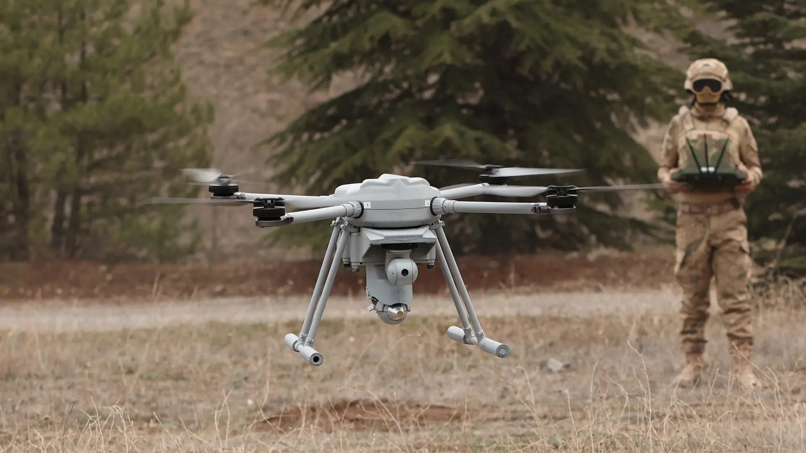
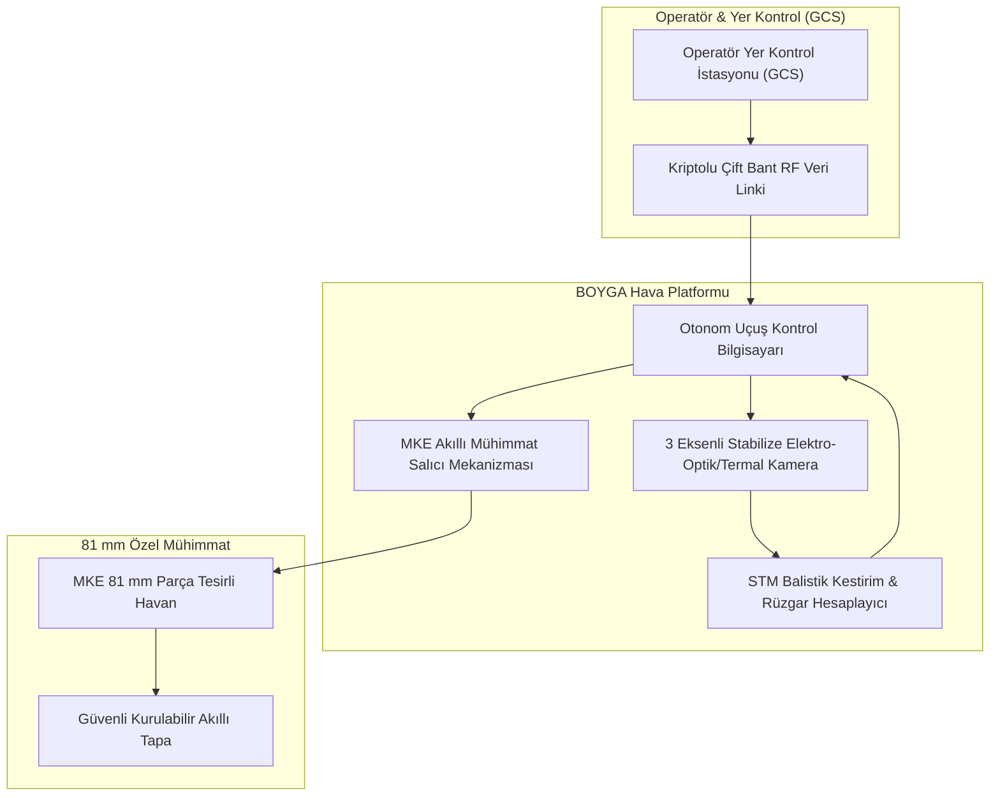

# 💣 Proje: STM BOYGA (Havan Mühimmatı Bırakan Taktik İHA)

<div align="center">

[](../../README.md)
[](../README.md)
[-00E676?style=for-the-badge&logo=speedtest&logoColor=black)](../../../docs/TRL_GUIDE.md)
[](#)

<p align="center">
  
</p>

</div>

---

## 🛡️ Stratejik Tanım & Doktriner Öncelik
**STM BOYGA**, Savunma Teknolojileri Mühendislik (STM) ve Makine ve Kimya Endüstrisi (MKE) ortaklığıyla geliştirilen, özel mühimmat bırakma mekanizmasına ve balistik kestirim bilgisayarına sahip döner kanatlı taktik İHA sistemidir. Geleneksel piyade havan atışlarındaki dağılım payını ve mevzilenme zorluklarını ortadan kaldıran BOYGA; MKE tarafından özelleştirilmiş 81 mm havan mühimmatını düşmanın sığınak, siper veya zırhsız araçlarının üzerine santimetre hassasiyetiyle dikey olarak bırakır. Asimetrik harpte piyade timlerine dikey hava topçusu gücü sağlayan benzersiz bir taktik platformdur.

---

## 📊 Kapsamlı Teknik Özellikler Tablosu

| Parametre | Değer / Özellik | Açıklama |
| :--- | :--- | :--- |
| **Sistem Sınıfı** | Döner Kanatlı Mühimmat Bırakan Taktik İHA | Dikey Kalkış-İniş (VTOL) Taktik Mühimmat Bırakıcı |
| **Faydalı Yük / Mühimmat** | 1 Adet MKE 81 mm Özelleştirilmiş Havan Mühimmatı | Optimize edilmiş tapa ve yönlendirici kuyruk |
| **Havada Kalış Süresi** | 30 Dakika (Mühimmat Yüklü) / 45 Dakika (Yüksüz) | Görev bölgesine intikal ve hassas nişan süresi |
| **Operasyonel Tavan** | 1.500 Metre AGL (Yer Seviyesinden Yüksek) | Düşman hafif silah menzilinin üstünde güvenli atış |
| **Haberleşme Menzili** | 5 km (Görüş Hattı - LOS) | Güvenli şifreli askeri veri bağı |
| **Ağırlık (Boş / MTOW)** | 13.5 kg / ~17 kg | İki kişilik tim tarafından taşınabilir modüler yapı |
| **Bırakma Doğruluğu** | < 1 Metre CEP | Balistik kestirim algoritması sayesinde |
| **Emniyet Mimarisi** | Çift Kademeli Mekanik & Elektronik Arming | Bırakma sonrası belirli mesafede tapa kurulması |

---

## 🧩 Alt Sistemler ve Aviyonik/Elektronik Entegrasyonu



- **Milli Balistik Kestirim Algoritması:** Dronun anlık yer hızı, irtifası, yatış açıları ve harici rüzgar sensörlerinden gelen verileri saniyede onlarca kez işleyerek kameradaki nişangah dairesini hedefe kilitler.
- **Akıllı Bırakma Mekanizması:** Mühimmatı bırakırken dronun ağırlık merkezi değişimini anında telafi eden otopilot kompanzasyonu.
- **MKE Tapa Emniyeti:** Dron düşse dahi patlamayan, serbest düşüşte belirli irtifa ve dönüş devrine ulaştığında kurulan milli tapa mimarisi.

---

## 🎯 Görev Profili, Muharebe Senaryoları & Mühimmat Yelpazesi

### 1. Siper ve Mevzi Arkasındaki Tehditleri İmha
Geleneksel tüfek ve roketlerin ulaşamadığı kum torbası arkasına veya beton mevzilere saklanmış keskin nişancı ve makineli tüfek yuvaları dik düşüşle etkisiz hale getirilir.

### 2. Meskun Mahal ve Bina Bacası Girişleri
Şehir çatışmalarında açık kapı, avlu veya sığınak havalandırma boşluklarına mühimmat bırakılarak sivil zayiat olmaksızın cerrahi tahribat sağlanır.

### 3. Pusu ve Yol Kontrol Tehditlerini Önleme
Konvoy güzergahındaki şüpheli menfez ve yol kenarı mevzileri güvenli mesafeden BOYGA ile taranıp anında imha edilir.

---

## 🚀 TRL Seviyesi ve Gelişim Yol Haritası

```
[██████████] TRL 9 - Seri Üretim ve Güvenlik Güçlerine Teslim Edildi
```

- [x] **TRL 1-4:** Konsept tasarımı, MKE 81 mm havan mühimmatı aerodinamik modifikasyonu.
- [x] **TRL 5-6:** Rüzgar tüneli testleri, prototip salıcı mekanizması ve yer testleri.
- [x] **TRL 7:** Saha testlerinde canlı havan mühimmatı bırakışları ve balistik algoritma doğrulaması.
- [x] **TRL 8:** TSK kabul ve kalifikasyon testlerinin sıfır hatayla tamamlanması.
- [x] **TRL 9:** Türk Kara Kuvvetleri Komutanlığı'na seri teslimat, aktif terörle mücadele görevleri.

---

## 🔗 İç Dizin Navigasyonu
[⬅️ Üst Dizine](../README.md) | [🏛️ Dominion Hub](../../README.md) | [🏠 Ana Sayfa](../../../README.md)
