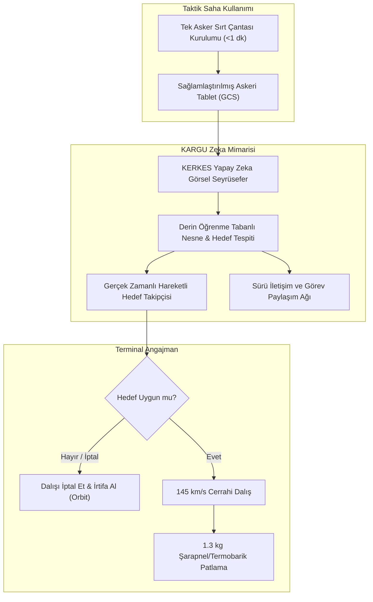

# 🦅 Proje: STM KARGU (Döner Kanatlı Vurucu İHA / Kamikaze Drone)

<div align="center">

[](../../README.md)
[](../README.md)
[-00E676?style=for-the-badge&logo=speedtest&logoColor=black)](../../../docs/TRL_GUIDE.md)
[](#)


</div>

---

## 🛡️ Stratejik Tanım & Doktriner Öncelik
**STM KARGU**, tek er tarafından sırtta taşınabilen ve hızla havaya fırlatılabilen, yapay zekâ tabanlı görüntü işleme ve derin öğrenme algoritmalarıyla donatılmış taktik döner kanatlı kamikaze (loitering munition) İHA sistemidir. Asimetrik harpte, meskun mahalde ve sınır ötesi operasyonlarda sahadaki piyade timine anlık hava taarruzu yeteneği kazandırır. Mağara girişleri, bina pencereleri, komuta araçları ve hareketli hedeflere cerrahi hassasiyetle dalış yapan KARGU; ayrıca **KERKES** projesiyle entegre olarak GPS karartması uygulanan muharebe sahalarında dahi görsel seyrüseferle görevini tamamlar ve sürü halinde müşterek taarruz icra edebilir.

---

## 📊 Kapsamlı Teknik Özellikler Tablosu

| Parametre | Değer / Özellik | Açıklama |
| :--- | :--- | :--- |
| **Sistem Sınıfı** | Döner Kanatlı Taktik Vurucu İHA (Kamikaze Drone) | Katlanabilir Karbon Gövdeli Mini Loitering |
| **Operasyonel Menzil** | 10 km (Görüş Hattı) | İleri hat ötesi cerrahi vuruş menzili |
| **Havada Kalış Süresi** | 30+ Dakika | Hedef gözetleme ve uygun anı bekleme |
| **Maksimum Dalış Hızı** | 145 km/s (40 m/s) | Hedefe kaçış fırsatı tanımayan hızlı dalış |
| **Sistem Ağırlığı** | ~7 kg | Tek er sırt çantasında kolayca taşınabilir |
| **Harp Başlığı Seçenekleri** | 1.3 kg Parçacıklı Şarapnel / Termobarik / Zırh Delici | Personel, yumuşak araç ve sığınak hedefleri |
| **Güdüm ve Arayıcı** | 2 Eksenli Gimbal EO/IR Kamera + AI Görüntü İşleme | Gece/gündüz otomatik hareketli hedef takibi |
| **Görev Güvenliği** | Görev İptal (Mission Abort) & Yeniden İrtifa Kazanma | Yanlış hedef durumunda dalışı durdurup geri dönme |
| **GPS-Bağımsız Yetenek** | KERKES Görsel Navigasyon Entegrasyonu | Elektronik karıştırmaya tam dirençli seyrüsefer |

---

## 🧩 Alt Sistemler ve Aviyonik/Elektronik Entegrasyonu



- **Gelişmiş Görüntü İşleme ve Yüz/Araç Tanıma:** Operatör ekrandan hedef kutusunu seçtiğinde İHA, hedefin hız ve yön değişimlerine karşı kamerayı ve uçuş rotasını otomatik olarak kilitler.
- **Görev İptal (Abort) Yeteneği:** Dalış esnasında sivil bir unsurun belirmesi durumunda operatör tek tuşla saldırıyı iptal eder; KARGU dalışı kesip hızla tırmanarak güvenli bekleme irtifasına döner.
- **Sürü Halinde Müşterek Saldırı:** Birden fazla KARGU aynı anda fırlatılarak tek bir operatör tarafından yönetilir ve koordineli olarak farklı açılardan hedefi kuşatır.

---

## 🎯 Görev Profili, Muharebe Senaryoları & Mühimmat Yelpazesi

### 1. Mağara Girişleri ve Tünel Tahkimatlarının Temizlenmesi
Hava araçlarının veya topların göremediği dik yamaçlardaki terör sığınakları ve mağara ağızları yatay/dikey dalışla tam merkezden imha edilir.

### 2. Hareket Halindeki Düşman Komuta Konvoyları
Konvoy lider aracı yapay zeka ile tespit edilip takip edilir ve yüksek hızla araç tavanına dalarak konvoy durdurulur.

### 3. Elektronik Harp Altında Nokta Vuruş (Anti-Jamming)
Düşman GNSS karıştırıcılarının yoğun olduğu bölgelerde KERKES görsel seyrüseferi sayesinde GPS'e ihtiyaç duymadan hedefi vurur.

---

## 🚀 TRL Seviyesi ve Gelişim Yol Haritası

```
[██████████] TRL 9 - Muharebe Kanıtlanmış, Seri Üretimde ve 10+ Ülkeye İhraç Edildi
```

- [x] **TRL 1-4:** STM bünyesinde döner kanatlı vurucu konsept geliştirme ve aerodinamik gövde.
- [x] **TRL 5-6:** Canlı harp başlıksız dalış testleri ve optik hedefleme kalifikasyonu.
- [x] **TRL 7:** Gerçek harp başlıklı canlı atış testleri ve patlayıcı etkinlik doğrulaması.
- [x] **TRL 8:** TSK operasyonel testleri, KERKES görsel seyrüsefer entegrasyonu.
- [x] **TRL 9:** TSK ve Jandarma envanterine giriş; Suriye, Libya ve Karabağ muharebelerinde aktif kullanım ve küresel ihracat.

---

## 🔗 İç Dizin Navigasyonu
[⬅️ Üst Dizine](../README.md) | [🏛️ Dominion Hub](../../README.md) | [🏠 Ana Sayfa](../../../README.md)
