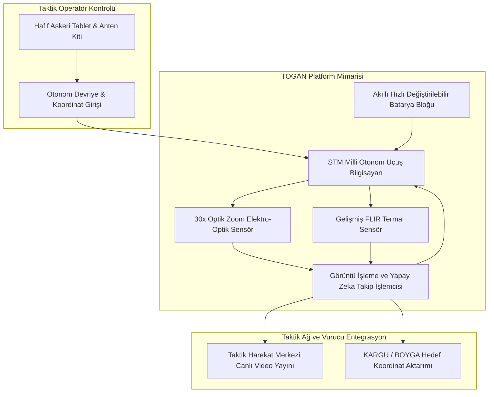

# 🦅 Proje: STM TOGAN (Otonom Döner Kanatlı Taktik Gözcü İHA)

<div align="center">

[

<p align="center">
  
</p>
](../../README.md)
[](../README.md)
[-00E676?style=for-the-badge&logo=speedtest&logoColor=black)](../../../docs/TRL_GUIDE.md)
[](#)


</div>

---

## 🛡️ Stratejik Tanım & Doktriner Öncelik
**STM TOGAN**, taktik sahada keşif, gözetleme ve istihbarat (ISR) görevlerini otonom olarak icra etmek üzere tasarlanmış mikro döner kanatlı gözetleme İHA sistemidir. Özel kuvvetler, sınır güvenlik birlikleri ve taktik piyade timlerinin gözü kulağı olan TOGAN; 30x optik yakınlaştırma yapabilen gündüz kamerası ve gelişmiş termal sensörüyle kilometrelerce ötedeki tehditleri tespit eder. STM'nin geliştirdiği milli uçuş kontrol algoritmaları ve yapay zeka görüntü işleme motoru sayesinde hareketli hedefi otomatik takip eder; KARGU ve BOYGA gibi vurucu İHA'larla müşterek ağ kurarak hedef koordinatlarını anında aktarır.

---

## 📊 Kapsamlı Teknik Özellikler Tablosu

| Parametre | Değer / Özellik | Açıklama |
| :--- | :--- | :--- |
| **Sistem Sınıfı** | Döner Kanatlı Taktik Keşif & Gözetleme İHA | Sırt Çantasında Taşınabilir Mikro VTOL |
| **Menzil** | 10 km (Görüş Hattı - LOS) | Güvenli mesafeden çevre gözetlemesi |
| **Havada Kalış Süresi** | 45+ Dakika | Sınıfının en uzun havada kalış sürelerinden biri |
| **Sistem Ağırlığı** | ~7 kg | Tek er tarafından dakikalar içinde göreve hazırlanır |
| **Kamera Yükü** | 30x Optik Zoom Gündüz Kamerası / Termal IR Kamera | 3 eksenli jiroskopik stabilize gimbal |
| **Akustik İz** | Ultra Düşük Ses Seviyesi (100 m irtifada duyulamaz) | Karbon-fiber özel profil paller |
| **Batarya Değişimi** | < 1 Dakikada Çalışırken Değişim (Hot-Swap) | Operasyonel kesintiyi sıfıra indirir |
| **Uçuş Modları** | Tam Otonom Rota, Hedef Çevresi Dairesel Uçuş (Orbit), Eve Dönüş | Basit dokunmatik tablet kontrolü |

---

## 🧩 Alt Sistemler ve Aviyonik/Elektronik Entegrasyonu



- **Yapay Zeka Destekli Nesne Tanıma ve Takip:** İnsan, sivil araç ve askeri kamuflajlı unsurları otomatik olarak algılayıp işaretler; hedef hareket etse bile kamera açısını ve dairesel uçuşu (Orbit) otomatik korur.
- **Ultra Düşük Akustik ve Termal İmza:** Optimize edilmiş motor ve pervane yapısı sayesinde 100 metre irtifanın üzerinde yerdeki hedefler tarafından duyulması imkansızdır.
- **Müşterek Vurucu İHA Entegrasyonu:** TOGAN tarafından tespit edilen tehdit koordinatı, STM taktik veri bağı üzerinden havadaki KARGU kamikaze İHA'sına tek dokunuşla angajman emri olarak aktarılır.

---

## 🎯 Görev Profili, Muharebe Senaryoları & Mühimmat Yelpazesi

### 1. Sınır Hattı Devriyesi ve Yasadışı Geçiş Tespiti
Karakol ve üs bölgelerinin çevresinde otonom devriye uçuşu yaparak gece termal görüşle yaklaşan tehditleri kilometrelerce öteden tespit eder.

### 2. Taktik Tim İntikallerinde Öncü Keşif
Özel kuvvetler intikal hattındaki tepe arkaları, kör vadiler ve şüpheli binaları intikalden önce havadan denetleyerek pusu riskini sıfırlar.

### 3. Doğal Afet ve Arama Kurtarma Desteği
Deprem, çığ ve yangın bölgelerinde enkaz altındaki veya sarp arazide mahsur kalmış kazazedeleri termal kamera ile tespit edip kurtarma ekiplerine rota çizer.

---

## 🚀 TRL Seviyesi ve Gelişim Yol Haritası

```
[██████████] TRL 9 - Seri Üretimde, TSK ve Emniyet Teşkilatında Aktif Hizmette
```

- [x] **TRL 1-4:** STM bünyesinde mini gözetleme İHA konsepti ve aerodinamik gürültü azaltma çalışmaları.
- [x] **TRL 5-6:** Prototip uçuş testleri, 30x optik zoom gimbal entegrasyonu ve rüzgar direnci testleri.
- [x] **TRL 7:** Zorlu operasyon sahası iklim testleri ve yapay zeka takip algoritmalarının sahada doğrulanması.
- [x] **TRL 8:** TSK ve Emniyet Genel Müdürlüğü kabul muayene testleri.
- [x] **TRL 9:** Seri üretim teslimatları, aktif sınır ve terörle mücadele operasyonlarında kesintisiz görev.

---

## 🔗 İç Dizin Navigasyonu
[⬅️ Üst Dizine](../README.md) | [🏛️ Dominion Hub](../../README.md) | [🏠 Ana Sayfa](../../../README.md)
