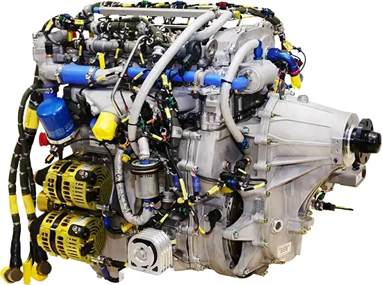
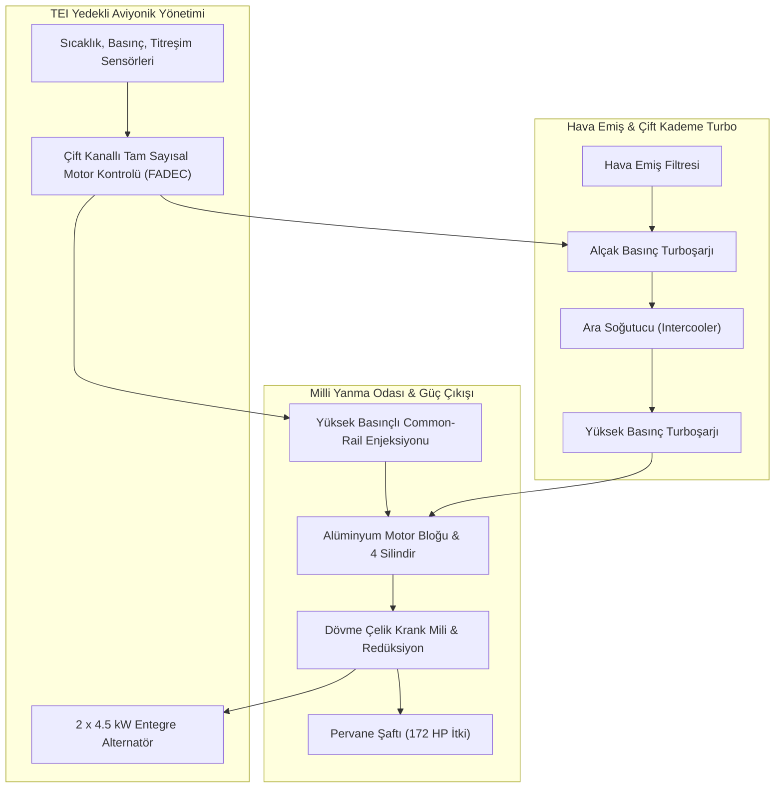

# ⚙️ Proje: TEI-PD170 Havacılık Turbodizel Motoru

<div align="center">

[](../../README.md)
[](../README.md)
[-00E676?style=for-the-badge&logo=speedtest&logoColor=black)](../../../docs/TRL_GUIDE.md)
[](#)

<p align="center">
  
</p>

</div>

---

## 🛡️ Stratejik Tanım & Doktriner Öncelik
**TEI-PD170**, Türkiye'nin Orta İrtifa Uzun Havada Kalış (MALE) sınıfı insansız hava araçlarının (TUSAŞ ANKA, TUSAŞ AKSUNGUR, Bayraktar TB3) yabancı motor bağımlılığını tamamen ortadan kaldıran, dünya standartlarında rekor irtifa kabiliyetine sahip milli turbodizel havacılık motorudur. İki kademeli seri turboşarj mimarisi sayesinde rakip Batılı motorlar 20.000 feet üzerinde güç kaybederken, PD170 30.000 feet irtifada dahi 170 beygir gücünü eksiksiz üretmeyi sürdürür. Düşük yakıt sarfiyatı ve askeri jet yakıtı (JP-8/Jet-A1) ile çalışma kabiliyeti Türk İHA filosuna stratejik dayanıklılık kazandırmıştır.

---

## 📊 Kapsamlı Teknik Özellikler Tablosu

| Parametre | Değer / Özellik | Açıklama |
| :--- | :--- | :--- |
| **Motor Tipi** | Sıralı 4 Silindir, 4 Zamanlı Turbodizel | Havacılık Standardı Common-Rail Dizel |
| **Kalkış Gücü** | 172 HP (±2 HP) | Deniz seviyesinde tam kalkış gücü |
| **Kritik İrtifa Gücü** | 170 HP @ 20.000 ft / 130 HP @ 30.000 ft | Yüksek irtifada minimum güç kaybı |
| **Maksimum İrtifa Tavanı** | 45.000 Feet | Sınıfının küresel irtifa tavan rekoru |
| **Kuru Ağırlık** | 162 kg (Tüm aksesuarlar dahil) | Yüksek güç/ağırlık oranı |
| **Yakıt Tipi** | JP-8, Jet-A1, Dizel (F-34, F-35 NATO Standartları) | Küresel askeri lojistikle tam uyumlu |
| **Özgül Yakıt Tüketimi (BSFC)** | ~210 g/kWh | Olağanüstü yakıt verimliliği ve menzil |
| **Elektrik Güç Üretimi** | 2 x 4.5 kW (9 kW Entegre Çift Alternatör) | İHA sensör ve radar yükü için devasa güç |
| **TBO (Revizyon Ömrü)** | 1.800 Saat (Hedef: 3.600 Saat) | Uzun operasyonel servis döngüsü |

---

## 🧩 Alt Sistemler ve Aviyonik/Elektronik Entegrasyonu



- **Çift Kademeli Seri Turboşarj Sistemi:** Yüksek irtifadaki seyreltik havayı iki aşamada sıkıştırarak silindirlere deniz seviyesi basıncında oksijen pompalar.
- **Milli FADEC (Full Authority Digital Engine Control):** Motorun tüm enjeksiyon, basınç ve devir parametrelerini pilot müdahalesine gerek kalmaksızın saniyede yüzlerce kez optimize eden yedekli yazılım ve işlemci mimarisi.
- **Kompakt Entegre Çift Alternatör:** SAR radarları, CATS/ASELFLIR kameraları ve uydu terminallerinin yüksek elektrik gereksinimini harici jeneratöre gerek kalmadan karşılar.

---

## 🎯 Entegrasyon Platformları ve Operasyonel Başarılar

### 1. TUSAŞ ANKA MALE İHA Ailesi
ANKA-B ve ANKA-S platformlarında yabancı Thielert motorlarının yerini alarak tavan irtifasını ve operasyonel kalış süresini 30+ saate çıkarmıştır.

### 2. TUSAŞ AKSUNGUR Ağır SİHA
İki adet TEI-PD170 motoruyla donatılan AKSUNGUR, 50 saate varan havada kalış ve 750 kg mühimmat taşıma kabiliyetine bu motor sayesinde ulaşmıştır.

### 3. Bayraktar TB3 (Deniz Konuşlu SİHA)
TCG ANADOLU amfibi hücum gemisinin kısa pistinden kalkış ve iniş yapabilmesi için yüksek tork sağlayan PD170 motoru kullanılmıştır.

---

## 🚀 TRL Seviyesi ve Gelişim Yol Haritası

```
[██████████] TRL 9 - Seri Üretimde ve 100.000+ Saat Muharebe Uçuşu
```

- [x] **TRL 1-4:** SSB Operasyonel İHA Motor Projesi başlatılması, tek silindir testleri.
- [x] **TRL 5-6:** İlk motor prototipinin test bremzesinde çalıştırılması ve 30.000 ft irtifa simülasyonu.
- [x] **TRL 7:** TUSAŞ ANKA üzerinde ilk uçuş testi (Aralık 2018).
- [x] **TRL 8:** Seri üretim kalifikasyonu ve zorlu kış/çöl iklim dayanıklılık testleri.
- [x] **TRL 9:** Seri üretim hattı, 100.000+ saat operasyonel uçuş kaydı, TSK ve dost ülke envanterlerinde tam aktiflik.

---

## 🔗 İç Dizin Navigasyonu
[⬅️ Üst Dizine](../README.md) | [🏛️ Dominion Hub](../../README.md) | [🏠 Ana Sayfa](../../../README.md)
