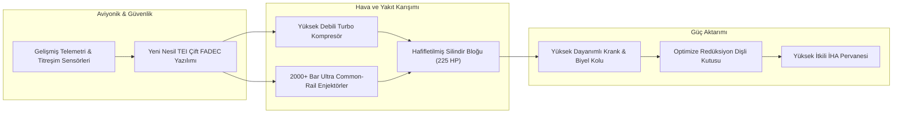

# ⚙️ Proje: TEI-PD222 İleri Turbodizel Havacılık Motoru

<div align="center">

[](../../README.md)
[](../README.md)
[-00E676?style=for-the-badge&logo=speedtest&logoColor=black)](../../../docs/TRL_GUIDE.md)
[](#)


</div>

---

## 🛡️ Stratejik Tanım & Doktriner Öncelik
**TEI-PD222**, başarısını kanıtlamış PD170 mimarisinin mekanik ve termodinamik sınırları genişletilerek üretilen, 222-225 beygir kalkış gücüne sahip yeni nesil turbodizel İHA motorudur. Ağır faydalı yük taşıyan taktik ve operasyonel insansız hava araçlarının kalkış pist mesafesini kısaltmak, tırmanma hızını katlamak ve ek mühimmat kapasitesi sunmak amacıyla tasarlanmıştır. PD170'e kıyasla 5 kg daha hafif olmasına rağmen +55 beygir daha fazla güç üreterek Türk savunma sanayiinin motor tasarımındaki malzeme ve yanma optimizasyonu ustalığını ortaya koymuştur.

---

## 📊 Kapsamlı Teknik Özellikler Tablosu

| Parametre | Değer / Özellik | Açıklama |
| :--- | :--- | :--- |
| **Motor Mimarisi** | Sıralı 4 Silindir, Optimize Turbodizel | Gelişmiş alüminyum alaşım blok |
| **Kalkış Gücü** | 222 - 225 HP | Yüksek tork ve hızlı ivmelenme |
| **Sürekli Seyir Gücü** | 200 HP | Uzun mesafeli karakol gücü |
| **İrtifa Tavanı** | 45.000 Feet | Yüksek irtifa görev profillerine tam uyum |
| **Kritik İrtifa** | 25.000 Feet | Güç kaybı yaşamadan korunan irtifa sınırı |
| **Kuru Ağırlık** | ~167 kg | Güç/ağırlık oranında sınıf liderliği |
| **Ömür / TBO** | 3.600 Saat | Düşük işletme maliyeti ve yüksek güvenilirlik |
| **Yakıt Uyumu** | JP-8, Jet-A1, Dizel | NATO yakıt standartlarına tam sertifikasyon |
| **Hedef Platformlar** | Bayraktar TB3, TUSAŞ ANKA, TUSAŞ AKSUNGUR, AKINCI-C | Ağır faydalı yük ve deniz konuşlu kalkış |

---

## 🧩 Alt Sistemler ve Aviyonik/Elektronik Entegrasyonu



- **Mekanik Hafifletme ve Mukavemet:** Silindir bloğundaki ağırlık azaltıcı tasarım optimizasyonları ve yüksek mukavemetli biyel kolları sayesinde motorun dayanımı artırılmış, ağırlığı korunmuştur.
- **Yenilenmiş Yüksek Akışlı Turboşarj:** 225 beygir gücün gerektirdiği hava debisini sağlamak üzere kompresör çarkı aerodinamiği yeniden modellenmiştir.
- **Akıllı FADEC Yazılım Katmanı:** Bayraktar TB3'ün TCG ANADOLU amfibi pistinden kalkışındaki ani gaz açma tepkisini milisaniyeler seviyesine indiren dinamik haritalama.

---

## 🎯 Görev Profili, Muharebe Senaryoları & Mühimmat Yelpazesi

### 1. TCG ANADOLU Güvertesinden Kısa Kalkış
Bayraktar TB3 gibi platformların deniz rüzgarı ve kısa pist koşullarında tam silah yüküyle (örneğin 4x MAM-L veya 2x MAM-T) güvenle havalanmasını sağlar.

### 2. Yüksek İrtifa Ağır Yük Taarruzu
AKSUNGUR ve ANKA platformlarında 500+ kg ek sensör (AESA radar + SAR + FLIR) veya ilave güdümlü bomba taşınmasına imkan tanır.

### 3. Sınır Güvenliğinde Hızlı Tırmanma
Acil alarm durumlarında İHA'nın operasyon irtifasına dakikalar içinde tırmanarak kriz bölgesine hızla intikal etmesini sağlar.

---

## 🚀 TRL Seviyesi ve Gelişim Yol Haritası

```
[████████░░] TRL 8 - Kalifikasyon ve Platform Entegrasyon Fazı
```

- [x] **TRL 1-4:** PD170 çekirdeği üzerinden güç yükseltme fizibilitesi ve termal simülasyonlar.
- [x] **TRL 5-6:** İlk prototip montajı, bremze testlerinde 225 HP güç üretimi doğrulanması.
- [x] **TRL 7:** 3.600 saatlik dayanıklılık testlerinin kritik aşamaları ve yer kalifikasyonu.
- [x] **TRL 8:** İHA platformlarında taksi ve uçuş entegrasyon denemeleri.
- [ ] **TRL 9:** Seri üretim teslimatlarının başlaması ve envanterdeki MALE/SİHA filolarına entegrasyonu.

---

## 🔗 İç Dizin Navigasyonu
[⬅️ Üst Dizine](../README.md) | [🏛️ Dominion Hub](../../README.md) | [🏠 Ana Sayfa](../../../README.md)
