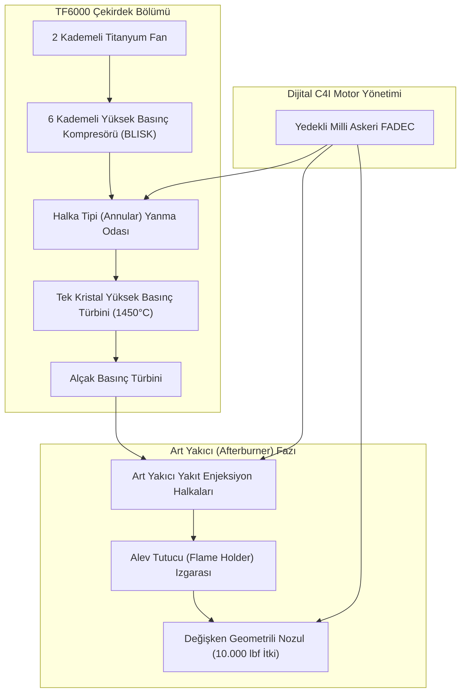

# ✈️ Proje: TEI-TF10000 Art Yakıcılı Turbofan Motor

<div align="center">

[

<p align="center">
  
</p>
](../../README.md)
[](../README.md)
[-yellow?style=for-the-badge&logo=speedtest&logoColor=black)](../../../docs/TRL_GUIDE.md)
[](#)


</div>

---

## 🛡️ Stratejik Tanım & Doktriner Öncelik
**TEI-TF10000**, Türkiye'nin geliştirdiği ilk askeri turbofan motor olan TF6000'in çekirdek mimarisi üzerine art yakıcı (Afterburner / Reheat) modülü eklenerek üretilen, 10.000 lbf sınıfı süpersonik jet motorudur. Bayraktar KIZILELMA-B insansız savaş uçağı ve TUSAŞ ANKA-3'ün süpersonik versiyonlarına ses hızının üzerinde (Mach 1.2+) sürat kazandırmak amacıyla geliştirilmektedir. Türkiye'nin 5. nesil milli muharip uçağı KAAN'ın yerli motoruna giden yoldaki en kritik teknolojik basamak olan TF10000; tek kristal türbin kanatçıkları, süperalaşım döküm ve yüksek sıcaklık art yakıcı geometrisiyle jet motoru liginde dev bir sıçramadır.

---

## 📊 Kapsamlı Teknik Özellikler Tablosu

| Parametre | Değer / Özellik | Açıklama |
| :--- | :--- | :--- |
| **Motor Mimarisi** | Düşük Bypasslı, Çift Şaftlı Art Yakıcılı Turbofan | Askeri Süpersonik İtki Ünitesi |
| **Kuru İtki (Dry Thrust)** | 6.000 lbf (~26.7 kN) | Art yakıcı kapalı ekonomik seyir gücü |
| **Art Yakıcılı İtki (Reheat)** | 10.000 lbf (~44.5 kN) | Süpersonik ivmelenme ve tırmanma gücü |
| **Bypass Oranı (BPR)** | ~1.08 | Yüksek hız ve kompakt kesit için optimize |
| **Türbin Giriş Sıcaklığı (TIT)** | 1.450+ °C | İleri termal bariyer kaplamaları (TBC) |
| **Kompresör Kademesi** | 2 Kademe Fan + 6 Kademe Eksenel Kompresör | Yüksek basınç oranı ve kompresyon verimi |
| **Nozul Geometrisi** | Değişken Geometrili Yakınsak-Iraksak Nozul | Süpersonik egzoz gazı yönlendirmesi |
| **Uygulama Alanları** | KIZILELMA-B, ANKA-3 Süpersonik, HÜRJET-C, Hızlı Hücumbotlar | İnsansız savaş uçakları ve hafif muharip jetler |

---

## 🧩 Alt Sistemler ve Aviyonik/Elektronik Entegrasyonu



- **Milli Tek Kristal Döküm Türbin Kanatçıkları:** TEI dökümhanelerinde geliştirilen, merkezkaç kuvvetine ve 1.450°C'yi aşan yanma gazlarına dayanıklı nikel süperalaşım kanatçıklar.
- **Değişken Geometrili Nozul Mekanizması:** Art yakıcı devreye girdiğinde nozul boğazını hidrolik/elektromekanik aktüatörlerle genişleterek motor içi geri basıncı önler ve süpersonik şok dalgalarını itkiye dönüştürür.
- **BLISK (Bladed Disk) Kompresör Diskleri:** Kanatçık ve diskin yekpare titanyum bloktan işlendiği, parça sayısını ve kaçakları azaltan ileri imalat teknolojisi.

---

## 🎯 Entegrasyon Platformları ve Muharebe Rolleri

### 1. Bayraktar KIZILELMA-B Süpersonik Muharebe
KIZILELMA'nın B varyantına ses üstü sürat kazandırarak hava-hava muharebelerinde düşman F-16 veya Su-35 savaş uçaklarına karşı önleme kabiliyeti sağlar.

### 2. TUSAŞ ANKA-3 Derin Darbe Taarruzu
Düşman hava savunmasının derinliklerine yüksek hızla sızarak dahili yuvasındaki SOM-J veya Tolun mühimmatlarını bırakıp hızla uzaklaşma olanağı tanır.

### 3. Deniz Platformları ve Hücumbotlar
Türk Deniz Kuvvetleri'nin yeni nesil hızlı hücumbot projelerinde gaz türbini tahrik ünitesi olarak yüksek sürat gücü sunar.

---

## 🚀 TRL Seviyesi ve Gelişim Yol Haritası

```
[██████░░░░] TRL 6 - Çekirdek Doğrulandı, Art Yakıcı İmalat ve Yer Testleri
```

- [x] **TRL 1-3:** Art yakıcı aerotermal modelleme ve CFD simülasyonları.
- [x] **TRL 4:** TF6000 çekirdek motoru üzerinden tasarım optimizasyonu ve malzeme kalifikasyonu.
- [x] **TRL 5:** Çekirdek motor TF6000'in başarıyla ilk ateşlemesini yapması (Şubat 2024).
- [x] **TRL 6:** Art yakıcı modülü prototip imalatı ve yer bremzesinde alev tutucu test tertibatı kurulumu.
- [ ] **TRL 7:** TF10000 tam motor olarak art yakıcı ile bremzede tam güç (10.000 lbf) testi (2025).
- [ ] **TRL 8-9:** Uçuş testleri ve platform entegrasyonu (KIZILELMA-B & ANKA-3).

---

## 🔗 İç Dizin Navigasyonu
[⬅️ Üst Dizine](../README.md) | [🏛️ Dominion Hub](../../README.md) | [🏠 Ana Sayfa](../../../README.md)
