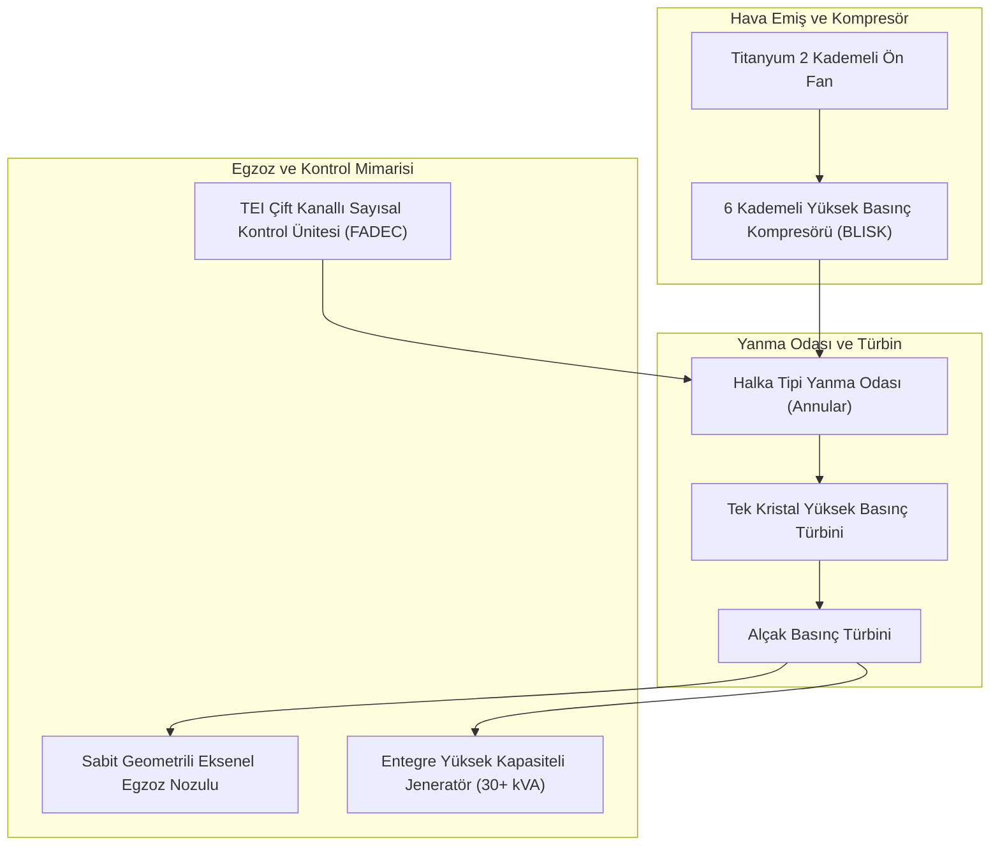

# ✈️ Proje: TEI-TF6000 Askeri Turbofan Motoru

<div align="center">

[](../../README.md)
[](../README.md)
[-00E676?style=for-the-badge&logo=speedtest&logoColor=black)](../../../docs/TRL_GUIDE.md)
[](#)


</div>

---

## 🛡️ Stratejik Tanım & Doktriner Öncelik
**TEI-TF6000**, Türkiye Cumhuriyeti tarihinin tamamen yerli imkânlarla tasarlanan, dökülen ve çalıştırılan ilk askeri turbofan motorudur. 6.000 lbf kuru itki üreten bu mühendislik anıtı; insansız savaş uçakları (Bayraktar KIZILELMA, TUSAŞ ANKA-3), hafif taarruz ve jet eğitim uçakları (HÜRJET türevleri) ve hücumbotlar için bağımsız milli itki kaynağıdır. Şubat 2024'te Eskişehir TEI tesislerinde gerçekleştirilen ilk başarılı ateşleme ile Türkiye, dünyada kendi askeri jet motorunu sıfırdan tasarlayıp üretebilen sınırlı sayıdaki havacılık devleri arasına girmiştir.

---

## 📊 Kapsamlı Teknik Özellikler Tablosu

| Parametre | Değer / Özellik | Açıklama |
| :--- | :--- | :--- |
| **Motor Tipi** | Düşük Bypasslı Askeri Turbofan Motor | Yüksek Performanslı İtki Mimarisi |
| **Kuru İtki (Dry Thrust)** | 6.000 lbf (~26.7 kN) | Sürekli yüksek subsonik itki |
| **Bypass Oranı** | ~1.08 | Kompakt gövde çapı ve yüksek jet hızı |
| **Kompresör Yapısı** | 2 Kademe Fan + 6 Kademe Eksenel Kompresör | Yekpare titanyum BLISK teknolojisi |
| **Türbin Kademesi** | 1 Kademe Yüksek Basınç + 1 Kademe Alçak Basınç Türbini | Tek kristal süperalaşım kanatçıklar |
| **Yanma Odası** | Halka Tipi (Annular) Düşük Emisyonlu Yanma | Yüksek verimli buharlaştırıcı püskürtme |
| **Özgül Yakıt Sarfiyatı** | Askeri standartlarda optimize | Uzun menzilli karakol ve devriye uçuşları |
| **Hedef Platformlar** | KIZILELMA-A, ANKA-3, Milli Hücumbotlar | İnsansız savaş uçakları ve hücumbot itkisi |

---

## 🧩 Alt Sistemler ve Aviyonik/Elektronik Entegrasyonu



- **Milli BLISK Üretim Teknolojisi:** Kompresör rotor kanatçıkları diske geçme değil, 5 eksenli hassas tezgahlarda yekpare bloktan işlenerek motor ağırlığı radikal biçimde düşürülmüştür.
- **Gelişmiş Soğutma Kanalları:** Türbin kanatçıkları içindeki mikro soğutma labirentleri sayesinde metal erime noktasının üzerindeki gaz sıcaklıklarında güvenle çalışır.
- **Yüksek Güçlü Aviyonik Jeneratör:** KIZILELMA ve ANKA-3'ün AESA radarları, elektronik harp podları ve görev bilgisayarlarını besleyecek yüksek elektrik akımını üretir.

---

## 🎯 Operasyonel Görev Profili ve Entegrasyon

### 1. İnsansız Savaş Uçağı (KIZILELMA-A)
KIZILELMA'nın ilk seri üretim varyantlarında subsonik seyir hızında uzun menzilli görevler icra etmesini sağlar.

### 2. ANKA-3 Hayalet Uçan Kanat
ANKA-3'ün gövde içine entegre edilerek düşük radar kesit alanını koruyan özel S-kanallı hava alığı ile tam uyum gösterir.

### 3. TF10000 ve KAAN Motoruna Teknoloji Transferi
TF6000 projesinde kazanılan döküm, tolerans, FADEC ve yanma tecrübeleri Türkiye'nin 35.000 lbf'lik KAAN motorunun temel yapı taşını oluşturmuştur.

---

## 🚀 TRL Seviyesi ve Gelişim Yol Haritası

```
[███████░░░] TRL 7 - İlk Ateşleme Başarılı, Test Bremzesinde Doğrulama Sürüyor
```

- [x] **TRL 1-4:** SSB Askeri Turbofan Geliştirme Projesi sözleşmesi, aerodinamik tasarım.
- [x] **TRL 5:** Tek kristal döküm, BLISK işleme ve tüm alt sistem imalatının tamamlanması.
- [x] **TRL 6:** Montajın tamamlanması ve bremzeye yerleştirilerek çalıştırma testlerine hazır hale getirilmesi.
- [x] **TRL 7:** 27 Şubat 2024 - İlk başarılı ateşleme ve rölanti/orta güç testlerinin icrası.
- [ ] **TRL 8:** Tam güç (6.000 lbf) dayanıklılık testleri ve kalifikasyon belgesi.
- [ ] **TRL 9:** Uçuş testleri ve platformlarda seri kullanıma geçiş.

---

## 🔗 İç Dizin Navigasyonu
[⬅️ Üst Dizine](../README.md) | [🏛️ Dominion Hub](../../README.md) | [🏠 Ana Sayfa](../../../README.md)
