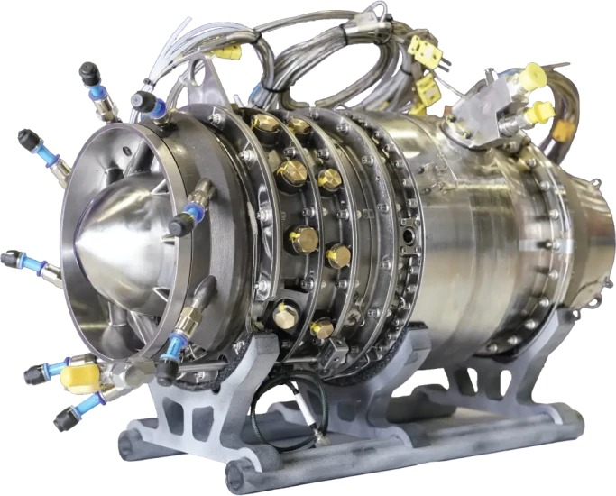
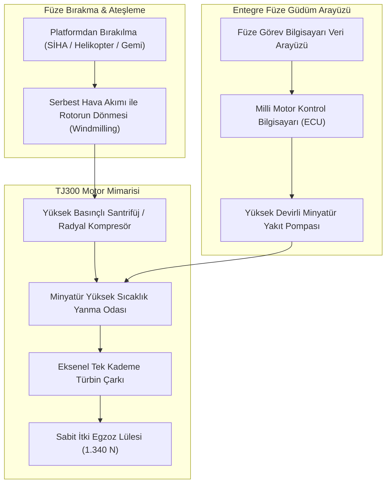

# 🚀 Proje: TEI-TJ300 Orta Menzilli Füze Turbojet Motoru

<div align="center">

[](../../README.md)
[](../README.md)
[-00E676?style=for-the-badge&logo=speedtest&logoColor=black)](../../../docs/TRL_GUIDE.md)
[](#)

<p align="center">
  
</p>

</div>

---

## 🛡️ Stratejik Tanım & Doktriner Öncelik
**TEI-TJ300**, Türkiye'nin TÜBİTAK desteğiyle geliştirdiği, 240 milimetre gibi daracık bir motor çapına sığdırılmış olmasına karşın 1.340 Newton (300 lbf) itki üretebilen, sınıfında dünya güç yoğunluğu rekorunu elinde bulunduran milli turbojet motorudur. Orta menzilli gemisavar füzeleri, seyir füzeleri ve hava platformlarından bırakılan standoff mühimmatlar için tasarlanmıştır. Düşük ağırlığı (~34 kg), hava akımıyla marşsız çalışma (Windmilling) kabiliyeti ve yüksek irtifada ani ateşlenebilme güvenilirliği ile Türkiye'nin güdümlü füze bağımsızlığında kritik bir yapıtaşıdır.

---

## 📊 Kapsamlı Teknik Özellikler Tablosu

| Parametre | Değer / Özellik | Açıklama |
| :--- | :--- | :--- |
| **Motor Sınıfı** | Minyatür Füze Turbojet Motoru | Yüksek Güç Yoğunluklu İtki Ünitesi |
| **Maksimum İtki** | 1.340 N (300 lbf) | 240 mm çapta dünya itki rekoru |
| **Motor Dış Çapı** | 240 mm (9.4 inç) | Standart füze gövde tüplerine doğrudan montaj |
| **Motor Kuru Ağırlığı** | ~34 kg | Füze menzil ve harp başlığı kapasitesini artırır |
| **Çalışma İrtifası** | Deniz Seviyesinden 5.000+ Metreye (16.500 ft) | Deniz yalama ve orta irtifa seyir profili |
| **Maksimum Sürat** | Yüksek Subsonik (0.8 - 0.9 Mach) | Füzeyi hedef üzerine ses hızına yakın ulaştırır |
| **Başlatma Yöntemi** | Rüzgar Etkisiyle Başlatma (Windmilling) / Piroteknik | Ağır marş motoru ihtiyacını ortadan kaldırır |
| **Kullanılan Yakıt** | Askeri Ağır Havacılık Yakıtları (JP-8, JP-10) | Yüksek enerji yoğunluklu füze yakıtı |
| **Kontrol Ünitesi** | Milli Entegre Elektronik Kontrol Ünitesi (ECU) | Füzeyle tümleşik dijital telemetri |

---

## 🧩 Alt Sistemler ve Aviyonik/Elektronik Entegrasyonu



- **Windmilling Başlatma Özelliği:** Hava platformundan bırakılan füzenin motor pallerinin karşıdan gelen hava akımıyla hızla dönmeye başlaması ve elektrik/marş motoru gerekmeksizin doğrudan yakıt püskürtülerek ateşlenmesi.
- **Kompakt Santrifüj Kompresör:** Sınırlı çap içinde maksimum hava sıkıştırma oranını yakalayan ileri aerodinamik tasarım.
- **Yağlama Sistemi Entegrasyonu:** Yakıt ile soğutmalı ve yağlamalı özel rulman tasarımı sayesinde harici yağlama tankı ve pompası taşımayarak ağırlıktan devasa tasarruf sağlar.

---

## 🎯 Uygulama Alanları ve Hedef Platformlar

### 1. Orta Menzilli Gemisavar Füzeleri (OMGS)
ROKETSAN tarafından geliştirilen orta menzilli kıyı savunma ve gemisavar füzelerinin ana itki kaynağıdır.

### 2. Hava-Yer Taktik Seyir Mühimmatları
AKINCI, AKSUNGUR, HÜRJET ve savaş uçaklarından atılacak 100-200 km menzilli kompakt mühimmatların itkisi.

### 3. Denizaltı Kovanından Atılan Taktik Seyir Füzeleri
Kapsül içinde torpido kovanından fırlatılıp su yüzeyine çıktığında devreye giren taktik füze konseptleri.

---

## 🚀 TRL Seviyesi ve Gelişim Yol Haritası

```
[██████████] TRL 9 - Kalifiye Edildi, Seri Üretimde ve Envantere Hazır
```

- [x] **TRL 1-4:** Sanayi ve Teknoloji Bakanlığı & TÜBİTAK desteğiyle konsept ve aerodinamik tasarım.
- [x] **TRL 5-6:** İlk prototip montajı ve bremzede dünya rekoru itki değerine ulaşılması (Haziran 2020).
- [x] **TRL 7:** Rüzgar tüneli irtifa ve windmilling başlatma testlerinin tamamlanması.
- [x] **TRL 8:** Füze gövdesi entegrasyonu ve tam sistem yer kalifikasyonu.
- [x] **TRL 9:** Seri üretim hattının kurulması, füze projelerine teslimatların yapılması.

---

## 🔗 İç Dizin Navigasyonu
[⬅️ Üst Dizine](../README.md) | [🏛️ Dominion Hub](../../README.md) | [🏠 Ana Sayfa](../../../README.md)
