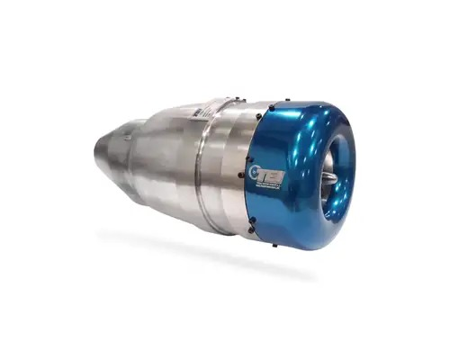
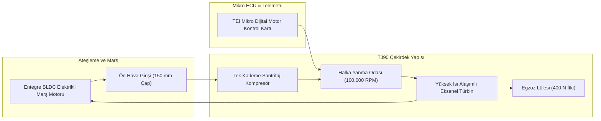

# ⚙️ Proje: TEI-TJ90 Mikro Turbojet Motoru

<div align="center">

[](../../README.md)
[](../README.md)
[-00E676?style=for-the-badge&logo=speedtest&logoColor=black)](../../../docs/TRL_GUIDE.md)
[](#)

<p align="center">
  
</p>

</div>

---

## 🛡️ Stratejik Tanım & Doktriner Öncelik
**TEI-TJ90**, yüksek hızlı hedef uçaklar (TUSAŞ Şimşek) ve mini taktik seyir füzeleri için milli imkanlarla geliştirilmiş kompakt, yüksek devirli mikro turbojet motorudur. Yaklaşık 4 kilogramlık toplam gövde ağırlığına rağmen 400 Newton (90 lbf) itki üretebilen TJ90; hava savunma tatbikatlarında savaş uçağı ve füzeleri taklit eden hedef İHA'ların 500+ km/s süratlere ulaşmasını sağlar. Türk Silahlı Kuvvetleri'nin hava savunma unsurlarını (HİSAR, KORKUT, SİPER) en gerçekçi tehdit simülasyonlarıyla eğitmesinde ve harbe hazır tutulmasında sessiz kahramandır.

---

## 📊 Kapsamlı Teknik Özellikler Tablosu

| Parametre | Değer / Özellik | Açıklama |
| :--- | :--- | :--- |
| **Motor Sınıfı** | Mikro Turbojet İtki Sistemi | Kompakt Yüksek Devirli Jet Motoru |
| **Üretilen İtki** | 400 N (~90 lbf) @ Deniz Seviyesi | Yüksek hız tırmanma ve seyir gücü |
| **Çalışma Devri** | 96.000 - 100.000 RPM | Dakikada 100 bin devir dönen mikro türbin |
| **Kuru Motor Ağırlığı** | ~3.9 - 4.2 kg | Ultra hafif gövde mimarisi |
| **Dış Çap** | ~150 mm | Dar tüp ve kanat altı pod uyumu |
| **Platform Sürati** | 400 - 500+ km/s (Target Drone) | Gerçek savaş uçağı ve füze yaklaşma hızı |
| **Yakıt Tipi** | Jet-A1, JP-8 + %5 Özel Yağlama Karışımı | Basit ve güvenilir besleme mimarisi |
| **Başlatma Yöntemi** | Entegre Elektrikli Fırçasız Marş Motoru | Hızlı ve güvenilir yer/hava ateşlemesi |
| **Kontrol Mimarisi** | Milli Kompakt Dijital ECU Kartı | Otopilot ile tam entegre dijital yönetim |

---

## 🧩 Alt Sistemler ve Aviyonik/Elektronik Entegrasyonu



- **100.000 RPM Rotor Kararlılığı:** Dakikada 100.000 devir yapan milin dinamik balans ve mikro seramik rulmanlarla titreşimsiz çalışması sağlanmıştır.
- **Yekpare Santrifüj Çark:** Havayı merkezkaç kuvvetiyle radyal olarak hızlandıran yüksek mukavemetli alüminyum alaşım kompresör.
- **Entegre Marş/Jeneratör:** Motoru çalıştıran marş motoru, motor rölantiye ulaştıktan sonra jeneratör moduna geçerek hedef uçağın elektroniklerini besler.

---

## 🎯 Uygulama Alanları ve Hedef Platformlar

### 1. TUSAŞ Şimşek Yüksek Hızlı Hedef Uçak
Hava savunma radarları ve füzeleri için dost kuvvet tatbikatlarında süpersonik/yüksek hızlı düşman hava hedeflerini simüle eder.

### 2. Kamikaze Hedef ve Sahte Hedef (Decoy)
Düşman hava savunmasını aldatmak ve mühimmatını boşa harcatmak üzere fırlatılan sahte hedef mühimmatlarında itki kaynağıdır.

### 3. Hafif Taktik Seyir ve Loitering Füzeleri
Geleceğin otonom mini seyir füzeleri ve sürü taarruz platformları için maliyet etkin itki alternatifi sunar.

---

## 🚀 TRL Seviyesi ve Gelişim Yol Haritası

```
[██████████] TRL 9 - Seri Üretimde, TSK Tarafından Yaygın Kullanımda
```

- [x] **TRL 1-4:** TEI bünyesinde mikro turbojet motor tasarımı ve aerodinamik akış çözümleri.
- [x] **TRL 5-6:** Prototip üretimi, test standında 400 Newton itki ve 100.000 RPM doğrulaması.
- [x] **TRL 7:** TUSAŞ Şimşek platformuna entegrasyon ve ilk başarılı uçuş testi (2017).
- [x] **TRL 8:** Çoklu irtifa uçuşları, yüksek hız dalışları ve askeri çevre kalifikasyonu.
- [x] **TRL 9:** Seri üretim teslimatları, TSK atış poligonlarında kesintisiz operasyonel hizmet.

---

## 🔗 İç Dizin Navigasyonu
[⬅️ Üst Dizine](../README.md) | [🏛️ Dominion Hub](../../README.md) | [🏠 Ana Sayfa](../../../README.md)
