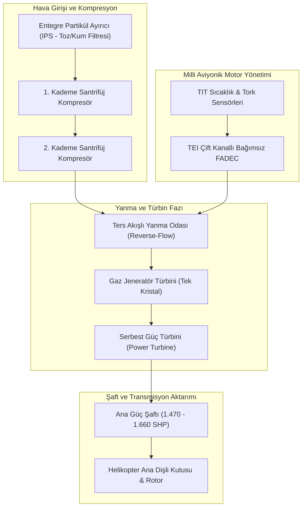

# 🚁 Proje: TEI-TS1400 Milli Turboşaft Helikopter Motoru

<div align="center">

[](../../README.md)
[](../README.md)
[-00E676?style=for-the-badge&logo=speedtest&logoColor=black)](../../../docs/TRL_GUIDE.md)
[](#)


</div>

---

## 🛡️ Stratejik Tanım & Doktriner Öncelik
**TEI-TS1400**, Türkiye'nin özgün helikopteri TUSAŞ T625 GÖKBEY başta olmak üzere, T129 ATAK taarruz helikopteri ve yeni nesil döner kanatlı platformları yabancı motor lisans kısıtlamalarından tamamen kurtaran, Türkiye'nin ilk milli ve sertifikalı turboşaft motorudur. 1.470 şaft beygir gücü (SHP) kalkış ve tek motor arızası (OEI) durumunda 1.660 SHP acil durum gücü üreten bu devrimsel motor; tek kristal türbin kanatçıkları, ters akışlı yanma odası ve çift kanallı yedekli FADEC sistemi ile dünya helikopter motoru pazarındaki en modern ve rekabetçi tasarımlardan biridir.

---

## 📊 Kapsamlı Teknik Özellikler Tablosu

| Parametre | Değer / Özellik | Açıklama |
| :--- | :--- | :--- |
| **Motor Sınıfı** | Çift Şaftlı Serbest Güç Türbinli Turboşaft | Askeri & Sivil Havacılık Sertifikalı |
| **Kalkış Gücü (Take-Off)** | 1.470 SHP | Deniz seviyesi ve sıcak hava performansı |
| **Acil Durum Gücü (OEI - 30 sn)** | 1.660 SHP | Tek motor durduğunda güvenli uçuş gücü |
| **Sürekli Seyir Gücü** | 1.250 SHP | Ekonomik ve uzun menzilli uçuş modu |
| **Kuru Motor Ağırlığı** | ~160 kg | 9.2 shp/kg olağanüstü güç/ağırlık oranı |
| **Servis Tavanı** | 20.000 Feet | Yüksek dağlık arazi ve sıcak hava operasyonları |
| **Çıkış Şaft Devri** | 23.000 RPM (Redüksiyon Dişlisine Giriş) | Helikopter ana transmisyonuna yüksek tork aktarımı |
| **Kompresör Tipi** | 2 Kademeli Santrifüj Kompresör | Yüksek basınç oranı ve yabancı madde direnci |
| **Uygulama Platformları** | TUSAŞ T625 GÖKBEY, T129 ATAK, HÜRJET Varyantları | Genel maksat ve taarruz helikopterleri |

---

## 🧩 Alt Sistemler ve Aviyonik/Elektronik Entegrasyonu



- **Ters Akışlı (Reverse-Flow) Yanma Odası:** Motorun boyunu kısaltarak ağırlık merkezini optimize eden ve türbin girişine son derece homojen sıcaklık dağılımı sağlayan aerotermal mimari.
- **Entegre Partikül Ayırıcı (IPS):** Çöl, dağlık ve tozlu arazilerde helikopterin kalkışı esnasında havaya kalkan kum taneciklerini motora girmeden dışarı atan santrifüj filtre sistemi.
- **Çift Kanallı Yedekli FADEC:** Herhangi bir elektriksel veya sensör arızasında milisaniyeler içinde yedek kanala geçerek motorun durmasını kesin olarak engelleyen tam sayısal motor kontrolü.

---

## 🎯 Operasyonel Görev Profili ve Entegrasyon

### 1. TUSAŞ T625 GÖKBEY Genel Maksat Helikopteri
GÖKBEY'in ambulans, arama kurtarma, VIP ve taktik nakliye görevlerinde yerli kalbi olarak yüksek sıcaklık ve irtifada tam performans uçuş sağlar.

### 2. T129 ATAK Taarruz Helikopteri Entegrasyonu
Mevcut yabancı motorların yerine geçerek ATAK'ın dost ve müttefik ülkelere yönelik ihracatında karşılaşılan tüm diplomatik engelleri ortadan kaldırır.

### 3. Deniz Konuşlu Helikopter Operasyonları
Korozyona dayanıklı nikel süperalaşımları ve tuzlu deniz havasına uygun kaplamalarıyla fırkateyn ve TCG ANADOLU pistlerinde sorunsuz çalışma.

---

## 🚀 TRL Seviyesi ve Gelişim Yol Haritası

```
[████████░░] TRL 8 - Helikoptere Entegre Edildi, Uçuş Testleri Başarıyla Sürüyor
```

- [x] **TRL 1-4:** SSB Turboşaft Motor Geliştirme Projesi (TMGP) sözleşmesi ve tasarım doğrulama.
- [x] **TRL 5-6:** İlk prototip montajı, çekirdek motor çalıştırması ve 1.500+ SHP güç rekoru.
- [x] **TRL 7:** 22 Nisan 2023 - GÖKBEY helikopteri ile TS1400 motorunun ilk tarihi test uçuşu.
- [x] **TRL 8:** İrtifa, tek motor arızası (OEI) simülasyonları ve zorlu hava koşulları uçuş testleri.
- [ ] **TRL 9:** Sivil Havacılık (SHGM / EASA) ve Askeri sertifikasyonların tamamlanarak seri üretime geçilmesi.

---

## 🔗 İç Dizin Navigasyonu
[⬅️ Üst Dizine](../README.md) | [🏛️ Dominion Hub](../../README.md) | [🏠 Ana Sayfa](../../../README.md)
