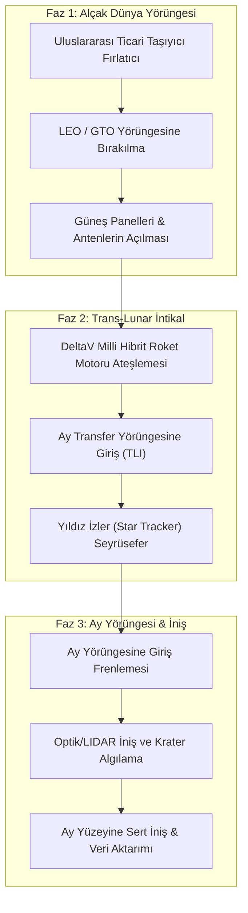

# 🌙 Proje: AY GÖREVİ (Milli Uzay Programı Derin Uzay Misyonu)

<div align="center">

[](../../README.md)
[](../README.md)
[-yellow?style=for-the-badge&logo=speedtest&logoColor=black)](../../../docs/TRL_GUIDE.md)
[](#)


</div>

---

## 🛡️ Stratejik Tanım & Doktriner Öncelik
**Milli Ay Görevi (AYAP)**, Türkiye Cumhuriyeti'nin Milli Uzay Programı kapsamında Türkiye Uzay Ajansı (TUA), DeltaV Uzay Teknolojileri, TÜBİTAK UZAY ve TUSAŞ iş birliğiyle yürütülen en prestijli derin uzay projesidir. Misyon; DeltaV tarafından geliştirilen milli ve yenilikçi hibrit roket motoru (Sıvı Oksijen + Katı Parafin) teknolojisiyle uzay aracını Dünya yörüngesinden Ay yörüngesine taşımayı ve Ay yüzeyine sert/yumuşak iniş yaparak teknolojik gösterim gerçekleştirmeyi hedefler. Bu tarihi başarı Türkiye'yi dünyada derin uzaya bağımsız erişim sağlayan ve Ay misyonu icra edebilen elit ülkeler ligine taşıyacaktır.

---

## 📊 Kapsamlı Teknik Özellikler Tablosu

| Parametre | Değer / Özellik | Açıklama |
| :--- | :--- | :--- |
| **Görev Tipi** | Derin Uzay Seyrüseferi & Ay Yüzeyi İniş Aracı | İki Aşamalı Milli Ay Misyonu (AYAP-1 & AYAP-2) |
| **Ana İtki Sistemi** | DeltaV Sıvı Oksijen (LOX) + Parafin Hibrit Roket Motoru | Uzay ortamında yeniden ateşlenebilir itki |
| **İtki Değeri** | Uzayda ~3.000 - 5.000 N Vakum İtkisi | Yörünge düzeltme ve frenleme manevraları |
| **Yönelim Kontrol (RCS)** | Soğuk Gaz / Minyatür Hibrit İtki Nozulları | 3 Eksenli hassas tutum belirleme ve kontrol |
| **Uzay Aracı Ağırlığı** | ~1.5 - 2.5 Ton (Yakıt Dahil Fırlatma Kütlesi) | LEO / GTO yörüngesinden ayrılış ağırlığı |
| **Haberleşme Ağı** | X-Bant ve S-Bant Derin Uzay Şebekesi (DSN Uyumlu) | 384.000 km mesafeden kesintisiz telemetri |
| **Güç Üretimi** | Katlanabilir Galyum-Arsenit (GaAs) Güneş Panelleri | Uzay radyasyonuna dayanıklı yüksek verimli hücreler |
| **Aviyonik Mimarisi** | Radyasyon Dirençli (Rad-Hard) Milli Görev Bilgisayarı | TÜBİTAK BİLGEM & TÜBİTAK UZAY ortak tasarımı |

---

## 🧩 Alt Sistemler ve Aviyonik/Elektronik Entegrasyonu



- **DeltaV Milli Hibrit Roket Teknolojisi:** Sıvı oksijen oksitleyici ve katı parafin yakıtın birleşimiyle patlama riski sıfıra yakın, maliyeti son derece düşük ve uzay vakumunda defalarca durdurulup yeniden ateşlenebilen benzersiz itki sistemi.
- **Yıldız İzler (Star Tracker) & Güneş Sensörleri:** Uzay aracının yönünü uzaydaki yıldız haritasıyla eşleştirerek miliradyan hassasiyetle konum tayini sağlayan optik seyrüsefer.
- **Derin Uzay İletişimi:** Dünyadaki yer istasyonları ve müttefik derin uzay anten ağlarıyla (DSN) 384 bin kilometreden görüntü, telemetri ve bilimsel veri aktarımı.

---

## 🎯 Misyon Aşamaları ve Bilimsel Hedefler

### 1. Aşama-1: Sert İniş ve İtki Gösterimi (AYAP-1)
Uzay aracının Dünya yörüngesinden DeltaV hibrit motoruyla Ay'a transfer edilmesi, uzay ortamında motorun operasyonel olarak ateşlenmesi ve Ay yüzeyine çarparak veri gönderimi.

### 2. Aşama-2: Yumuşak İniş ve Mobil Gezgin (AYAP-2)
Ay kutup bölgelerine iniş takımlarıyla yumuşak iniş gerçekleştirilmesi, yerli robotik gezginin (rover) yüzeye indirilerek toprak analizi ve su buzu aranması.

### 3. Derin Uzay Lojistiği ve Geleceğin Madenciliği
Gelecekte kurulacak uluslararası Ay üslerine malzeme taşınması ve uzay madenciliği için gereken seyrüsefer ve itki altyapısının doğrulanması.

---

## 🚀 TRL Seviyesi ve Gelişim Yol Haritası

```
[██████░░░░] TRL 6 - Sistem ve İtki Testleri Tamamlandı, Uçuş Modeli Hazırlığı
```

- [x] **TRL 1-3:** Milli Uzay Programı Ay Misyonu stratejik planı ve sistem gereksinim analizi.
- [x] **TRL 4:** DeltaV hibrit roket motorunun yer bremzelerinde vakum ve irtifa simülasyon testleri.
- [x] **TRL 5:** Sonda Roketi Sistemi (SORS) ile hibrit motorun uzay sınırını (100+ km) aşarak uzayda ateşlenmesi.
- [x] **TRL 6:** Uzay aracının ön tasarım (PDR) ve kritik tasarım (CDR) aşamalarının tamamlanması; aviyonik ve itki modelleri testi.
- [ ] **TRL 7:** Uçuş modelinin üretimi ve entegre çevre/vakum/termal testlerinin icrası.
- [ ] **TRL 8-9:** Fırlatma rampasına intikal, Ay'a fırlatılış ve yüzeye ulaşarak tarihi görevin tamamlanması.

---

## 🔗 İç Dizin Navigasyonu
[⬅️ Üst Dizine](../README.md) | [🏛️ Dominion Hub](../../README.md) | [🏠 Ana Sayfa](../../../README.md)
