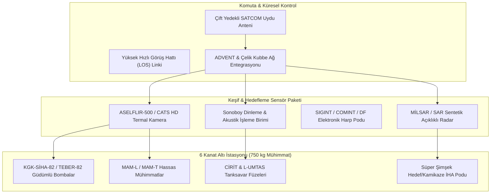

# 🦅 Proje: TUSAŞ AKSUNGUR Ağır MALE İnsansız Hava Aracı

<div align="center">

[](../../README.md)
[](../README.md)
[-00E676?style=for-the-badge&logo=speedtest&logoColor=black)](../../../docs/TRL_GUIDE.md)
[](#)


</div>

---

## 🛡️ Stratejik Tanım & Doktriner Öncelik
**TUSAŞ AKSUNGUR**, Türk Havacılık ve Uzay Sanayii (TUSAŞ) tarafından ANKA İHA ailesinin mühendislik tecrübesi üzerine inşa edilen, çift motorlu, yüksek faydalı yük kapasiteli ve kesintisiz 50+ saat havada kalış rekoruna sahip operasyonel MALE sınıfı insansız hava aracıdır. İki adet yerli TEI-PD170 turbodizel motoruyla donatılan AKSUNGUR; 750+ kg mühimmat ve sensör taşıma kapasitesiyle Türkiye'nin ilk kez bir İHA'dan kanat altına sonoboy podu takarak Denizaltı Savunma Harbi (DSH) icra etmesini sağlamıştır. Ağır genel maksat bombalarını (KGK, TEBER, HGK) stand-off mesafelerden hedefe ulaştıran AKSUNGUR, Türk Deniz ve Hava Kuvvetleri'nin Mavi Vatan ve sınır ötesi harekatlardaki gökyüzü kalesidir.

---

## 📊 Kapsamlı Teknik Özellikler Tablosu

| Parametre | Değer / Özellik | Açıklama |
| :--- | :--- | :--- |
| **Sistem Sınıfı** | Çift Motorlu Yüksek Faydalı Yük MALE İHA | Çok Rollü İstihbarat, Taarruz & DSH |
| **Kanat Açıklığı** | 24.2 Metre | Yüksek süzülme oranı ve kanat altı 6 istasyon |
| **Gövde Uzunluğu** | 12.5 Metre | Çift kuyruk bumu mimarisi |
| **Maksimum Kalkış Ağırlığı (MTOW)** | 3.300 kg | Ağır faydalı yük ve yakıt kapasitesi |
| **Faydalı Yük Kapasitesi** | 750+ kg | 6 harici silah pylonu + dahili gövde sensörü |
| **Havada Kalış Süresi** | 50+ Saat (Keşif/Gözetleme) / 24+ Saat (Tam Silah Yükü) | Dünya çapında dayanıklılık rekoru |
| **Servis Tavanı** | 40.000 Feet | Düşman orta menzilli hava savunmasının üstü |
| **Motor Sistemi** | 2 x TEI-PD170 Çift Turboşarjlı Dizel (2 x 170 HP) | Milli ve yüksek irtifa kabiliyetli itki |
| **Haberleşme Altyapısı** | Karıştırmaya Dayanıklı Çift SATCOM + LOS Veri Linki | Küresel uydu kontrolü ve sınırsız menzil |

---

## 🧩 Alt Sistemler ve Aviyonik/Elektronik Entegrasyonu



- **Denizaltı Savunma Harbi (DSH) Kabiliyeti:** Kanat altındaki özel podlardan denize sonoboy bırakarak su altındaki denizaltıların akustik ses imzasını anlık tespit edip donanma karargahına aktarır.
- **SAR/GMTI Radarı:** Bulutlu, sisli veya fırtınalı havalarda dahi yeryüzünün metre altı çözünürlükte radar haritasını çıkarır ve hareketli kara/deniz hedeflerini işaretler.
- **GSM İletişim Rölesi Desteği:** Deprem ve afet dönemlerinde kanat altına takılan baz istasyonu podu ile yüzlerce kilometrekarelik alanda cep telefonu şebekesini ayağa kaldırır.

---

## 🎯 Görev Profili, Muharebe Senaryoları & Mühimmat Yelpazesi

### 1. Mavi Vatan Denizaltı ve Su Üstü Devriyesi
Ege ve Doğu Akdeniz'de 50 saat boyunca kesintisiz havada kalarak düşman fırkateyn ve denizaltılarını sonar ve elektro-optik sistemlerle arar.

### 2. Stand-Off Derin Taarruz (KGK & TEBER)
Kanadında taşıdığı 250 kg'lık kanatlı güdüm kiti KGK-82 ile düşman hava savunma menziline girmeden 30-40 km öteden stratejik hedefleri nokta atışıyla imha eder.

### 3. Çoklu MAM-T / MAM-L Sürü Bombardımanı
Geniş taarruz görevlerinde 6 silah istasyonuna dağıtılmış 12+ adede varan MAM ailesi mühimmatıyla düşman zırhlı konvoylarını tek uçuşta etkisiz hale getirir.

---

## 🚀 TRL Seviyesi ve Gelişim Yol Haritası

```
[██████████] TRL 9 - Seri Üretimde, Envanterde ve Dost Ülkelere İhraç Edildi
```

- [x] **TRL 1-4:** TUSAŞ bünyesinde çift motorlu ağır MALE platform konsepti ve gövde tasarımı.
- [x] **TRL 5-6:** Prototip imalatı ve TEI PD170 motorlarının ilk entegrasyonu.
- [x] **TRL 7:** 2019 yılında ilk uçuşun icrası ve 49 saatlik tarihi kesintisiz uçuş rekoru.
- [x] **TRL 8:** Deniz Kuvvetleri kabul testleri, sonoboy atımı ve KGK-82 canlı mühimmat atışları.
- [x] **TRL 9:** Türk Deniz Kuvvetleri ve Hava Kuvvetleri envanterine giriş; Kırgızistan, Angola ve müttefik ülkelere ihracat teslimatları.

---

## 🔗 İç Dizin Navigasyonu
[⬅️ Üst Dizine](../README.md) | [🏛️ Dominion Hub](../../README.md) | [🏠 Ana Sayfa](../../../README.md)
