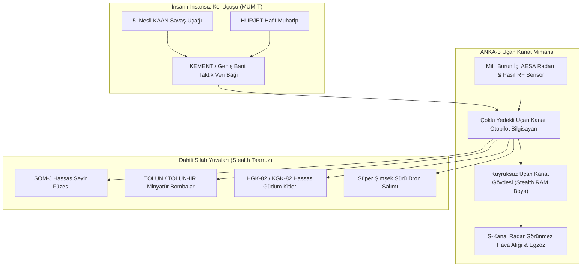

# 🦇 Proje: TUSAŞ ANKA-3 Hayalet İnsansız Savaş Uçağı (VLO MIUS)

<div align="center">

[

<p align="center">
  
</p>
](../../README.md)
[](../README.md)
[-00E676?style=for-the-badge&logo=speedtest&logoColor=black)](../../../docs/TRL_GUIDE.md)
[](#)


</div>

---

## 🛡️ Stratejik Tanım & Doktriner Öncelik
**TUSAŞ ANKA-3**, Türk havacılık sanayiinin ulaştığı en ileri teknolojik seviyeyi temsil eden, dikey ve yatay kuyrukları bulunmayan "Uçan Kanat" (Flying Wing) gövde geometrisine sahip, Çok Düşük Radar Kesit Alanlı (VLO - Stealth) yeni nesil insansız savaş uçağıdır (MİUS). Turbofan jet motoruyla yüksek subsonik hızlarda (0.7 Mach) seyreden ANKA-3; düşman hava savunma şemsiyesinin (A2/AD) arkasına radarlara yakalanmadan sızarak derin darbe (Deep Strike), düşman hava savunmasının bastırılması/yok edilmesi (SEAD/DEAD) ve KAAN savaş uçağı ile otonom kol uçuşunda "Sadık Kanat Adamı" (Loyal Wingman / MUM-T) görevlerini icra etmek üzere geliştirilmiştir. Dahili silah yuvaları mühimmat taşırken dahi radar görünmezliğini korur.

---

## 📊 Kapsamlı Teknik Özellikler Tablosu

| Parametre | Değer / Özellik | Açıklama |
| :--- | :--- | :--- |
| **Sistem Sınıfı** | Hayalet İnsansız Savaş Uçağı (VLO Stealth UCAV) | Kuyruksuz Uçan Kanat (Flying Wing) Mimarisi |
| **Maksimum Kalkış Ağırlığı (MTOW)** | 6.500 kg | Ağır sınıf jet muharip hava platformu |
| **Faydalı Yük Kapasitesi** | 1.200 kg | Dahili gövde istasyonları + harici kanat pylonları |
| **Azami Sürat** | 0.7 Mach (800+ km/s) | Yüksek subsonik intikal ve görev sürati |
| **Seyir Sürati** | 250 Knot (460 km/s) | Uzun menzilli düşük yakıt tüketimli devriye |
| **İrtifa Tavanı** | 40.000 Feet | Yüksek irtifa görev profili |
| **Havada Kalış Süresi** | 10 Saat | İnsansız jet uçağı için olağanüstü dayanıklılık |
| **İtki Ünitesi** | İleri Turbofan Motor (TEI-TF6000 / AI-322F Türevi) | Gövde içine gömülü S-Kanal hava alıklı itki |
| **Gövde Geometrisi** | VLO (Very Low Observable) Stealth Karbon Kompozit | Radarda kuş boyutunda iz (RCS < 0.001 m²) |

---

## 🧩 Alt Sistemler ve Aviyonik/Elektronik Entegrasyonu



- **Kuyruksuz Uçan Kanat Uçuş Kontrol Dinamiği:** Geleneksel dikey kuyruk dümeni bulunmadığı için aerodinamik kararsızlığı milisaniyeler seviyesinde çözen, kanat firar kenarındaki çok parçalı elevonları dinamik yöneten gelişmiş milli yazılım.
- **S-Kanal (Serpentine) Hava Alığı:** Turbofan motorun dönen kompresör pallerinin radar sinyallerini yansıtmasını önlemek üzere tasarlanan kavisli S-kanal hava emiş geometrisi.
- **MUM-T (Manned-Unmanned Teaming):** MMU KAAN pilotunun ANKA-3'e kokpitten hedef ataması yapabilmesi, ANKA-3'ün öncü keşif yaparak KAAN'a tehlikesiz taktik resim sağlaması.

---

## 🎯 Görev Profili, Muharebe Senaryoları & Mühimmat Yelpazesi

### 1. Düşman Derinliğinde SEAD/DEAD Operasyonları
Düşmanın S-300/S-400 gibi entegre hava savunma radarları tarafından fark edilmeden hava sahasına sızarak dahili yuvasından ateşlediği TOLUN veya SOM-J ile radar mevzilerini imha eder.

### 2. KAAN ile Birlikte "Sadık Kanat Adamı" (Loyal Wingman)
KAAN'ın onlarca kilometre önünde uçarak tehlikeli hava sahasını tarar, tespit ettiği düşman uçaklarına ilk füzeyi ateşler veya düşman füzelerini üzerine çeken sahte hedef görevi görür.

### 3. Sürü Şimşek Dağıtımı ile Hava Savunmasını Felç Etme
Dahili bölmesinden bıraktığı çok sayıda Süper Şimşek İHA'sı ile düşman hava savunma radarlarını yanıltır ve elektronik taarruzla kör eder.

---

## 🚀 TRL Seviyesi ve Gelişim Yol Haritası

```
[███████░░░] TRL 7 - İlk Uçuş Başarıyla Gerçekleşti, Uçuş Testleri ve Silah Entegrasyonu Sürüyor
```

- [x] **TRL 1-4:** Gizlilik içinde yürütülen uçan kanat hayalet konsepti, rüzgar tüneli ve RCS ölçümleri.
- [x] **TRL 5-6:** Prototip yapısal montaj, motor çalıştırma ve taksi testlerinin tamamlanması.
- [x] **TRL 7:** 28 Aralık 2023 - Tarihi ilk uçuş testi (1 saat 10 dakika havada kalış, 8.000 ft irtifa, 150 knot sürat).
- [ ] **TRL 8:** Dahili silah kapağının uçuşta açılması ve ilk mühimmat bırakma atış testleri (2024-2025).
- [ ] **TRL 9:** Seri üretim ve Türk Hava Kuvvetleri envanterine katılarak KAAN ile müşterek harekat icrası.

---

## 🔗 İç Dizin Navigasyonu
[⬅️ Üst Dizine](../README.md) | [🏛️ Dominion Hub](../../README.md) | [🏠 Ana Sayfa](../../../README.md)
