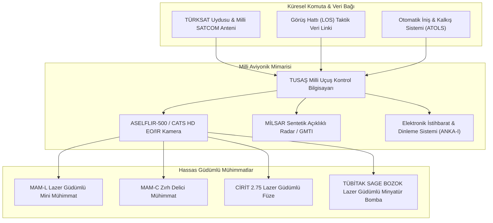

# 🦅 Proje: TUSAŞ ANKA Çok Rollü MALE İnsansız Hava Aracı

<div align="center">

[](../../README.md)
[](../README.md)
[-00E676?style=for-the-badge&logo=speedtest&logoColor=black)](../../../docs/TRL_GUIDE.md)
[](#)


</div>

---

## 🛡️ Stratejik Tanım & Doktriner Öncelik
**TUSAŞ ANKA**, Türkiye'nin milli havacılık ve uzay sanayiinin modern İHA doktrinini başlatan, dünyada rüştünü kanıtlamış Orta İrtifa Uzun Havada Kalış (MALE) sınıfı operasyonel insansız hava aracı sistemidir. ANKA-B, ANKA-S (Uydu Kontrollü) ve ANKA-I (Elektronik İstihbarat) varyantlarıyla geliştirilen sistem; gece/gündüz, her türlü olumsuz hava koşulunda tam otonom iniş-kalkış, keşif, gözetleme, hedef teşhisi ve hassas taarruz görevlerini icra eder. Milli motor TEI-PD170, milli uydu bağlantısı (TÜRKSAT üzerinden SATCOM) ve gelişmiş ASELFLIR kameralarıyla donatılmış olan ANKA, Türkiye'nin göklerdeki bağımsızlığının ve operasyonel derinliğinin simgesidir.

---

## 📊 Kapsamlı Teknik Özellikler Tablosu

| Parametre | Değer / Özellik | Açıklama |
| :--- | :--- | :--- |
| **Sistem Sınıfı** | MALE Sınıfı Çok Rollü Taktik & Stratejik İHA | Keşif, Gözetleme, SIGINT & Hassas Taarruz |
| **Kanat Açıklığı** | 17.5 Metre | Yüksek aerodinamik süzülme performansı |
| **Gövde Uzunluğu** | 8.6 Metre | İleri kompozit radar soğurucu gövde |
| **Maksimum Kalkış Ağırlığı (MTOW)** | 1.700 kg | Sağlam iniş takımları ve gövde yapısı |
| **Faydalı Yük Kapasitesi** | 350+ kg | Elektro-optik kamera, SAR ve mühimmat yükü |
| **Servis İrtifası** | 30.000 Feet | Yüksek irtifa devriye uçuşları |
| **Havada Kalış Süresi** | 30+ Saat | Kesintisiz uzun süreli karakol |
| **İtki Sistemi** | TEI-PD170 Turbodizel Motor (170 HP) | Milli, yüksek irtifada güç kaybetmeyen motor |
| **Operasyonel Yarıçap** | 250 km (LOS) / Sınırsız (SATCOM Uydu Kontrolü) | TÜRKSAT uyduları üzerinden küresel görev menzili |
| **Otonomi Seviyesi** | Tam Otonom Uçuş, Taksi, İniş ve Kalkış (ATOLS) | Pilot müdahalesiz tam güvenlikli iniş |

---

## 🧩 Alt Sistemler ve Aviyonik/Elektronik Entegrasyonu



- **Milli Uçuş Kontrol ve Otopilot Sistemi:** TUSAŞ mühendislerince yazılan, buzlanma önleme (De-icing), otomatik acil iniş ve meydan pas geçme algoritmalarına sahip triple-redundant (üç yedekli) uçuş bilgisayarı.
- **Kritik İstihbarat Sürümü (ANKA-I):** Milli İstihbarat Teşkilatı (MİT) ve TSK için özel üretilen; düşman radar ve telsiz haberleşmelerini yüzlerce kilometre öteden dinleyip haritalandıran özel SIGINT/COMINT donanımı.
- **MİLSAR Radarı:** Gece veya yoğun sis altında dahi hareketli hedefleri izleyen ve haritalandıran sentetik açıklıklı radar.

---

## 🎯 Görev Profili, Muharebe Senaryoları & Mühimmat Yelpazesi

### 1. Küresel Uydu Kontrollü Keşif ve Taarruz (ANKA-S)
Ankara'daki harekat merkezinden kontrol edilerek binlerce kilometre ötedeki sınır ötesi operasyon alanlarında kesintisiz 30 saat keşif ve MAM-L taarruzu icra eder.

### 2. Sinyal ve Elektronik İstihbarat Toplama (SIGINT)
Düşman hava savunma radarlarının yerlerini ve frekans bantlarını sessizce tespit ederek hava harekatı öncesi taarruz koridoru açar.

### 3. Deniz Devriyesi ve Sahil Güvenlik
Ege ve Akdeniz'de kaçakçılık, düzensiz göç ve yabancı savaş gemilerinin hareketlerini SAR radarı ve FLIR ile kesintisiz gözetler.

---

## 🚀 TRL Seviyesi ve Gelişim Yol Haritası

```
[██████████] TRL 9 - Seri Üretimde, Muharebe Kanıtlanmış (Combat Proven) ve Küresel İhracat
```

- [x] **TRL 1-4:** SSB MALE İHA Geliştirme Sözleşmesi, temel aerodinamik tasarım.
- [x] **TRL 5-6:** İlk ANKA prototipinin hangardan çıkışı ve yer motor testleri.
- [x] **TRL 7:** 30 Aralık 2010 - İlk başarılı test uçuşu.
- [x] **TRL 8:** Uydu kontrolü (ANKA-S) kalifikasyonu, TEI-PD170 milli motor entegrasyonu.
- [x] **TRL 9:** TSK, Deniz Kuvvetleri, Jandarma ve MİT envanterine teslimat; Tunus, Kazakistan, Malezya, Endonezya ve birçok ülkeye geniş çaplı ihracat.

---

## 🔗 İç Dizin Navigasyonu
[⬅️ Üst Dizine](../README.md) | [🏛️ Dominion Hub](../../README.md) | [🏠 Ana Sayfa](../../../README.md)
