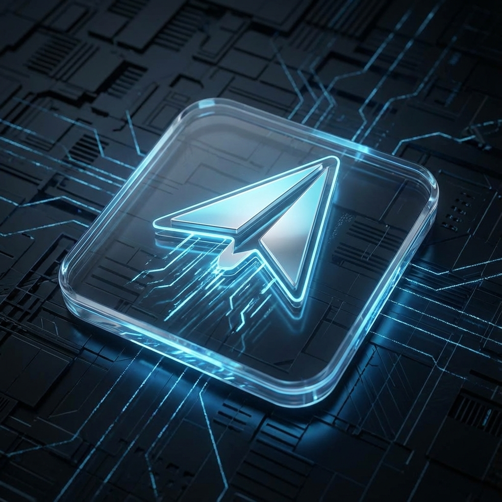
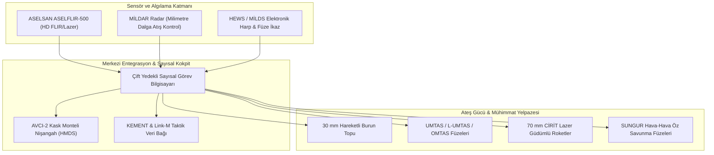

# 🚁 Proje: T929 ATAK-2 (Ağır Sınıf Taarruz Helikopteri)

   

  

---

### 🛡️ Stratejik Tanım & Doktriner Öncelik
T929 ATAK-2 Ağır Sınıf Taarruz Helikopteri, Türk Silahlı Kuvvetleri'nin derin harekat, yüksek irtifa ve sıcak hava koşullarında yakın hava desteği, taarruz, silahlı keşif ve eskort görevlerini tavizsiz yerine getirebilmesi için tasarlanmış 10+ ton sınıfı stratejik taarruz platformudur. AH-64E Apache Guardian ve Ka-52 Alligator ile doğrudan aynı küresel ligde yer alan ATAK-2, 1.500 kg'ı aşan harici mühimmat taşıma kapasitesi, modern burun radarı, entegre kask monteli nişangah ve milli sayısal kokpit mimarisiyle kara ve deniz havacılığının taarruz gücünü caydırıcı seviyeye taşımaktadır. Ayrıca TCG ANADOLU gibi amfibi hücum gemilerinden katlanabilir paller ve deniz korozyonuna dayanıklı gövde ile konuşlanabilme kabiliyetine sahiptir.

---

### 📊 Kapsamlı Teknik Özellikler Tablosu

| Parametre | Değer / Özellik |
| :--- | :--- |
| **Maksimum Kalkış Ağırlığı (MTOW)** | 11.500 kg |
| **Faydalı Mühimmat Kapasitesi** | 1.500 kg+ (6 Harici Silah İstasyonu) |
| **Motor Gücü** | 2 x 2.500 BG Turboşaft (TV3-117VMA-SBM1V-01T / İleride TEI TS3000) |
| **Mürettebat Konfigürasyonu** | 2 (Tandem / Pilot & Silah Sistem Subayı) |
| **Azami Seyir Hızı** | 318 km/s (172 Knots) |
| **Servis Tavanı** | 20.000 ft (6.096 m) |
| **Tırmanma Oranı** | 13.5 m/s |
| **Havada Kalış / Görev Yarıçapı** | 3+ saat / 400+ km operasyonel yarıçap |
| **Zırh & Beka Mimarisi** | 12.7 mm zırh delici ve 23 mm şarapnele dayanıklı kompozit zırh, kendini onaran yakıt tankı |
| **Burun Topu Sistemi** | 30x113 mm Milli Ağır Otomatik Top (Yüksek atış açısı toleranslı) |

---

### 🧩 Alt Sistemler ve Aviyonik/Elektronik Entegrasyonu
- **Sensör Süiti:** ASELSAN ASELFLIR-500 yüksek çözünürlüklü Elektro-Optik Keşif, Gözetleme ve Hedefleme Sistemi; Milimetre Dalga Boyu Atış Kontrol Radarı (MİLDAR).
- **Elektronik Harp & Karşı Tedbirler (HEWS):** Radar İkaz Alıcısı (RWR), Lazer İkaz Alıcısı (LWR), Füze İkaz Sistemi (MWS/MİLDS IR-UV), Chaff/Flare Karşı Tedbir Salma Sistemi (CMDS), Yönlendirilmiş Kızılötesi Karşı Tedbir (DIRCM).
- **Kask ve Nişangah Sistemi:** ASELSAN AVCI-2 Entegre Kask Monteli Kumanda ve Hedefleme Sistemi (HMDS) ile hedefe bakarak nişan alma ve gece görüş kabiliyeti.
- **Ağ Tabanlı Muharebe & Veri Bağı:** TSK Taktik Veri Ağı (Link-M, Link-16), KEMENT Taktik Veri Bağı, SİHA'larla ortak kol uçuşu ve MUM-T (Manned-Unmanned Teaming) koordinasyonu.

---

### 🎯 Görev Profili, Muharebe Senaryoları & Mühimmat Yelpazesi
- **Ağır Zırhlı Birlik İmhası:** UMTAS, L-UMTAS ve OMTAS uzun menzilli tanksavar füzeleri ile düşman zırhlı unsurlarına standoff mesafelerden taarruz.
- **Yakın Hava Desteği (CAS):** 30 mm otomatik top ve 70 mm CİRİT lazer güdümlü roketlerle piyade unsurlarına hassas ateş desteği.
- **Hava Savunma Baskısı (SEAD):** Düşman hava savunma mevzilerine karşı güdümlü mühimmatla nokta atışları ve radar karıştırma desteği.
- **Amfibi & Deniz Operasyonları:** TCG ANADOLU güvertesinden kıyı başı harekatlarına koruma sağlama, su üstü hücumbot ve korvet hedeflerini güdümlü mühimmatla bertaraf etme.

---

### 📐 Özel Mimari ve Görev Akış Şeması

---

### 🚀 TRL Seviyesi ve Gelişim Yol Haritası
- [x] Konsept Tasarım ve Sistem İhtiyaç Analizi
- [x] Kritik Tasarım Gözden Geçirme (CDR)
- [x] Yer Testleri ve İlk Motor Çalıştırma (Nisan 2023)
- [x] İlk Uçuş Doğrulaması (Nisan 2023)
- [x] Uçuş Zarfı Genişletme ve Dinamik Testler
- [ ] 30 mm Burun Topu ve Entegre Mühimmat Canlı Atış Kalifikasyonu
- [ ] TSK Envanterine Kabul ve Seri Üretim Teslimatları

---

### 🔗 Sağlam İç Dizin Navigasyonu
[⬅️ Üst Dizine](../README.md) | [🏛️ Dominion Hub](../../README.md) | [🏠 Ana Sayfa](../../../README.md)
