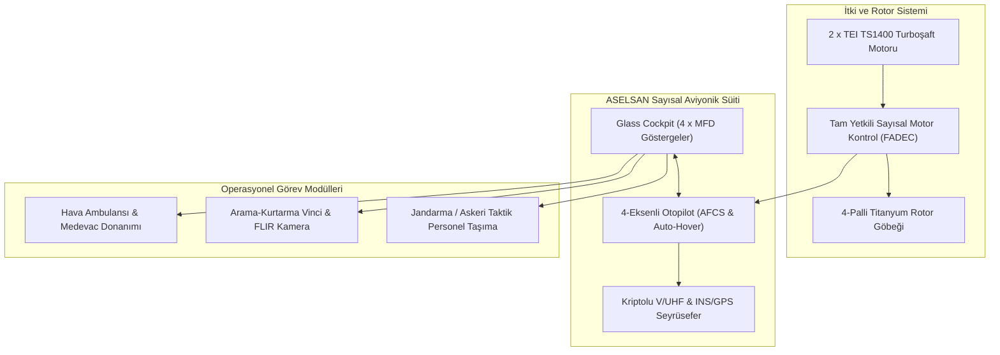

# 🚁 Proje: T625 GÖKBEY (Genel Maksat Helikopteri)

   

  

---

### 🛡️ Stratejik Tanım & Doktriner Öncelik
T625 GÖKBEY, Türkiye'nin sivil ve askeri havacılık ihtiyaçlarını milli imkanlarla karşılamak üzere TUSAŞ tarafından tasarlanıp üretilen 6 ton sınıfı çift motorlu özgün genel maksat helikopteridir. TEI tarafından geliştirilen milli turboshaft motoru TS1400 ile güçlendirilen platform; VIP nakliye, sahra ambulansı, arama-kurtarma (SAR), kıyı güvenlik karakolu ve kolluk kuvvetleri operasyonları gibi geniş bir spektrumda yüksek irtifa ve sıcaklık şartlarında güvenle görev yapabilmektedir. Avrupa Havacılık Emniyeti Ajansı (EASA) ve Sivil Havacılık Genel Müdürlüğü (SHGM) sertifikasyon standartlarına uygun üretilen GÖKBEY, Türkiye'nin döner kanat havacılığındaki bağımsızlığının en somut kanıtıdır.

---

### 📊 Kapsamlı Teknik Özellikler Tablosu

| Parametre | Değer / Özellik |
| :--- | :--- |
| **Maksimum Kalkış Ağırlığı (MTOW)** | 6.050 kg |
| **Yolcu / Mürettebat Kapasitesi** | 2 Mürettebat + 12 Yolcu |
| **Motor Tipi** | 2 x TEI TS1400 Milli Turboşaft (veya LHTEC CTS800-4AT) |
| **Motor Gücü** | 2 x 1.400 BG (Kalkış Gücü) |
| **Azami Seyir Hızı** | 306 km/s (165 Knots) |
| **Servis Tavanı** | 20.000 ft (6.096 m) |
| **Maksimum Menzil** | 740 km (Dahili yakıtla) / 950 km+ (Harici yakıt tankıyla) |
| **Havada Kalış Süresi** | 4 saat+ |
| **Rotor Sistemi** | 4 Palı Tam Kompozit Titanyum Rotor Göbeği |
| **Kabini Hacmi / Konfigürasyon** | 5 m³ modüler kabin (Ambulans için 2 sedye + 2 sağlık personeli) |

---

### 🧩 Alt Sistemler ve Aviyonik/Elektronik Entegrasyonu
- **Sayısal Kokpit (Glass Cockpit):** ASELSAN Entegre Aviyonik Süiti (4 adet çok fonksiyonlu 8x10 inç LCD ekran).
- **Uçuş Kontrol Sistemi:** Çift yedekli tam dijital 4-eksenli Otopilot Sistemi (AFCS) ile otomatik rota takibi ve asılı kalma (auto-hover) modu.
- **Haberleşme & Seyrüsefer:** V/UHF Güvenli Telsizler, INS/GPS entegrasyonu, TACAN, VOR/ILS, Sayısal Harita Birimi.
- **Arama Kurtarma & Gözetleme:** Harici vinç (hoist), gece görüş uyumlu (NVIS) iç-dış aydınlatma, ASELSAN Elektro-Optik FLIR faydalı yük opsiyonu.

---

### 🎯 Görev Profili, Muharebe Senaryoları & Mühimmat Yelpazesi
- **Hava Ambulansı & Medevac:** Doğal afetlerde ve kritik yaralanmalarda yoğun bakım standartlarında 2 sedyeli hasta transferi.
- **Arama-Kurtarma (SAR):** Denizde ve dağlık arazide termal FLIR ve harici vinç yardımıyla zorlu kurtarma harekatları.
- **Kolluk Kuvvetleri & Askeri İntikal:** Jandarma Genel Komutanlığı ve Kara Havacılık için manga sevkiyatı ve devriye uçuşları.
- **VIP & Kurumsal Taşıma:** Ses yalıtımlı lüks iç dizayn ile stratejik devlet erkanı ve sivil yolcu transferi.

---

### 📐 Özel Mimari ve Görev Akış Şeması

---

### 🚀 TRL Seviyesi ve Gelişim Yol Haritası
- [x] Temel Tasarım ve Prototip İmalatı
- [x] İlk Uçuş Doğrulaması (Eylül 2018)
- [x] Tam Donanımlı Aviyonik Sistem Testleri
- [x] TEI TS1400 Yerli Motorla İlk Uçuş (Nisan 2023)
- [x] Jandarma Genel Komutanlığı'na İlk Teslimat (2024)
- [ ] Sivil EASA Tip Sertifikasyonu Tamamlanması
- [ ] Seri Üretim Kapasitesinin Artırılması ve İhracat

---

### 🔗 Sağlam İç Dizin Navigasyonu
[⬅️ Üst Dizine](../README.md) | [🏛️ Dominion Hub](../../README.md) | [🏠 Ana Sayfa](../../../README.md)
