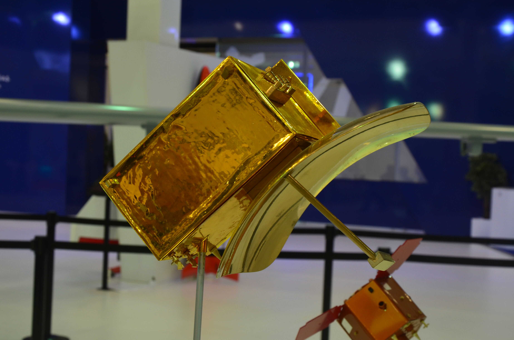
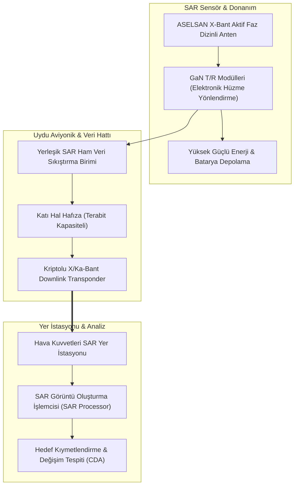

# 📡 Proje: GÖKTÜRK-3 (Sentetik Açıklıklı Radar - SAR Keşif Uydusu)

   

  

---

### 🛡️ Stratejik Tanım & Doktriner Öncelik
GÖKTÜRK-3, optik kameraların yetersiz kaldığı gece şartlarında, yoğun bulutlu, sisli ve her türlü zorlu hava koşullarında dahi Dünya yüzeyinden santimetre mertebesinde yüksek çözünürlüklü radar görüntüsü elde etmek üzere geliştirilen milli Sentetik Açıklıklı Radar (SAR) uydusudur. TUSAŞ ana yükleniciliğinde ve ASELSAN SAR faydalı yük sorumluluğunda yürütülen proje; Türkiye'nin kesintisiz '24 saat / her hava koşulunda' küresel istihbarat toplama doktrininin en kritik uzay ayağıdır. SAR teknolojisi sayesinde kamuflaj altındaki askeri unsurları, radar yansıtıcılarını ve yer değişikliklerini tespit edebilme kabiliyeti sunar.

---

### 📊 Kapsamlı Teknik Özellikler Tablosu

| Parametre | Değer / Özellik |
| :--- | :--- |
| **Radar Faydalı Yükü** | Aktif Faz Dizinli X-Bant SAR (Sentetik Açıklıklı Radar) |
| **Görüntüleme Çözünürlüğü** | Spotlight Modunda: <0.5 metre | Stripmap: ~1 metre | ScanSAR: ~3 metre |
| **Çalışma Frekansı** | X-Bant (ASELSAN tasarımı T/R modülleri) |
| **Yörünge Tipi** | Güneş Eşzamanlı Alçak Dünya Yörüngesi (Sun-Synchronous LEO) |
| **Yörünge İrtifası** | 500 - 600 km |
| **Kütle / Sınıf** | ~1.500 - 2.000 kg sınıfı ağır SAR platformu |
| **Görüntüleme Modları** | Spotlight, Stripmap, ScanSAR, Deniz Gözlem Modu (Maritime) |
| **İtki Sistemi** | Elektrikli İtki / Kimyasal İtki Hibrit Yörünge Düzeltme |
| **Veri Linki Hızı** | Kriptolu X/Ka-Bant Çok Yüksek Hızlı SAR Downlink |
| **Görev Ömrü** | En az 7 yıl |

---

### 🧩 Alt Sistemler ve Aviyonik/Elektronik Entegrasyonu
- **ASELSAN X-Bant SAR Anteni:** Binlerce T/R (Gönderme/Alma) GaN modülünden oluşan elektronik hüzme yönlendirmeli aktif faz dizinli radar.
- **SAR Veri İşleme Ünitesi:** Yüksek hızlı çiplerle ham radar yankılarının uzayda ön işlenmesi ve veri sıkıştırma algoritmaları.
- **Gelişmiş Yörünge & Yönelim Kontrol (AOCS):** Ağır radar anteninin oluşturduğu atalet momentlerini dengeleyen yüksek torklu tepki tekerleri.
- **Yüksek Güç Enerji Ünitesi:** SAR radarının anlık yüksek güç tüketimini karşılayan büyük alanlı güneş panelleri ve yüksek deşarj kapasiteli bataryalar.

---

### 🎯 Görev Profili, Muharebe Senaryoları & Mühimmat Yelpazesi
- **Her Hava Şartında İstihbarat:** Yoğun bulut tabakası, yağmur veya gece karanlığından etkilenmeden hedef sahasının 3 boyutlu radar haritalanması.
- **Hareketli Hedef Tespiti (GMTI):** Kara ve deniz yüzeyindeki hareketli askeri unsurların (tank konvoyları, savaş gemileri) tespiti ve takibi.
- **Kamuflaj Delici İstihbarat:** Radar dalgalarının yaprak örtüsü ve hafif engelleri geçerek gizlenmiş hedefleri açığa çıkarması.
- **İnterferometrik SAR (InSAR):** Zemin çöküntüleri, fay hatları hareketleri ve askeri tahkimat kazılarının milimetrik tespiti.

---

### 📐 Özel Mimari ve Görev Akış Şeması

---

### 🚀 TRL Seviyesi ve Gelişim Yol Haritası
- [x] SAR Radar Teknolojisi Fizibilite ve Mimari Tasarım
- [x] T/R Modül ve Anten Laboratuvar Doğrulaması
- [x] USET Altyapısında SAR Entegrasyon Modeli Testleri
- [ ] Uçuş Modeli İmalatı ve Uydu Düzeyi Entegrasyon
- [ ] Fırlatma ve Yörüngede Radar Kalibrasyonu (TRL 6 -> TRL 9)

---

### 🔗 Sağlam İç Dizin Navigasyonu
[⬅️ Üst Dizine](../README.md) | [🏛️ Dominion Hub](../../README.md) | [🏠 Ana Sayfa](../../../README.md)
