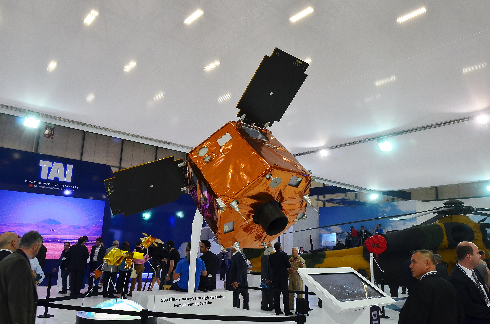
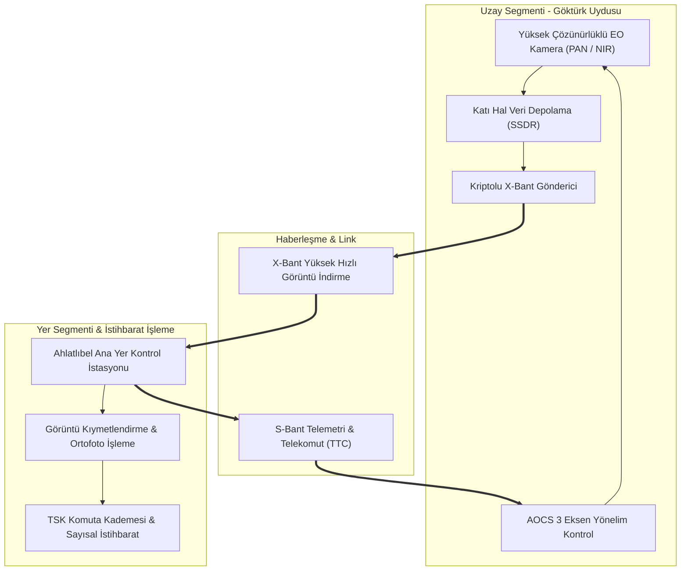

# 🛰️ Proje: GÖKTÜRK Ailesi (Yüksek Çözünürlüklü Yer Gözlem Uyduları)

   

  

---

### 🛡️ Stratejik Tanım & Doktriner Öncelik
GÖKTÜRK Uydu Ailesi (GÖKTÜRK-1 ve GÖKTÜRK-2), Türk Silahlı Kuvvetleri'nin dünya üzerindeki herhangi bir coğrafyadan coğrafi sınırlamalara tabi olmaksızın yüksek çözünürlüklü istihbarat ve gözetleme görüntüsü alabilmesini sağlayan stratejik elektro-optik uzay varlığıdır. TUSAŞ USET (Uydu Montaj, Entegrasyon ve Test Merkezi) altyapısında entegre edilen bu uydular, sınır güvenliği, terörle mücadele, haritacılık, tarımsal rekolte tespiti ve doğal afet hasar analizi alanlarında Türkiye'ye bağımsız istihbarat kabiliyeti sunmaktadır. Güneş eşzamanlı alçak dünya yörüngesinde (LEO) görev yapan uydular, şifreli X-bant veri kanalları üzerinden Ahlatlıbel ve yedek yer kontrol istasyonlarına kesintisiz görüntü aktarmaktadır.

---

### 📊 Kapsamlı Teknik Özellikler Tablosu

| Parametre | Değer / Özellik |
| :--- | :--- |
| **Yörünge Tipi** | Güneş Eşzamanlı Alçak Dünya Yörüngesi (Sun-Synchronous LEO) |
| **Yörünge İrtifası** | Göktürk-1: ~680 km | Göktürk-2: ~686 km |
| **Gözlem Çözünürlüğü** | Göktürk-1: 0.5 - 0.8 metre (Pankromatik) | Göktürk-2: 2.5 metre |
| **Spektral Bantlar** | Pankromatik (PAN) ve 4 Bant Multispektral (Mavi, Yeşil, Kırmızı, Yakın Kızılötesi NIR) |
| **Uydu Kütlesi** | Göktürk-1: ~1.070 kg | Göktürk-2: ~400 kg |
| **Tasarım Ömrü** | 5 - 7 yıl (Aktif görev süresi uzatıldı) |
| **Yörünge Dolanım Süresi** | Yaklaşık 98 dakika (~günde 14-15 tur) |
| **Veri İndirme Hızı** | X-Bant Yüksek Hızlı Kriptolu Downlink (160+ Mbps) |
| **Yönelim Doğruluğu** | 3 Eksenli Stabilizasyon, Yıldız İzler (Star Tracker) ve Manyetometre Destekli |
| **Yer Kontrol İstasyonu** | Ahlatlıbel Hava Kuvvetleri Keşif Uydu Tabur Komutanlığı |

---

### 🧩 Alt Sistemler ve Aviyonik/Elektronik Entegrasyonu
- **Elektro-Optik Kamera Sistemi:** Geniş açıklıklı teleskop, yüksek hassasiyetli TDI CCD detektörler ve çok spektral tarayıcı.
- **Yönelim ve Yörünge Kontrol Sistemi (AOCS):** Tepki tekerleri (Reaction Wheels), Manyetotorquer çubukları ve hidrazin itki sistemi.
- **Veri Depolama & İletişim Süiti:** Katı Hal Veri Kayıt Cihazı (SSDR - Solid State Data Recorder), yüksek güvenlikli şifreleme donanımı, S-Bant telemetri/telekomut ve X-Bant veri aktarım transponderları.
- **Güç Alt Sistemi:** Güneş panelleri (GaAs güneş hücreleri) ve lityum-iyon batarya bloğu.

---

### 🎯 Görev Profili, Muharebe Senaryoları & Mühimmat Yelpazesi
- **Stratejik Askeri İstihbarat:** Düşman askeri üsleri, limanlar, radar mevzileri ve sınır hareketliliklerinin yüksek çözünürlükle haritalanması.
- **Hedef Tespiti ve Hasar Değerlendirmesi (BDA):** SOM veya TAYFUN füzeleri ile icra edilen stratejik vuruşların isabet ve hasar kontrolü.
- **Afet ve Kriz Yönetimi:** Deprem, sel, orman yangınları ve zemin deformasyonlarının acil tespiti için harita desteği.
- **Çevre ve Şehircilik Denetimi:** Kıyı şeridi değişimleri, kaçak yapılaşma takibi ve orman varlığının izlenmesi.

---

### 📐 Özel Mimari ve Görev Akış Şeması

---

### 🚀 TRL Seviyesi ve Gelişim Yol Haritası
- [x] TUSAŞ USET Altyapısının Kurulması
- [x] GÖKTÜRK-2 Fırlatma ve Yörüngeye Yerleşim (Aralık 2012)
- [x] GÖKTÜRK-1 Fırlatma ve Tam Operasyonel Kabul (Aralık 2016)
- [x] 10+ Yıl Kesintisiz Yörünge Görev İcrası
- [x] Göktürk Yenileme (GÖKTÜRK-1Y) Fazı Başlatılması
- [ ] Yeni Nesil Metre-Altı Çözünürlüklü GÖKTÜRK-1Y Entegrasyonu

---

### 🔗 Sağlam İç Dizin Navigasyonu
[⬅️ Üst Dizine](../README.md) | [🏛️ Dominion Hub](../../README.md) | [🏠 Ana Sayfa](../../../README.md)
