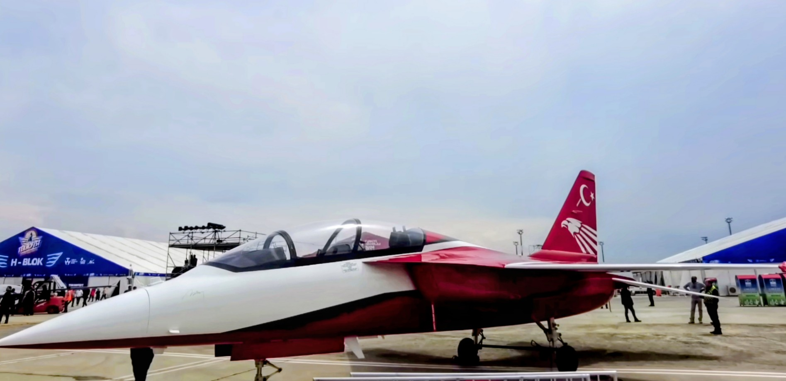
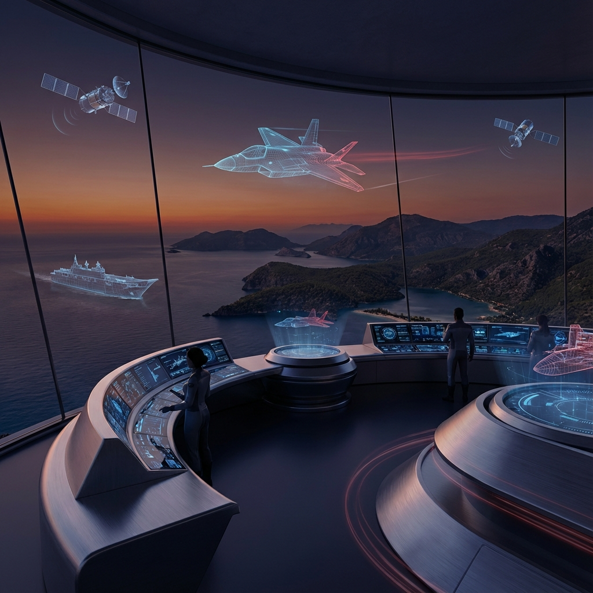
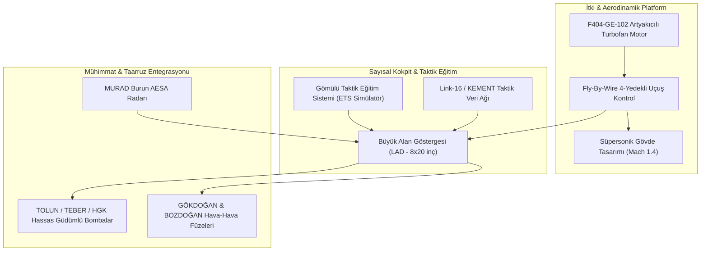

# ✈️ Proje: HÜRJET (Jet Eğitim ve Hafif Taarruz Uçağı)

   

  

---

### 🛡️ Stratejik Tanım & Doktriner Öncelik
HÜRJET, Türk Hava Kuvvetleri'nin envanterindeki emektar T-38M Arı jet eğitim uçakları ile NF-5A/B Türk Yıldızları akrotim uçaklarının yerini almak ve modern 5. nesil savaş pilotlarının (KAAN ve F-16 Viper) yetiştirilmesini sağlamak amacıyla TUSAŞ tarafından tasarlanıp üretilen tek motorlu, tandem koltuklu süpersonik jet uçağıdır. Gelişmiş uçuş kontrol sistemi, modern sayısal aviyonik kokpiti ve 3.000 kg'a varan harici mühimmat taşıma kapasitesi ile HÜRJET; sadece ileri jet eğitimi değil, aynı zamanda yakın hava desteği (CAS), hava devriyesi (CAP) ve taktik taarruz görevlerini de maliyet etkin şekilde icra edebilecek yetenektedir.

---

### 📊 Kapsamlı Teknik Özellikler Tablosu

| Parametre | Değer / Özellik |
| :--- | :--- |
| **Maksimum Kalkış Ağırlığı (MTOW)** | 8.300 kg |
| **Harici Yük / Mühimmat Kapasitesi** | 3.000 kg (7 Silah İstasyonu) |
| **Motor** | 1 x General Electric F404-GE-102 Turbofan (17.700 lbf artyakıcılı itki) |
| **Maksimum Hız** | Mach 1.4 (Süpersonik) |
| **Servis Tavanı** | 45.000 ft (13.716 m) |
| **Tırmanma Hızı** | 39.000 ft/dk |
| **Menzil / Harekât Yarıçapı** | 2.222 km (Dahili yakıt) / Görev yarıçapı ~900 km |
| **G Limitleri** | +8g / -3g |
| **Kanat Açıklığı / Uzunluk** | 9.5 metre / 13.6 metre |
| **Kokpit Konfigürasyonu** | Tandem 2 Koltuk (Martin-Baker Fırlatma Koltukları, Geniş Ekranlı MFD) |

---

### 🧩 Alt Sistemler ve Aviyonik/Elektronik Entegrasyonu
- **Kokpit ve Göstergeler:** Geniş Alan Göstergesi (LAD - Large Area Display), Sayısal Kask Monteli Nişangah (HMDS), HOTAS kumandaları.
- **Uçuş Kontrol:** 4 Kanallı Sayısal Fly-By-Wire (FBW) Uçuş Kontrol Bilgisayarı.
- **Radar ve Sensörler:** ASELSAN MURAD Hafif AESA Radarı entegrasyon opsiyonu, LDP (Hedefleme Podu) taşıma yeteneği.
- **Ağ Merkezli Harp & Veri Bağı:** Link-16 taktik veri bağı, KEMENT veri terminali, Havada Yakıt İkmali (IFR) yeteneği.
- **Gömülü Eğitim Sistemi (ETS):** Radar, füze ve tehdit simülasyonunu kokpit ekranlarına gerçek zamanlı yansıtan sanal taktik eğitim yazılımı.

---

### 🎯 Görev Profili, Muharebe Senaryoları & Mühimmat Yelpazesi
- **İleri Seviye Jet Pilot Eğitimi (AJT):** 5. nesil avcı uçaklarına (KAAN) geçiş yapacak harbe hazırlık pilot eğitimi.
- **Hafif Muharip ve Yakın Hava Desteği (LCA):** GBU, MAM serisi, TOLUN ve TEBER güdümlü mühimmatlarıyla kara hedeflerine nokta atışı.
- **Hava Devriyesi & Sınır Güvenliği:** BOZDOĞAN ve GÖKDOĞAN füzeleriyle alçaktan uçan İHA veya hava hedeflerini önleme.
- **Akrotim Gösteri Uçuşları:** Türk Yıldızları bünyesinde yüksek manevralı gösteri formasyonu.

---

### 📐 Özel Mimari ve Görev Akış Şeması

---

### 🚀 TRL Seviyesi ve Gelişim Yol Haritası
- [x] Kavramsal ve Detay Tasarım Doğrulaması
- [x] İlk Motor Çalıştırma (Ocak 2023)
- [x] İlk Uçuş Doğrulaması (25 Nisan 2023)
- [x] Süpersonik Zarf Testleri ve İrtifa Açma Uçuşları
- [x] İkinci Prototip Montaj ve Test Süreci
- [ ] Hava Kuvvetleri Filo Kabulü ve İlk Parti Seri Teslimatlar

---

### 🔗 Sağlam İç Dizin Navigasyonu
[⬅️ Üst Dizine](../README.md) | [🏛️ Dominion Hub](../../README.md) | [🏠 Ana Sayfa](../../../README.md)

---

### 📸 Taktik ve Operasyonel Görseller / Saha Galerisi

  

