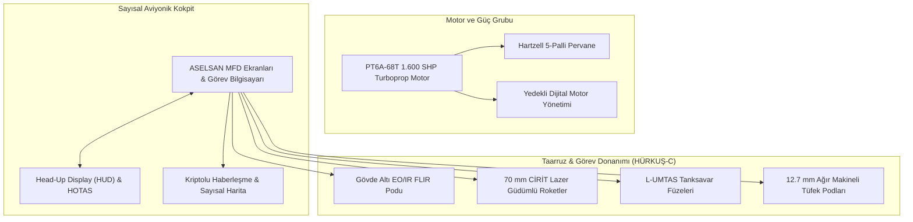

# 🛩️ Proje: TUSAŞ HÜRKUŞ (Yeni Nesil Temel Eğitim ve Hafif Taarruz Uçağı)

   

  

---

### 🛡️ Stratejik Tanım & Doktriner Öncelik
HÜRKUŞ, Türkiye'nin havacılık tarihindeki dönüm noktalarından biri olup, Avrupa Havacılık Emniyeti Ajansı (EASA) CS-23 tip sertifikası alarak uluslararası tescillenen ilk özgün Türk sivil ve askeri turboprop eğitim uçağıdır. Başlangıç pilotaj eğitimi (HÜRKUŞ-A), Türk Hava Kuvvetleri standardında gelişmiş sayısal kokpitli temel pilotaj eğitimi (HÜRKUŞ-B) ve asimetrik harpte yakın hava desteği sağlamak üzere 1.500 kg silah yükü kapasiteli hafif taarruz uçağı (HÜRKUŞ-C / HÜRKUŞ Hava Yer) konfigürasyonlarıyla üretilmektedir. Afrika ve müttefik ülkelere ihraç edilerek muharebe ortamında da kendini kanıtlamıştır.

---

### 📊 Kapsamlı Teknik Özellikler Tablosu

| Parametre | Değer / Özellik |
| :--- | :--- |
| **Maksimum Kalkış Ağırlığı (MTOW)** | 3.650 kg (HÜRKUŞ-C Hafif Taarruz) |
| **Motor** | 1 x Pratt & Whitney Canada PT6A-68T Turboprop (1.600 SHP) |
| **Pervane** | Hartzell 5-Palı Alüminyum Sabit Hızlı Pervane |
| **Maksimum Seyir Hızı** | 574 km/s (310 Knots) |
| **Stall Hızı (Flaplı)** | 126 km/s (68 Knots) |
| **Servis Tavanı** | 34.700 ft (10.577 m) |
| **Maksimum Menzil** | 1.478 km (Dahili yakıt) |
| **Havada Kalış Süresi** | 4 saat 15 dakika |
| **G Sınırları** | +7g / -3.5g |
| **Faydalı Yük (HÜRKUŞ-C)** | 1.500 kg (5 adet harici silah istasyonu) |

---

### 🧩 Alt Sistemler ve Aviyonik/Elektronik Entegrasyonu
- **Kokpit Mimarisi:** ASELSAN Entegre Sayısal Aviyonik Süiti (Glass Cockpit, Çok Fonksiyonlu Renkli Ekranlar - MFD).
- **HUD & HOTAS:** Başüstü Göstergesi (HUD - Head-Up Display) ve eller gaz ve kolda uçuş kontrolü (HOTAS).
- **Kask Sistemi:** Gece görüş uyumlu kokpit ve kask entegrasyonu.
- **Hedefleme & FLIR:** HÜRKUŞ-C için gövde altı elektro-optik/kızılötesi (EO/IR) FLIR kamera podu ve lazer işaretleyici.
- **Haberleşme & Öz Savunma:** Güvenli V/UHF telsizler, Chaff/Flare karşı tedbir salıcıları (CMDS) ve zırh korumalı kokpit tabanı.

---

### 🎯 Görev Profili, Muharebe Senaryoları & Mühimmat Yelpazesi
- **Temel ve İleri Pilotaj Eğitimi:** Askeri jet pilot adaylarının temel seyrüsefer, aletli uçuş ve kol uçuşu eğitimleri.
- **Asimetrik Harp & Yakın Hava Desteği (HÜRKUŞ-C):** CİRİT 70 mm lazer güdümlü roketler ve UMTAS tanksavar füzeleri ile kara birliklerine hassas destek.
- **Sınır ve Kritik Tesis Koruma:** Termal FLIR kamerası ile gece/gündüz sınır hatlarında silahlı devriye uçuşları.
- **İleri Hava Kontrolörü (FAC) Görevleri:** Yer birlikleri ile taarruz jetleri arasında mühimmat hedefleme koordinasyonu sağlama.

---

### 📐 Özel Mimari ve Görev Akış Şeması

---

### 🚀 TRL Seviyesi ve Gelişim Yol Haritası
- [x] HÜRKUŞ-A EASA CS-23 Sertifikasyonu (2016)
- [x] HÜRKUŞ-B Hava Kuvvetleri Kabul Testleri
- [x] HÜRKUŞ-C Canlı Mühimmat Atış Testleri (CİRİT / UMTAS)
- [x] Dost ve Müttefik Ülkelere İhracat Teslimatları (Çad, Nijer vb.)
- [x] HÜRKUŞ-2 Gelişmiş Hafif Gövde Tasarımı
- [ ] Hava Kuvvetleri Komutanlığı Seri Filo Entegrasyonu

---

### 🔗 Sağlam İç Dizin Navigasyonu
[⬅️ Üst Dizine](../README.md) | [🏛️ Dominion Hub](../../README.md) | [🏠 Ana Sayfa](../../../README.md)
