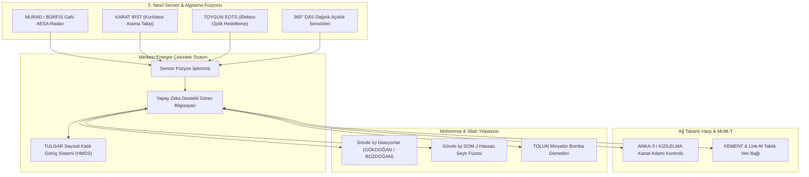

# 🦅 Proje: KAAN (Milli Muharip Uçak - MMU / 5. Nesil Savaş Uçağı)

   

  

---

### 🛡️ Stratejik Tanım & Doktriner Öncelik
KAAN (Milli Muharip Uçak - MMU), Türk Hava Kuvvetleri'nin 2030'lu yıllardan itibaren ana vurucu gücünü oluşturacak, Türkiye'yi dünyada 5. nesil savaş uçağı tasarlayıp üretebilen 4 ülkeden biri konumuna yükselten en stratejik savunma sanayii projesidir. Düşük radar izi (Stealth - Düşük RCS), dahili silah istasyonları, süperseyir (Supercruise), gelişmiş sensör füzyonu, yapay zekâ destekli görev bilgisayarı ve insansız hava araçlarıyla (ANKA-3, KIZILELMA) müşterek kol uçuşu (MUM-T) icra edebilen KAAN; hava-hava hakimiyeti ve derin taarruz doktrinlerinde Türkiye'nin gökyüzündeki mutlak bağımsızlık sembolüdür.

---

### 📊 Kapsamlı Teknik Özellikler Tablosu

| Parametre | Değer / Özellik |
| :--- | :--- |
| **Maksimum Kalkış Ağırlığı (MTOW)** | ~30.000 kg |
| **Harici ve Dahili Silah İstasyonları** | Dahili Silah İstasyonları (Gövde İçi) + Harici Kanat İstasyonları |
| **Motor** | 2 x General Electric F110-GE-129 (Başlangıç) / İleride 2 x 35.000 lbf Milli Turbofan Motor |
| **Azami Hız** | Mach 1.8+ (Süperseyir / Supercruise yetenekli) |
| **Servis Tavanı** | 55.000 ft (16.764 m) |
| **G Sınırları** | +9g / -3.5g |
| **Kanat Açıklığı / Uzunluk** | 14 metre / 21 metre |
| **Radar Görünürlüğü (RCS)** | Çok Düşük Radar Kesit Alanı (Dahili istasyonlar, radar soğurucu kompozit RAM kaplama) |
| **Sensör Mimarisi** | ASELSAN BÜRFİS / MURAD AESA Burun Radarı, Bütünleşik RF Süiti |
| **Elektro-Optik Süit** | ASELSAN KARAT (Kızılötesi Arama ve Takip - IRST) & TOYGUN (Elektro-Optik Hedefleme Sistemi - EOTS) |

---

### 🧩 Alt Sistemler ve Aviyonik/Elektronik Entegrasyonu
- **ASELSAN MURAD / BÜRFİS AESA Radarı:** Çok modlu hava-hava, hava-yer, sentetik açıklıklı radar (SAR/ISAR) ve elektronik harp karıştırma desteği.
- **Kızılötesi Sensör Entegrasyonu:** Burun üstü ASELSAN KARAT IRST ve gövde altı gömülü ASELSAN TOYGUN EOTS ile 360 derece durumsal farkındalık sağlayan DAS (Dağıtık Açıklık Sistemi).
- **Kaska Monteli Gösterge:** ASELSAN TULGAR Sayısal Kask Monteli Entegre Görüş Sistemi (HMDS).
- **Yapay Zekâ ve MUM-T:** Pilot yükünü azaltan karar destek algoritmaları ve ANKA-3 / KIZILELMA gibi 'Sadık Kanat Adamı' (Loyal Wingman) İHA'larını kokpitten kontrol etme altyapısı.
- **Milli Aviyonik & Veri Ağı:** Çift yedekli modüler aviyonik mimari, KEMENT ve milli kriptolu geniş bant veri bağı.

---

### 🎯 Görev Profili, Muharebe Senaryoları & Mühimmat Yelpazesi
- **Hava Hakimiyeti & Hava-Hava Muharebesi:** GÖKDOĞAN, BOZDOĞAN ve yeni nesil ramjet motorlu füzelerle görüş ötesi düşman hedeflerini stealth avantajıyla tespit edip vurma.
- **Derin Taarruz & SEAD/DEAD:** Düşman radar ve hava savunma ağlarının içerisine tespit edilmeden sızarak SOM-J ve TOLUN füzeleriyle stratejik komuta merkezlerini imha etme.
- **Sürü İHA Koordinatörlüğü:** ANKA-3 veya süpersonik insansız taarruz uçaklarıyla birlikte müşterek sürü taarruzları yönetme.
- **Elektronik Taarruz:** AESA radarının hüzme yönlendirme yeteneğini kullanarak düşman sensör ve iletişim linklerini felç etme.

---

### 📐 Özel Mimari ve Görev Akış Şeması

---

### 🚀 TRL Seviyesi ve Gelişim Yol Haritası
- [x] Rüzgar Tüneli ve RCS Radar İzi Tasarım Doğrulaması
- [x] Sistem Entegrasyon Laboratuvarı (Iron Bird) Testleri
- [x] Motor Çalıştırma ve Taksi Testleri (2023)
- [x] KAAN İlk Uçuşu Başarıyla Gerçekleştirildi (21 Şubat 2024)
- [x] İkinci Uçuş ve Uçuş Kontrol Zarfı Açma Testleri (Mayıs 2024)
- [ ] Yeni Prototip İmalatları (P1, P2, P3) ve AESA Radar Uçuş Testleri
- [ ] TSK Envanterine Giriş ve Blok-1 Seri Üretim Teslimatları

---

### 🔗 Sağlam İç Dizin Navigasyonu
[⬅️ Üst Dizine](../README.md) | [🏛️ Dominion Hub](../../README.md) | [🏠 Ana Sayfa](../../../README.md)
