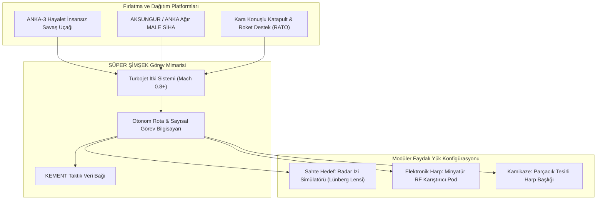

# ⚡ Proje: SÜPER ŞİMŞEK (Yüksek Hızlı Sahte Hedef ve Kamikaze İHA)

   

  

---

### 🛡️ Stratejik Tanım & Doktriner Öncelik
SÜPER ŞİMŞEK, TUSAŞ'ın operasyonel tecrübeye sahip ŞİMŞEK hedef uçak ailesinin yüksek hızlı, artırılmış menzilli ve modüler faydalı yük taşıyabilen yeni nesil türevidir. ANKA-3, AKSUNGUR ve KAAN gibi insansız ve insanlı taarruz uçaklarından havadan salınabilen (Air-Launched) bu platform; düşman hava savunma radarlarını yanıltıcı 'Sahte Hedef' (Air-Launched Decoy - ADM), aktif elektronik karıştırıcı veya harp başlığı entegre edilmiş 'Kamikaze / Dolanan Mühimmat' konfigürasyonlarında görev yapabilmektedir. Düşman radar ağlarını doyuma ulaştırma ve hava savunma bataryalarını gafil avlama doktrininin kritik bir asimetrik unsurudur.

---

### 📊 Kapsamlı Teknik Özellikler Tablosu

| Parametre | Değer / Özellik |
| :--- | :--- |
| **Maksimum Kalkış Ağırlığı** | ~200 kg |
| **Faydalı Yük Kapasitesi** | 35 - 50 kg (Harp başlığı veya Elektronik Harp kiti) |
| **Motor Tipi** | 1 x Mini Turbojet Motoru (TEI TJ90 / TJ300 türevi) |
| **Maksimum Hız** | Mach 0.8 - 0.9 (Yüksek Subsonik / Transonik) |
| **Menzil / Harekât Yarıçapı** | 700+ km (Havadan salım ile) |
| **Servis Tavanı** | 35.000 ft (10.668 m) |
| **Fırlatma Yöntemleri** | ANKA, AKSUNGUR, ANKA-3, KAAN harici/dahili istasyonlarından veya karadan roket destekli (RATO) katapult |
| **Güdüm ve Kontrol** | INS/GPS, Anti-Jamming GNSS, Optik/Kızılötesi Terminal Güdüm opsiyonu |
| **Gövde Malzemesi** | Düşük radar izli kompozit kanat ve gövde |
| **Sahte Hedef Yeteneği** | Lünberg lensi ve aktif RF transponder ile farklı uçak tiplerinin radar izini taklit etme |

---

### 🧩 Alt Sistemler ve Aviyonik/Elektronik Entegrasyonu
- **Aktif/Pasif Radar Yansıtıcı:** Farklı avcı uçaklarının (F-16, F-4, vb.) radar kesit alanını taklit eden dijital radar izi simülatörü.
- **Elektronik Harp Podu:** Minyatür RF karıştırıcı (Jammer) ve chaff dağıtım donanımı.
- **Otonom Uçuş Bilgisayarı:** TUSAŞ otonom seyrüsefer ve hedef takip algoritmaları, önceden planlanmış yanıltıcı rota profilleri.
- **Taktik Veri Bağı:** Ana fırlatıcı platform (ANKA-3 / AKSUNGUR) ile çift yönlü şifreli telemetri ve hedef güncelleme kanalı.

---

### 🎯 Görev Profili, Muharebe Senaryoları & Mühimmat Yelpazesi
- **Hava Savunma Aldatması (Decoy):** Düşman S-300/S-400 benzeri uzun menzilli hava savunma bataryalarını üzerine çekerek radarlarını açmaya zorlama ve mühimmatlarını boşa harcatma.
- **Kamikaze Taarruz:** Tespit edilen düşman erken ihbar radarlarına veya komuta merkezlerine yüksek hızla dalış yaparak harp başlığıyla imha etme.
- **Elektronik Taarruz (Stand-in Jamming):** Düşman hava sahasının derinliklerinde radar karıştırması yaparak dost taarruz uçaklarına güvenli koridor açma.
- **Hedef Uçak Eğitimi:** HİSAR ve SİPER gibi milli hava savunma sistemlerinin yüksek süratli manevra yapan tehditlere karşı test edilmesi.

---

### 📐 Özel Mimari ve Görev Akış Şeması

---

### 🚀 TRL Seviyesi ve Gelişim Yol Haritası
- [x] Temel Aerodinamik ve Gövde Tasarımı
- [x] Turbojet İtki Entegrasyonu
- [x] Havadan Salım Testleri (AKSUNGUR üzerinden)
- [x] Süper Şimşek Otonom Uçuş ve Hedef Takip Testleri
- [ ] Elektronik Harp ve Kamikaze Başlığı Canlı Atış Kalifikasyonu
- [ ] Seri Üretim ve Filo Entegrasyonu

---

### 🔗 Sağlam İç Dizin Navigasyonu
[⬅️ Üst Dizine](../README.md) | [🏛️ Dominion Hub](../../README.md) | [🏠 Ana Sayfa](../../../README.md)
