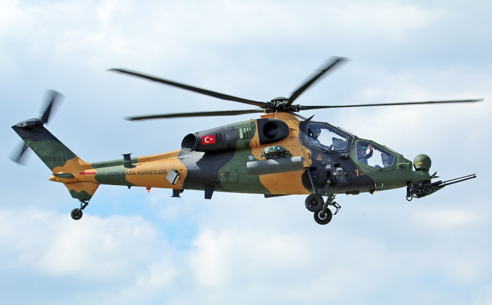
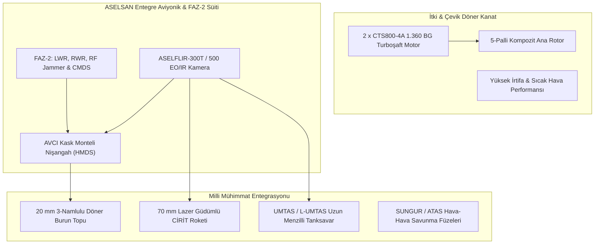

# 🚁 Proje: TUSAŞ T129 ATAK (Taarruz ve Taktik Keşif Helikopteri)

   

  

---

### 🛡️ Stratejik Tanım & Doktriner Öncelik
TUSAŞ T129 ATAK, Türk Silahlı Kuvvetleri, Jandarma Genel Komutanlığı ve Emniyet Genel Müdürlüğü'nün taarruz, silahlı keşif, yakın hava desteği ve hava koruma gereksinimlerini karşılamak üzere TUSAŞ ana yükleniciliğinde ve ASELSAN milli aviyonik/silah süitiyle modernize edilmiş, dünyada 'sıcak hava ve yüksek irtifa' (Hot & High) kategorisinde sınıfının en çevik taarruz helikopteridir. Ağır iklim ve zorlu coğrafi koşullarda 100'ü aşkın teslimat sayısı ve on binlerce saat muharebe uçuş tecrübesiyle rüştünü kanıtlamış olan platform; FAZ-1 ve FAZ-2 konfigürasyonlarıyla Filipinler ve Nijerya gibi ülkelere ihraç edilmiştir.

---

### 📊 Kapsamlı Teknik Özellikler Tablosu

| Parametre | Değer / Özellik |
| :--- | :--- |
| **Maksimum Kalkış Ağırlığı (MTOW)** | 5.065 kg |
| **Motor** | 2 x LHTEC CTS800-4A Turboşaft (2 x 1.360 BG) |
| **Maksimum Seyir Hızı** | 281 km/s (152 Knots) |
| **Servis Tavanı** | 15.000 ft (4.572 m) / Yer Tesirinde 13.780 ft |
| **Tırmanma Oranı** | 13.26 m/s |
| **Maksimum Menzil** | 537 km (Dahili yakıt) / 1.000 km (Harici yakıt tanklarıyla) |
| **Havada Kalış Süresi** | 3 saat |
| **Mürettebat** | 2 (Tandem / Ön: Silah Sistem Subayı, Arka: Pilot) |
| **Silah Yükü Kapasitesi** | 1.200 kg (4 adet kanat altı silah istasyonu + burun topu) |
| **Burun Topu** | 20 mm 3-Namlulu Döner Gatling Topu (500 mermi kapasiteli) |

---

### 🧩 Alt Sistemler ve Aviyonik/Elektronik Entegrasyonu
- **Elektro-Optik Keşif Sistemi:** ASELSAN ASELFLIR-300T / ASELFLIR-500 Termal Görüntüleme, Lazer Mesafe Bulucu ve Lazer Hedef İşaretleyici.
- **Kask Monteli Nişangah:** ASELSAN AVCI Kaska Entegre Kumanda Sistemi ile silah sistem subayının baş hareketlerine kilitlenen burun topu ve füze güdümü.
- **Elektronik Harp Süiti (FAZ-2):** Radar İkaz Alıcısı (RWR), Lazer İkaz Alıcısı (LWR), Füze İkaz Sistemi (MWS), RF Karıştırıcı (Jammer), Chaff/Flare Atıcılar.
- **Haberleşme & Seyrüsefer:** ASELSAN 9681 V/UHF Yazılım Tabanlı Telsiz, Milli Kriptolu Haberleşme Birimi, Sayısal Harita Sistemi, INS/GPS.

---

### 🎯 Görev Profili, Muharebe Senaryoları & Mühimmat Yelpazesi
- **Yakın Hava Desteği (CAS):** Terörle mücadele ve sınır ötesi harekatlarda piyade birliklerine 20 mm top ve CİRİT roketleriyle anlık hassas destek.
- **Zırhlı Hedef Avcılığı:** UMTAS ve L-UMTAS tanksavar füzeleriyle düşman ana muharebe tankları ve zırhlı personel taşıyıcılarını standoff mesafeden imha.
- **Hava Savunma:** Alçaktan uçan helikopter, İHA ve hafif hava hedeflerine karşı havadan atılan Stinger / SUNGUR füzeleri ile hava-hava muharebesi.
- **Silahlı Keşif ve Konvoy Güvenliği:** Gece şartlarında FLIR ile sınır güvenliği ve konvoy intikallerinin havadan korunması.

---

### 📐 Özel Mimari ve Görev Akış Şeması

---

### 🚀 TRL Seviyesi ve Gelişim Yol Haritası
- [x] Özgün Tasarım ve Modernizasyon Fazı
- [x] ATAK EDH (Erken Dağıtım Helikopteri) Teslimatları
- [x] T129 ATAK FAZ-1 Seri Üretim ve Envanter Teslimatları
- [x] T129 ATAK FAZ-2 (Elektronik Harp Donanımlı) Geliştirme ve Kabulü
- [x] Filipinler ve Nijerya'ya Resmi İhracat ve Envanter Teslimatları
- [ ] Yeni Nesil ASELFLIR-500 ve SUNGUR Entegrasyon Modernizasyonları

---

### 🔗 Sağlam İç Dizin Navigasyonu
[⬅️ Üst Dizine](../README.md) | [🏛️ Dominion Hub](../../README.md) | [🏠 Ana Sayfa](../../../README.md)

---

### 📸 Taktik ve Operasyonel Görseller / Saha Galerisi

  

