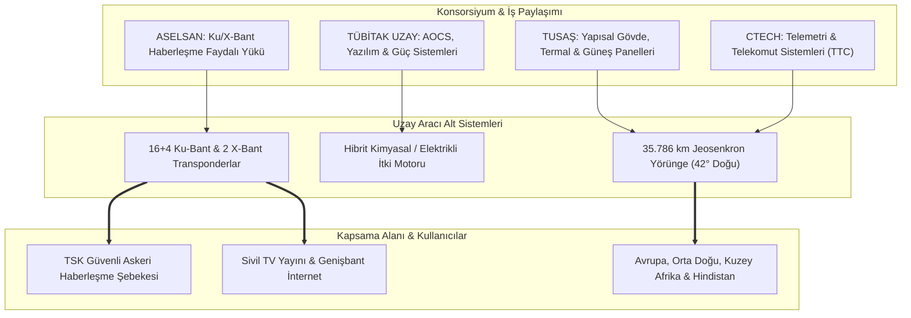

# 🛰️ Proje: TÜRKSAT 6A (Türkiye'nin İlk Yerli Haberleşme Uydusu)

   

  

---

### 🛡️ Stratejik Tanım & Doktriner Öncelik
TÜRKSAT 6A, Türkiye'nin uzay ve haberleşme teknolojilerinde tam bağımsızlık vizyonunun simgesi olan ilk yerli ve milli jeosenkron (GEO) haberleşme uydusudur. Ulaştırma ve Altyapı Bakanlığı ile TÜRKSAT A.Ş. desteğinde; TUSAŞ, TÜBİTAK UZAY, ASELSAN ve CTECH konsorsiyumu tarafından geliştirilen uydu, Türkiye'yi dünyada haberleşme uydusu üretebilen 11 ülkeden biri yapmıştır. 42° Doğu yörüngesinde konuşlanarak Türkiye'nin yanı sıra Avrupa, Kuzey Afrika, Orta Doğu ve Güney Asya'yı kapsayan geniş bir coğrafyada kesintisiz televizyon yayını, veri transferi ve milli güvenli askeri haberleşme imkanı sunmaktadır.

---

### 📊 Kapsamlı Teknik Özellikler Tablosu

| Parametre | Değer / Özellik |
| :--- | :--- |
| **Yörünge Tipi ve Konumu** | Jeosenkron Yer-Sabit Yörünge (GEO - 42° Doğu) |
| **Yörünge İrtifası** | 35.786 km |
| **Fırlatma Kütlesi** | 4.250 kg |
| **Faydalı Yük Kapasitesi** | 16 Ku-Bant Aktarıcı (Transponder) + 4 Yedek; 2 X-Bant Aktarıcı (Askeri) |
| **Faydalı Yük Gücü** | 7.5 kW elektrik gücü (Güneş panelleri) |
| **Tasarım Ömrü** | 15+ yıl |
| **Kapsama Alanı** | Türkiye, Avrupa, Orta Doğu, Kuzey Afrika, Hindistan ve Güneydoğu Asya |
| **İtki Sistemi** | Hibrit İtki (Kimyasal Apogee Motoru + Milli Elektrikli İtki HALE-3000) |
| **Entegrasyon Tesisi** | TUSAŞ USET (Uzay Sistemleri Entegrasyon ve Test Merkezi - Ankara) |
| **Fırlatma Aracı** | SpaceX Falcon 9 (8 Temmuz 2024 Fırlatması) |

---

### 🧩 Alt Sistemler ve Aviyonik/Elektronik Entegrasyonu
- **Haberleşme Faydalı Yükü:** ASELSAN tarafından geliştirilen Ku-Bant ve güvenli X-Bant askeri transponder süiti.
- **Telemetri & Telekomut:** CTECH tarafından geliştirilen S-Bant ve X-Bant güvenli yer kontrol haberleşme terminalleri.
- **Yönelim ve Yörünge Kontrol Sistemi (AOCS):** TÜBİTAK UZAY tarafından geliştirilen yıldız izlerler, güneş algılayıcıları ve yüksek torklu tepki tekerleri.
- **Gövde & Yapısal Sistem:** TUSAŞ tarafından üretilen kompozit ve metalik yapısal paneller, termal kontrol battaniyeleri ve güneş paneli açılma mekanizmaları.

---

### 🎯 Görev Profili, Muharebe Senaryoları & Mühimmat Yelpazesi
- **Milli Uydu Haberleşmesi & TV Yayını:** Milyonlarca haneye ultra yüksek çözünürlüklü televizyon yayını ve internet omurgası desteği.
- **Güvenli Askeri Haberleşme:** TSK unsurlarının okyanus aşırı ve sınır ötesi operasyonlarda kriptolu ve karıştırmaya dayanıklı uydu haberleşme ağı.
- **Afet Haberleşmesi:** Deprem, tsunami ve felaket anlarında karasal baz istasyonları çökse dahi kesintisiz acil durum veri linki sağlama.
- **Kapsama Genişletme:** Türkiye'nin uydu kapsama alanına Hindistan ve Güneydoğu Asya'yı ekleyerek 5 milyar nüfusa erişim sağlama.

---

### 📐 Özel Mimari ve Görev Akış Şeması

---

### 🚀 TRL Seviyesi ve Gelişim Yol Haritası
- [x] Sistem Seviyesi Tasarım ve Test Modeli (TM) Üretimi
- [x] Isıl Yapısal Model (STM) ve Mühendislik Modeli (EM) Testleri
- [x] USET Tesisinde Uçuş Modeli (FM) Montajı ve Titreşim/Akustik Testleri
- [x] SpaceX Falcon 9 Roketi ile Başarılı Fırlatma (8 Temmuz 2024)
- [x] 42° Doğu Yörüngesine İlerleme ve Yörünge Testleri (In-Orbit Testing)
- [ ] Tam Ticari ve Operasyonel Hizmete Giriş (TRL 8 -> TRL 9)

---

### 🔗 Sağlam İç Dizin Navigasyonu
[⬅️ Üst Dizine](../README.md) | [🏛️ Dominion Hub](../../README.md) | [🏠 Ana Sayfa](../../../README.md)
