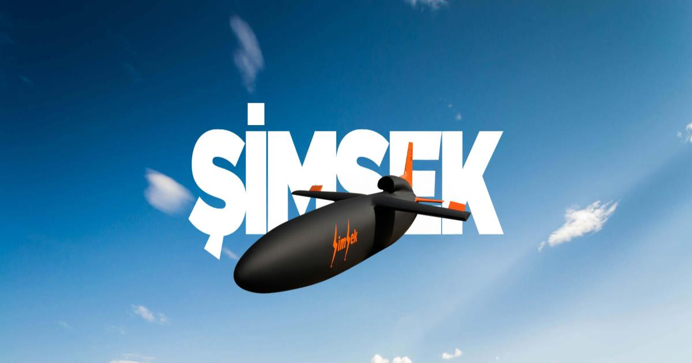
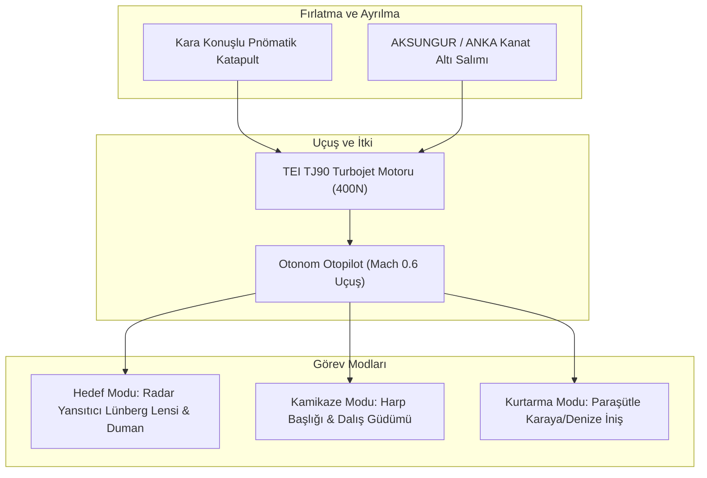

# 🎯 Proje: ŞİMŞEK (Yüksek Hızlı Hedef Uçak ve Dolanan Mühimmat)

   

  

---

### 🛡️ Stratejik Tanım & Doktriner Öncelik
TUSAŞ ŞİMŞEK, Türk Silahlı Kuvvetleri'nin hava savunma birliklerinin eğitim ve tatbikatlarında düşman savaş uçaklarını, seyir füzelerini ve yüksek hızlı hava tehditlerini simüle etmek üzere özgün olarak geliştirilmiş yüksek hızlı hedef uçak sistemidir. Turbojet motoruyla 400 knot hıza ulaşabilen ŞİMŞEK; HİSAR, SİPER, KORKUT ve deniz hava savunma sistemlerinin atışlı testlerinde kilit rol oynamaktadır. Son yıllarda kazanılan ilave kabiliyetlerle, üzerine patlayıcı harp başlığı ve arayıcı başlık entegre edilerek ANKA ve AKSUNGUR SİHA'lardan atılabilen yüksek hızlı bir kamikaze dolanan mühimmata (Loitering Munition) dönüştürülmüştür.

---

### 📊 Kapsamlı Teknik Özellikler Tablosu

| Parametre | Değer / Özellik |
| :--- | :--- |
| **Maksimum Kalkış Ağırlığı** | 75 kg |
| **Faydalı Yük Kapasitesi** | İzleme cihazları, duman üreteci, Lünberg lensi veya harp başlığı |
| **Motor** | 1 x Mini Turbojet Motoru (TEI TJ90 / 400N İtki) |
| **Azami Hız** | 740 km/s (400 Knots / Mach 0.6) |
| **Maksimum Uçuş İrtifası** | 25.000 ft (7.620 m) |
| **Havada Kalış Süresi** | 45 - 60 dakika |
| **Fırlatma Sistemi** | Basınçlı Katapult veya ANKA / AKSUNGUR kanat altı salıcı |
| **Kurtarma Sistemi** | Paraşüt ve deniz üzerine iniş için yüzdürücü yastıklar (Hedef modunda) |
| **Menzil / Veri Bağı** | 50+ km (Görüş hattı LOS) / Uydu destekli otonom rota |
| **G Manevra Limiti** | +5g / -2g yüksek manevra taklidi |

---

### 🧩 Alt Sistemler ve Aviyonik/Elektronik Entegrasyonu
- **Otopilot & Seyrüsefer:** TUSAŞ özgün uçuş kontrol bilgisayarı, GPS destekli otonom rota takip ve rota acil geri dönüş modları.
- **Radar İzi Artırıcı:** Karşı hava savunma radarlarına savaş uçağı gibi görünmesini sağlayan pasif ve aktif radar yansıtıcı Lünberg lensi.
- **Akustik ve Duman İzleyiciler:** Mermi ıskalama mesafesini ölçen akustik sensör (MDI - Miss Distance Indicator) ve görsel takip için duman jeneratörü.
- **Yer Kontrol İstasyonu:** Taşınabilir GCS üzerinden telemetri takibi ve formasyon uçuş yönetimi.

---

### 🎯 Görev Profili, Muharebe Senaryoları & Mühimmat Yelpazesi
- **Hava Savunma Test ve Doğrulama:** HİSAR-A+, HİSAR-O+, SİPER ve KORKUT sistemlerinin canlı hedef önleme tatbikatları.
- **Kamikaze Saldırı Misyonu:** AKSUNGUR ve ANKA'dan salınarak düşman radar mevzileri veya komuta binalarına yüksek hızla dalış.
- **Sahte Hedef Görevi:** Düşman erken ihbar radarlarını meşgul ederek gerçek taarruz unsurlarının tespit edilmesini engelleme.
- **Deniz Hava Savunma Eğitimi:** MİLGEM korvetleri ve fırkateynlerinin hava savunma topları için alçaktan uçan gemisavar füzesi profili simülasyonu.

---

### 📐 Özel Mimari ve Görev Akış Şeması

---

### 🚀 TRL Seviyesi ve Gelişim Yol Haritası
- [x] Orijinal ŞİMŞEK Hedef Uçak Geliştirme ve Kabulü
- [x] TSK ve Deniz Kuvvetleri Atışlı Tatbikatlarında Seri Kullanım
- [x] TEI TJ90 Yerli Turbojet Motoru Entegrasyonu
- [x] ANKA ve AKSUNGUR SİHA'lardan Havadan Fırlatma Testleri
- [x] Kamikaze Mühimmat Yeteneği Kazanımı ve Başarılı Hedef Vuruşu
- [ ] İhracat Faaliyetleri ve Sürü Görev Algoritmaları

---

### 🔗 Sağlam İç Dizin Navigasyonu
[⬅️ Üst Dizine](../README.md) | [🏛️ Dominion Hub](../../README.md) | [🏠 Ana Sayfa](../../../README.md)
